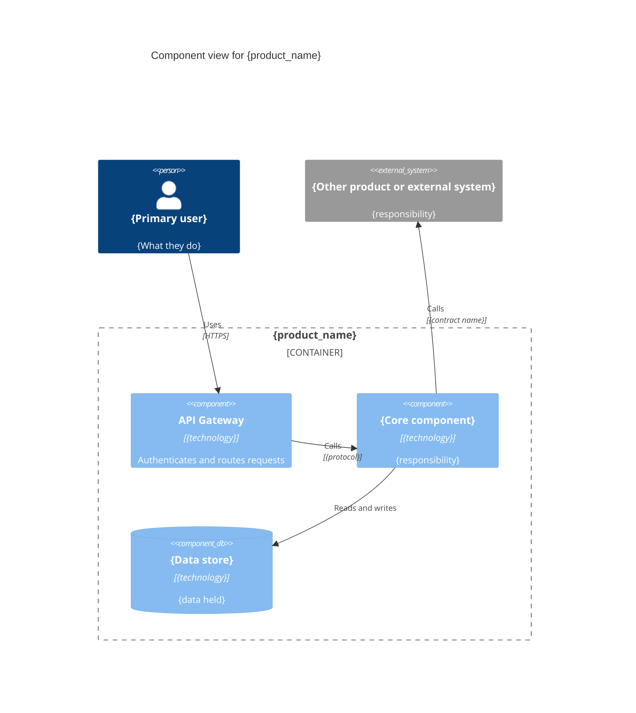

# Product Architecture Template (O-AA)

> **Standard:** Open Agile Architecture™ (O-AA, C208) — Ch. 14: Product Architecture
> **Organisation:** ${user_config.organisation_name}
> **Parent reference:** ${user_config.references_dir} — parent engagement reference, if any
> **TOGAF Mapping:** ADM Phase B (Business) + Phase C (Information Systems) + Phase E (Opportunities)
> **Trigger:** Use when architecture work targets a specific product (not enterprise-wide). Product-centric, outcome-driven, team-led.

## Document Control

<!-- DOC-CONTROL-HEADER -->
<!-- Resolved at command-execution time per _partials/RENDERING.md. -->

### Revision History

| Version | Date | Author | Description | Reviewer | Approver |
|---------|------|--------|-------------|----------|----------|
| `[VERSION]` | `[YYYY-MM-DD]` | ArcKit AI | Initial creation | `[REVIEWER_NAME]` | `[APPROVER_NAME]` |

---

## 1. Product Mission and Outcome

### 1.1 Product Mission Statement

```text
{product_name}: {one-sentence mission that captures the product's purpose and target value}

```

**Example:** `Paperclip: AI-driven project orchestration platform that connects architecture decisions to engineering execution through traceable, automated workflows.`

### 1.2 Product Outcome

| Dimension | Target | Measurement |
|---|---|---|
| **Value** | Primary business value delivered | KPI metric and baseline |
| **Outcome** | Measurable business outcome | Quantitative target |
| **Experience** | User/customer experience goal | NPS / satisfaction metric |
| **Adoption** | Target adoption rate | % of target users within timeframe |

### 1.3 Product Principles

1. **Principle 1:** {guiding design principle derived from O-AA axioms}
2. **Principle 2:** {guiding design principle}
3. **Principle 3:** {guiding design principle}

> O-AA axioms applied: Axiom 15 (Project to Product Shift) — the product, not the project, is the organizing principle for the team, backlog, and architecture; Axiom 6 (Autonomous Cross-Functional Teams) — the owning team holds the architecture, not a central group.

### 1.4 Product Boundary

Define what the product is and is not before describing its internal structure.

| In the product | Outside the product (owner) |
|---|---|
| {capability, journey or component the team owns} | {adjacent product, platform or service, and the team that owns it} |

### 1.5 Outcome Traceability

| Outcome (1.2) | Stakeholder goal (STKE) | Measure |
|---|---|---|
| {outcome} | {STKE goal ID and summary, or "No STKE artefact"} | {KPI and target} |

---

## 2. Cross-Functional Team Composition

### 2.1 Team Structure

O-AA mandates permanent, cross-functional teams (not temporary project teams). Each team owns a product end-to-end.

```yaml
# team.yaml — team composition
product:
  name: "{product_name}"
  owner: "{product_owner_name}"
  mission: "{mission_statement}"

team:
  roles:

    - role: "Product Owner"
      name: "{name}"
      responsibility: "Value prioritization, backlog ownership"

    - role: "Architect"
      name: "{name}"
      responsibility: "Architecture guardrails, technical decisions, compliance"

    - role: "Lead Engineer"
      name: "{name}"
      responsibility: "Implementation, code quality, CI/CD"

    - role: "AI Safety Engineer"
      name: "{name}"
      responsibility: "Model safety, data governance, regulatory compliance"

    - role: "DevOps Engineer"
      name: "{name}"
      responsibility: "Infrastructure, deployment, monitoring"

    - role: "QA Engineer"
      name: "{name}"
      responsibility: "E2E testing, acceptance criteria validation"

  cadence:
    sprint_weeks: 2
    architecture_review: "Each sprint planning + retrospective"
    compliance_review: "Monthly automated scan + quarterly audit"
    demo: "End of each sprint"

```

### 2.2 Architect Role in the Team

The architect is **embedded in the delivery team**, not a centralized governance function.

| Responsibility | Mode | Artifact |
|---|---|---|
| Define architecture guardrails | Upfront + continuous | Architecture decision records |
| Review technical decisions | Sprint-by-sprint | Sprint architecture checklist |
| Maintain compliance mapping | Automated + manual review | Compliance matrix per feature |
| Architecture evolution | Release planning | Release architecture roadmap |
| Cross-product alignment | Architecture forum | Quarterly cross-product sync |

---

## 3. Product Backlog with Architecture Items

### 3.1 Backlog Structure

Architecture items are first-class backlog items, not afterthoughts. Each backlog item carries architecture metadata.

```yaml
# backlog.yaml — product backlog
product: "{product_name}"
sprint: "{current_sprint}"

architecture_items:

  - id: "ARCH-001"
    title: "Vector store selection and deployment"
    type: "capability"
    priority: "high"
    sprint: 1
    description: "Evaluate and deploy Qdrant vs Milvus for production vector storage"
    acceptance_criteria:

      - "Supports 10M+ vectors with <10ms retrieval latency"

      - "Docker Compose deployment with health checks"

      - "Compliance: data encryption at rest (AES-256)"
    compliance:

      - regulation: "APP-11.1"
        control: "encryption_at_rest"
        status: "required"

      - regulation: "APRA-CPS230"
        control: "access_control"
        status: "required"
    estimation:
      story_points: 8
      risk: "medium"
    decisions:

      - adr: "ADR-006"
        choice: "Qdrant"
        rationale: "Superior performance for our workload profile"

  - id: "ARCH-002"
    title: "Model serving infrastructure"
    type: "infrastructure"
    priority: "critical"
    sprint: 1
    description: "Deploy SGLang model serving with GPU optimization"
    acceptance_criteria:

      - "P95 latency < 2s for 8K context window"

      - "Auto-scaling based on queue depth"

      - "GPU utilization monitoring with DCGM"
    compliance:

      - regulation: "APP-11.1"
        control: "data_isolation"
        status: "required"
    estimation:
      story_points: 13
      risk: "high"
    decisions: []

  - id: "ARCH-003"
    title: "Observability pipeline setup"
    type: "cross_cutting"
    priority: "high"
    sprint: 2
    description: "Implement Prometheus + Grafana monitoring stack"
    acceptance_criteria:

      - "All service health endpoints instrumented"

      - "Alerting rules for latency, error rate, GPU metrics"

      - "Dashboard templates for ops team"
    compliance: []
    estimation:
      story_points: 5
      risk: "low"
    decisions: []

functional_items:

  - id: "FEAT-001"
    title: "Document ingestion pipeline"
    type: "feature"
    priority: "high"
    sprint: 2
    architecture_dependency: ["ARCH-001", "ARCH-002"]
    compliance:

      - regulation: "GDPR-17"
        control: "transparency"
        status: "required"
        notes: "Privacy notice required for document processing"

```

### 3.2 Architecture Item Types

| Type | Description | Example |
|---|---|---|
| **capability** | New capability or capability evolution | Vector store, RAG pipeline |
| **infrastructure** | Foundation infrastructure decisions | GPU cluster, network topology |
| **cross_cutting** | Concerns spanning multiple features | Observability, authentication |
| **refactoring** | Architecture debt, structural improvement | Schema migration, API versioning |
| **compliance** | Regulatory compliance implementation | Audit logging, data retention |

### 3.3 Requirements Coverage

Every functional and non-functional requirement from the requirements artefact (`ARC-[PROJECT_ID]-REQ`) lands in a backlog item or is recorded as outside the product boundary.

| Requirement | Backlog item(s) | Status |
|---|---|---|
| {FR-xxx / NFR-xxx} | {ARCH-xxx, FEAT-xxx} | In scope |
| {FR-xxx / NFR-xxx} | — | Out of scope: {reason and owning product} |

---

## 4. Architecture Guardrails

Guardrails are the non-negotiable constraints the team designs within. The embedded architect owns them; changing one is an architecture decision recorded as an ADR.

### 4.1 Non-Negotiable Constraints

| ID | Constraint | Category | Source | Verified by |
|---|---|---|---|---|
| GR-001 | {e.g. All personal data encrypted at rest (AES-256)} | Compliance | {regulation, principle or NFR ID} | {automated check or review} |
| GR-002 | {e.g. p95 response time < 2s} | Performance | {NFR ID} | {load test in CI} |
| GR-003 | {e.g. No direct database access across product boundaries} | Architecture | {principle ID} | {architecture review} |

### 4.2 Technology Standards and Approved Building Blocks

| Concern | Approved option | Status | Notes |
|---|---|---|---|
| {e.g. Vector store} | {approved building block} | Adopted / Trial / Hold | {constraints on use} |

### 4.3 Anti-Patterns and Forbidden Approaches

| Anti-pattern | Why it is forbidden | Use instead |
|---|---|---|
| {e.g. Hard-coded credentials} | {risk} | {approved alternative} |

---

## 5. Product Architecture Diagram

### 5.1 C4 Component View

Show the product's components, its integration points with other products and external systems, data flows and API boundaries. Use Mermaid C4 syntax.



### 5.2 Interfaces and Dependencies

Interfaces to other products are contracts with an owner. Dependencies record their coupling type so the team can see which ones constrain its release cadence.

| Interface or dependency | Direction | Contract | Owner | Coupling type |
|---|---|---|---|---|
| {e.g. Identity platform} | Consumes | {API spec or event schema} | {owning team} | Runtime synchronous / Asynchronous event / Build-time / Data |

---

## 6. Release Architecture Roadmap

### 6.1 Release Planning

```yaml
# roadmap.yaml — release architecture roadmap
product: "{product_name}"
versioning: "semantic"  # semver or calendar

releases:

  - version: "0.1.0"
    name: "Foundation"
    target_date: "[YYYY-MM-DD]"
    outcome: "Core AI pipeline operational with compliance baseline"
    architecture_scope:

      - "Model serving infrastructure"

      - "Vector store deployment"

      - "Basic observability"

      - "Compliance: encryption + access control"
    features:

      - "Document ingestion"

      - "Query interface"
    compliance_milestones:

      - milestone: "encryption_at_rest"
        regulation: "APP-11.1"
        status: "implemented"

      - milestone: "access_logging"
        regulation: "APRA-CPS230"
        status: "implemented"

  - version: "0.2.0"
    name: "Agent Orchestration"
    target_date: "[YYYY-MM-DD]"
    outcome: "Multi-agent workflows with guardrails"
    architecture_scope:

      - "LangGraph workflow engine"

      - "Agent communication protocols"

      - "Inter-agent observability"
    features:

      - "Multi-agent task decomposition"

      - "Human-in-the-loop approval"
    compliance_milestones:

      - milestone: "audit_trail"
        regulation: "APP-11.1"
        status: "planned"

      - milestone: "model_output_filtering"
        regulation: "GDPR-22"
        status: "planned"

  - version: "1.0.0"
    name: "Production Readiness"
    target_date: "[YYYY-MM-DD]"
    outcome: "GA release with full compliance coverage"
    architecture_scope:

      - "Production-grade resilience"

      - "Disaster recovery"

      - "Performance baseline validation"
    compliance_milestones:

      - milestone: "full_compliance_audit"
        regulation: "All applicable"
        status: "planned"

architecture_evolution:

  - phase: "Foundation"
    focus: "Infrastructure and core capabilities"
    principle: "Right-sized, not over-engineered"

  - phase: "Scale"
    focus: "Multi-tenant, multi-region, high availability"
    principle: "Automate before you scale"

  - phase: "Mature"
    focus: "Self-healing, predictive operations"
    principle: "Observability drives architecture"

```

### 6.2 Release Gate Criteria

| Gate | Criteria | Validator |
|---|---|---|
| **Sprint Review** | Architecture items completed, compliance items green | Sprint architecture checklist |
| **Release Candidate** | All critical architecture items done, no P1 compliance gaps | Release compliance scan |
| **GA Release** | Full compliance audit, performance baseline met | Governance report |

---

## 7. Value Stream Mapping

### 7.1 Value Stream Definition

```yaml
# value_streams.yaml — value stream mapping
product: "{product_name}"

value_streams:

  - id: "VS-001"
    name: "Requirement to deployment"
    description: "End-to-end flow from backlog item to production deployment"
    steps:

      - name: "Backlog item created"
        owner: "Product Owner"
        duration_hours: 0
        type: "event"

      - name: "Architecture review"
        owner: "Architect"
        duration_hours: 4
        type: "analysis"
        output: "Architecture decision or guardrail confirmation"

      - name: "Implementation"
        owner: "Engineering team"
        duration_hours: 40
        type: "work"
        output: "Code, tests, documentation"

      - name: "Architecture validation"
        owner: "Architect + QA"
        duration_hours: 2
        type: "verification"
        output: "Architecture sign-off"

      - name: "Compliance scan"
        owner: "Automated pipeline"
        duration_hours: 0.5
        type: "verification"
        output: "Compliance report"

      - name: "Deployment"
        owner: "DevOps"
        duration_hours: 1
        type: "execution"
        output: "Production deployment"
    total_touch_time_hours: 13.5
    total_wait_time_hours: 12
    total_lead_time_hours: 25.5
    efficiency_percent: 52.9

  - id: "VS-002"
    name: "User query to answer"
    description: "Runtime value stream — user request through AI response delivery"
    steps:

      - name: "Request received"
        duration_ms: 0
        system: "API Gateway"

      - name: "Authentication"
        duration_ms: 50
        system: "Auth service"

      - name: "Query parsing"
        duration_ms: 100
        system: "NLP pipeline"

      - name: "Vector retrieval"
        duration_ms: 200
        system: "Vector store"

      - name: "Model inference"
        duration_ms: 1500
        system: "Model serving (SGLang)"

      - name: "Response filtering"
        duration_ms: 50
        system: "Safety filter"

      - name: "Response delivery"
        duration_ms: 50
        system: "API Gateway"
    target_latency_ms: 2000
    measured_latency_ms: 1950
    compliance_controls:

      - control: "input_validation"
        step: "Query parsing"
        regulation: "APP-11.1"

      - control: "output_filtering"
        step: "Response filtering"
        regulation: "GDPR-22"

```

### 7.2 Value Stream Metrics

| Metric | Target | Current | Gap |
|---|---|---|---|
| Lead time (requirement → deploy) | < 2 sprints | 3 sprints | -1 sprint |
| Deployment frequency | 2x per sprint | 1x per sprint | +1x |
| Architecture review cycle | < 4 hours | 6 hours | -2 hours |
| Compliance scan time | < 30 minutes | 45 minutes | -15 minutes |
| Value stream efficiency | > 60% | 52.9% | +7.1% |

---

## 8. Embedded Compliance Per Feature

### 8.1 Compliance Integration Approach

O-AA principle: Compliance is embedded in every feature, not bolted on at the end. Each backlog item carries its compliance requirements.

```yaml
# compliance.yaml — embedded compliance per feature
product: "{product_name}"
jurisdiction: "AU"  # AU | EU | APAC | US | multi

regulations:

  - id: "APP-11.1"
    name: "Australian Privacy Principle 11.1 — Protection of personal information"
    scope: "All data processing features"
    controls:

      - id: "encryption_at_rest"
        description: "AES-256 encryption for stored personal data"
        features: ["ARCH-001", "FEAT-001"]
        status: "implemented"

      - id: "encryption_in_transit"
        description: "TLS 1.3 for all data in transit"
        features: ["ARCH-002"]
        status: "implemented"

      - id: "access_control"
        description: "Role-based access control with audit logging"
        features: ["ARCH-003"]
        status: "planned"

  - id: "APRA-CPS230"
    name: "APRA CPS 230 — Information security"
    scope: "Information security management"
    controls:

      - id: "information_security_governance"
        description: "Information security governance framework"
        features: ["ARCH-001"]
        status: "planned"

      - id: "incident_response"
        description: "Incident response plan with 1-hour notification"
        features: []
        status: "planned"

feature_compliance_matrix:

  - feature: "FEAT-001"
    name: "Document ingestion pipeline"
    compliance:

      - regulation: "APP-11.1"
        control: "encryption_at_rest"
        status: "implemented"
        evidence: "AES-256 encryption verified in storage layer"

      - regulation: "GDPR-17"
        control: "transparency"
        status: "implemented"
        evidence: "Privacy notice displayed before document upload"

      - regulation: "GDPR-17"
        control: "right_to_withdraw"
        status: "planned"
        evidence: ""
        notes: "Delete button needed in next sprint"

compliance_gaps:

  - gap: "Audit logging not yet implemented"
    impact: "Cannot demonstrate APP-11.1 compliance for access control"
    remediation: "ARCH-003 — Observability pipeline includes audit logging"
    target_sprint: 3
    risk: "medium"

```

### 8.2 Compliance-as-Code Integration

| Integration Point | Tool | Frequency |
|---|---|---|
| Pre-commit hooks | `pre-commit` + compliance scanner | Every commit |
| CI pipeline | Automated compliance validation | Every PR |
| Sprint review | Compliance matrix review | Every sprint |
| Release gate | Full compliance audit | Every release |
| Quarterly audit | External compliance review | Quarterly |

---

## 9. Template Usage Guide

### When to Use This Template

- **Product-focused architecture:** The work targets a specific product, not enterprise-wide architecture

- **Agile team delivery:** The team works in sprints with continuous architecture evolution

- **Embedded compliance:** Regulatory requirements are part of the feature backlog, not a separate process

- **Outcome-driven:** Architecture decisions measured by product outcomes, not document production

### When NOT to Use This Template

- **Enterprise-wide transformation:** Use the TOGAF ADM workflow (`/arckit:adm-preliminary`) for enterprise scope

- **Regulatory compliance project:** Use a dedicated compliance assessment as the primary artefact

- **Infrastructure-only work:** Use a technology architecture (TOGAF Phase D) instead

### Integration with TOGAF ADM

| Product Architecture Element | TOGAF ADM Phase | Relationship |
|---|---|---|
| Product mission | Phase A (Vision) | Refines enterprise vision for the product |
| Team composition | Phase B (Business) | Product-centric team vs capability-centric org |
| Backlog architecture items | Phase C (Information Systems) | Incremental architecture evolution |
| Architecture guardrails | Phase D (Technology) + Phase G (Governance) | Constraints the team designs within |
| Release roadmap | Phase E+F (Opportunities + Migration) | Time-boxed delivery of architecture |
| Value streams | Phase B (Business) | Product value delivery focus |
| Embedded compliance | Phase G (Governance) | Continuous vs phase-gate compliance |

---

## 10. Worked Sample: Combined `product-architecture.yaml`

```yaml
# product-architecture.yaml — worked sample (Paperclip, an agent orchestration product)
product:
  name: "Paperclip"
  version: "0.1.0"
  mission: "AI-driven project orchestration connecting architecture decisions to engineering execution"
  outcome:
    value: "Reduce architecture-to-implementation handoff from weeks to hours"
    adoption: "100% of ${user_config.organisation_name} client engagements use Paperclip within 6 months"

guardrails:

  - id: "GR-001"
    constraint: "No agent writes to another product's data store directly"
    category: "architecture"

  - id: "GR-002"
    constraint: "All issue payloads encrypted in transit (TLS 1.3)"
    category: "compliance"

team:
  roles:

    - role: "Product Owner"
      name: "CEO Agent"

    - role: "Architect"
      name: "Enterprise Architecture Lead"

    - role: "Lead Engineer"
      name: "Founding Engineer"

    - role: "AI Safety Engineer"
      name: "AI Safety Architect"
  cadence:
    sprint_weeks: 1
    architecture_review: "Each sprint planning"
    compliance_review: "Monthly"

release_roadmap:

  - version: "0.1.0"
    target_date: "[YYYY-MM-DD]"
    outcome: "Core agent orchestration with Paperclip API"
    architecture_items:

      - "Agent heartbeat management"

      - "Issue assignment and checkout"

      - "Wake payload delivery"

  - version: "0.2.0"
    target_date: "[YYYY-MM-DD]"
    outcome: "Multi-company support with compliance pipeline"
    architecture_items:

      - "Multi-tenancy isolation"

      - "Compliance validation integration"

      - "Cross-agent communication"

compliance:
  jurisdiction: "AU"
  regulations:

    - id: "APP-11.1"
      controls:

        - "encryption_at_rest"

        - "access_logging"

    - id: "APRA-CPS230"
      controls:

        - "information_security_governance"

        - "incident_response"

```

---

## References

- O-AA Standard (C208): The Open Group Agile Architecture — https://publications.opengroup.org/c208 (Ch. 14: Product Architecture)

- ${user_config.references_dir} — organisation reference documents (e.g. Executable TOGAF ADM Workflow, OAA Study Notes, Compliance Validation Pipeline, Cross-Border Regulatory Mapping Tool); list only documents that exist in the configured directory, using relative paths

---

## External References

### Document Register

| Doc ID | Filename | Type | Source Location | Description |
|--------|----------|------|-----------------|-------------|
| *None provided* | — | — | — | — |

### Citations

| Citation ID | Doc ID | Page/Section | Category | Quoted Passage |
|-------------|--------|--------------|----------|----------------|
| — | — | — | — | — |

### Unreferenced Documents

| Filename | Source Location | Reason |
|----------|-----------------|--------|
| — | — | — |

---

**Generated by**: ArcKit `/arckit:product-architecture` command
**Generated on**: `[DATE] [TIME] GMT`
**ArcKit Version**: `{ARCKIT_VERSION}`
**Project**: `[PROJECT_NAME]` (Project `[PROJECT_ID]`)
**Model**: `[AI_MODEL]`
