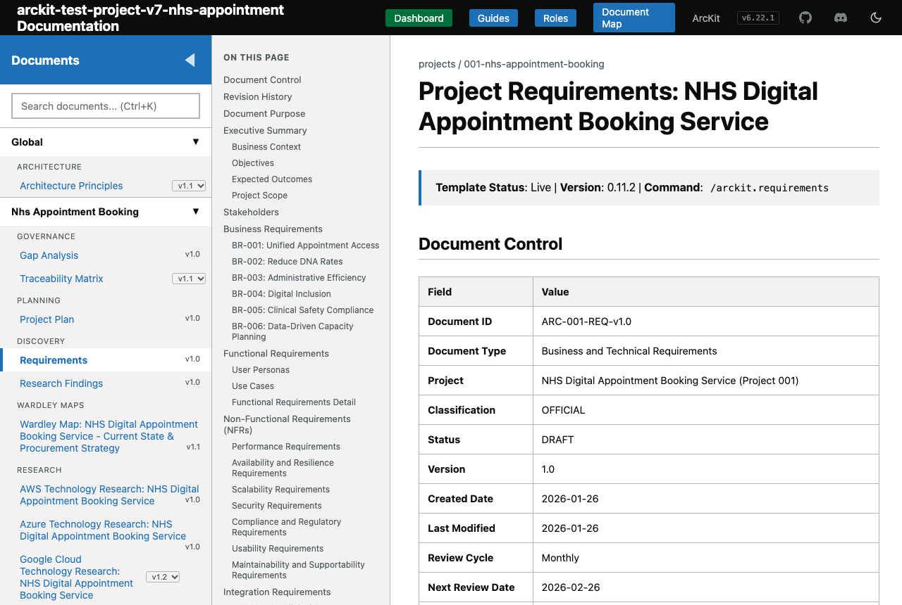

# ArcKit: The Enterprise Architecture Governance Harness

[](https://github.com/tractorjuice/arc-kit/stargazers)
[](https://github.com/tractorjuice/arc-kit/network/members)
[](LICENSE)
[](https://github.com/tractorjuice/arc-kit/releases)
[](https://github.com/tractorjuice/arc-kit/issues)

<picture>
  <source media="(prefers-color-scheme: dark)" srcset="docs/assets/arckit-banner-dark.svg">
  
</picture>

ArcKit is a free, open-source set of commands for Claude Code, Gemini CLI, GitHub Copilot, Codex CLI and other AI coding assistants. Each command drafts one architecture governance document from a template: a stakeholder analysis, a risk register, a business case, requirements, a design review, a UK government assessment.

Drafts cite the sources they read, carry a document ID, version and owner, and stay marked DRAFT until a qualified person reviews them. The core plugin has 76 commands; 20 optional plugins add commands for other countries, sectors and methods.

Install it in Claude Code:

```bash
claude plugin marketplace add tractorjuice/arckit-claude
claude plugin install arckit@arckit-claude
```

Then open Claude Code in your repository and run `/arckit:start`. For the other assistants, the overlays and automatic updates, see [Quick Start](#quick-start).

**[Getting started](https://arckit.org/getting-started.html) · [Command reference](https://arckit.org/commands.html) · [Guides](https://arckit.org/guides.html) · [Films](https://www.youtube.com/@arckitorg/playlists) · [Example projects](#example-projects) · [Who uses ArcKit](https://arckit.org/on-github.html)**

> ArcKit produces **DRAFT artefacts for qualified people to review**, not legal, regulatory, clinical, or security advice. See [What ArcKit does not do](#what-arckit-does-not-do).

<a href="https://tractorjuice.github.io/arckit-test-project-v7-nhs-appointment/#projects/001-nhs-appointment-booking/ARC-001-REQ-v1.0.md"></a>

*A requirements document drafted by `/arckit:requirements` and published by `/arckit:pages`, from the NHS appointment booking example. Select the image to open it.*

## What ArcKit drafts

- [Architecture principles](https://arckit.org/guide/principles.html) and a [project plan](https://arckit.org/guide/plan.html)
- [Stakeholder analysis](https://arckit.org/guide/stakeholders.html): a stakeholder map with each group's drivers, goals and outcomes
- [Risk register](https://arckit.org/guide/risk.html) on HM Treasury Orange Book principles
- [Strategic Outline Business Case](https://arckit.org/guide/sobc.html) on the Green Book five-case model
- [Requirements](https://arckit.org/guide/requirements.html): business, functional, non-functional, integration and data
- [Data model](https://arckit.org/guide/data-model.html) and a draft [Data Protection Impact Assessment](https://arckit.org/guide/dpia.html)
- [Technology research](https://arckit.org/guide/research.html) with checked facts and published costs, and research on [AWS](https://arckit.org/guide/aws-research.html), [Azure](https://arckit.org/guide/azure-research.html) and [Google Cloud](https://arckit.org/guide/gcp-research.html) from each provider's own documentation
- [Wardley Maps](https://arckit.org/guide/wardley.html), a [roadmap](https://arckit.org/guide/roadmap.html) and [architecture decision records](https://arckit.org/guide/adr.html)
- [Architecture diagrams](https://arckit.org/guide/diagram.html) in Mermaid or PlantUML
- [Statement of work](https://arckit.org/guide/sow.html) and [vendor evaluation](https://arckit.org/guide/evaluate.html) for a procurement
- [High-level](https://arckit.org/guide/hld-review.html) and [detailed design](https://arckit.org/guide/dld-review.html) reviews
- [Requirements traceability matrix](https://arckit.org/guide/traceability.html)
- UK government assessments: [Technology Code of Practice](https://arckit.org/guide/tcop.html), [GDS Service Standard](https://arckit.org/guide/service-assessment.html), [Secure by Design](https://arckit.org/guide/secure.html), [AI Playbook](https://arckit.org/guide/ai-playbook.html) and [ATRS](https://arckit.org/guide/atrs.html)
- [Product backlog](https://arckit.org/guide/backlog.html) and [ServiceNow service design](https://arckit.org/guide/servicenow.html)

The [command reference](#complete-command-reference) lists all 76 core commands, and [Overlays](#overlays) the optional ones. The [example projects](#example-projects) are public repositories with complete outputs, and [Who uses ArcKit](https://arckit.org/on-github.html) lists public repositories that use or mention it. For questions and worked examples, join the [ArcKit LinkedIn group](https://www.linkedin.com/groups/17641034/) or [Discord](https://discord.gg/HsA4Y3hQ4). The [ArcKit Awareness quiz](https://arckit.org/certification/awareness.html) checks what you've learned.

---

<details>
<summary><strong>Contents</strong></summary>

- [What ArcKit drafts](#what-arckit-drafts)
- [Watch first](#watch-first)
- [Quick Start](#quick-start)
- [Why ArcKit?](#why-arckit)
- [What ArcKit does not do](#what-arckit-does-not-do)
- [The ArcKit Workflow](#the-arckit-workflow)
- [UK Government assessments](#uk-government-assessments)
- [Overlays](#overlays)
- [Supported AI Assistants](#supported-ai-assistants)
- [Context footprint](#context-footprint)
- [Project Structure](#project-structure)
- [Template Customisation](#template-customisation)
- [Example projects](#example-projects)
- [Complete Command Reference](#complete-command-reference)
- [Wardley Mapping for Strategic Architecture](#wardley-mapping-for-strategic-architecture)
- [Architecture Diagrams with Mermaid](#architecture-diagrams-with-mermaid)
- [ServiceNow Service Management Design](#servicenow-service-management-design)
- [OKF Interoperability](#okf-interoperability)
- [Comparison to Other Tools](#comparison-to-other-tools)
- [Relationship to Spec Kit](#relationship-to-spec-kit)
- [Documentation](#documentation)
- [Tips](#tips)
- [Troubleshooting](#troubleshooting)
- [Contributing](#contributing)
- [Support](#support)
- [License](#license)
- [Acknowledgements](#acknowledgements)

</details>

---

## Watch first

New to ArcKit, or explaining it to someone who doesn't use a coding assistant? Start with a film:

- [ArcKit explained](https://youtu.be/-oQ5VRpkxp0): what ArcKit is and how it keeps AI-drafted architecture documents reviewable, in under eight minutes.
- [ArcKit for Beginners](https://www.youtube.com/playlist?list=PLHAFN5RjB5As): one fictional council project, followed from its architecture principles to the release decision. One hour, or four shorter parts.
- [ArcKit commands](https://www.youtube.com/playlist?list=PLOxB2ULF5XX0): a film of about a minute and a half for each command: what it is for, when to run it and what it produces.

The [ArcKit YouTube channel](https://www.youtube.com/@arckitorg/playlists) also has a playlist for each overlay. The narration is AI-generated and the films are experimental; tell us on [Discord](https://discord.gg/HsA4Y3hQ4) what to cover next.

---

## Quick Start

ArcKit runs inside an AI coding assistant. Claude Code gives the fullest experience; the other assistants are set up below.

### Claude Code

Install the ArcKit plugin (requires Claude Code **v2.1.319+**). First, make sure Claude Code is on the latest version:

```bash
claude install latest
```

Then in Claude Code:

```text
/plugin marketplace add tractorjuice/arckit-claude
```

Then install from the Discover tab, or via CLI. The marketplace ships **21 plugins** — install only the overlays you need. Each `claude plugin install` takes one plugin name:

```bash
# Core (76 commands — UK Government civilian + generic enterprise)
claude plugin install arckit@arckit-claude

# One overlay, here UAE federal. An overlay is switched off until you enable it.
claude plugin install arckit-uae@arckit-claude
claude plugin enable arckit-uae

# Several overlays at once
for overlay in uae fr ca eu at au us uk-nhs uk-gcloud togaf-adm agent-architecture; do
  claude plugin install "arckit-$overlay@arckit-claude"
  claude plugin enable "arckit-$overlay"
done
```

There is nothing to initialise: the plugin provides everything. Open Claude Code in your repository and run a command:

```text
/arckit:principles Create principles for a financial services company
/arckit:requirements Build a payment processing system...
/arckit:sow Generate RFP for vendor selection
```

**Turn on automatic updates.** Run `/plugin`, open the **Marketplaces** tab, select `arckit-claude` and turn auto-update on. Claude Code leaves it off for every marketplace that isn't Anthropic's own, so until you do this nothing changes when ArcKit releases. With it on, ArcKit updates in the background shortly after a session starts: run `/reload-plugins` when you see `Plugin updated`, or just start your next session.

Claude Code also reads `autoUpdate` from the marketplace's entry in a settings file. For a team, put this in the repository's `.claude/settings.json`, or in your organisation's managed settings, so everyone gets ArcKit with automatic updates on:

```json
{
  "extraKnownMarketplaces": {
    "arckit-claude": {
      "source": { "source": "github", "repo": "tractorjuice/arckit-claude" },
      "autoUpdate": true
    }
  },
  "enabledPlugins": {
    "arckit@arckit-claude": true
  }
}
```

For a managed rollout across an organisation, see the [enterprise scale guide](docs/guides/enterprise-scale.md).

To update by hand at any time, run `claude plugin update arckit@arckit-claude`, then `/reload-plugins`. To stay on one release, add the marketplace at its tag: `/plugin marketplace add tractorjuice/arckit-claude#vX.Y.Z`.

The standalone `tractorjuice/arckit-claude` marketplace hosts all Claude Code plugins: the `arckit` core plugin, regional overlays, sector overlays, the TOGAF ADM, O-AA, arc42 and AI agent architecture overlays, the `arckit-fde` tooling plugin, and the public-but-proprietary `arckit-uk-gcloud` supplier overlay. The 19 community plugins (`arckit-uae`, `arckit-fr`, `arckit-nl`, `arckit-ca`, `arckit-eu`, `arckit-at`, `arckit-au`, `arckit-au-energy`, `arckit-us`, `arckit-uk-finance`, `arckit-uk-nhs`, `arckit-uk-legacy`, `arckit-uk-food`, `arckit-uk-gcloud`, `arckit-togaf-adm`, `arckit-agent-architecture`, `arckit-oaa`, `arckit-arc42`, `arckit-repo`) require the `arckit` core plugin. `arckit-au-energy` (sector) additionally requires `arckit-au` (jurisdiction), which it composes — install `arckit-au@arckit-claude` and `arckit-au-energy@arckit-claude`, one `claude plugin install` each, and enable both. `arckit-uk-gcloud` is a **proprietary, Claude Code only** supplier-side G-Cloud bid-authoring overlay — it is public for installation and inspection, but not MIT licensed and not distributed to the non-Claude extension formats. One **tooling plugin** — `arckit-fde` — is a lean, Claude Code only plugin with one command, `/arckit-fde:create`, that generates a brandable (white-label) Forward Deploy Engineering consulting website into `docs/` (GitHub Pages ready), with UK Public Sector and Generic market presets; no dependencies, not converted to non-Claude formats, no governance doc-types.

The older `tractorjuice/arc-kit` marketplace remains available for compatibility, but new Claude Code installs should use `tractorjuice/arckit-claude`. Claude Code is the **primary development platform** for ArcKit and provides the most complete experience: all official commands, autonomous research agents, automation hooks, bundled MCP servers (AWS Knowledge, Microsoft Learn, Google Developer Knowledge, govreposcrape, uk-tenders), and automatic updates via the marketplace. See [Why Claude Code?](#why-claude-code) below.

<details>
<summary><strong>Why Claude Code v2.1.319 or later?</strong></summary>

> **Why v2.1.319?** It closes three ways a command could get past a permission check or the sandbox. It also runs ArcKit's after-write steps on an artefact written just as you send a new message; earlier versions skipped them, so the artefact had no provenance block and no entry in the published index. And updating a plugin now installs a dependency the new version adds, which every overlay relies on for the core plugin. It still carries what v2.1.295 brought: `onFailure: "block"`, so a check on an ArcKit artefact stops the write when it can't run. It also carries the fix for plugin SessionStart hooks not running in new cloud sessions, which skipped ArcKit's session set-up and version check there.
>
> The floor also carries earlier releases ArcKit depends on:
>
> **Models**
>
> - **v2.1.284** adds **Claude Sonnet 5.5** (`claude-sonnet-5-5`), the default Sonnet model on the Anthropic API, with 1M context; earlier clients cannot select it. Like Opus 5.5 it always thinks and defaults to `effort: medium`, so ArcKit's `effort: max` commands run at `max` on it.
> - **v2.1.280** adds **Claude Opus 5.5** (`claude-opus-5-5`), the default Opus model. It always thinks, so ArcKit's `effort: max` commands can no longer be quietly sent as `high` by a session with thinking off, and the Effective Effort row in each artefact's Build Provenance is accurate.
> - **v2.1.219** adds **Claude Opus 5** (`claude-opus-5`), with 1M context and fast mode, which earlier clients cannot select (superseded as the default by Opus 5.5).
> - **v2.1.197** makes Claude Sonnet 5 the default, with native 1M context.
>
> **Security and permissions**
>
> - **v2.1.251** stops the file tools (Read, Write, Edit) following a symlink swapped inside the working directory *after* the permission check, and makes Grep and Glob honour `Read()` deny rules through a symlinked search path. That is the same class of bypass the v2.1.222–v2.1.224 fixes closed for Bash, and the class ArcKit's `file-protection` and `secret-file-scanner` gates sit in front of.
> - **v2.1.234** stops Claude Code's MCP diagnostics printing **resolved secrets**. ArcKit bundles two keyed MCP servers whose `${user_config.*}` API keys sit in request headers. On a session with no keys configured those connections fail *by design*, so ArcKit routinely produces exactly the diagnostics this fixed.
> - **v2.1.222** stops PreToolUse auto-allow hooks bypassing tool restrictions inside background agent tasks, which became load-bearing when v2.1.232 made subagent spawns background by default.
> - **v2.1.223 and v2.1.224** close Bash permission-check bypasses, a sandbox `denyRead`/`denyWrite` trailing-slash bypass, and a bug where project paths over 200 characters resolved into another project's session directory. v2.1.224 also surfaces sandbox violation details in Bash results.
> - **v2.1.172** fixes wildcard-domain `WebFetch` rules (`WebFetch(domain:*.gov.uk)`) that never matched subdomains on earlier clients. That is the exact shape ArcKit recommends for confining research-agent traffic in OFFICIAL-SENSITIVE deployments.
>
> **Effort and thinking**
>
> - **v2.1.251** sends Opus 5 `effort: xhigh`/`max` as `high` when thinking is off instead of failing, so ArcKit's `effort: max` commands complete on thinking-off sessions.
> - **v2.1.221** fixes `WebSearch` returning a 400 at `effort: xhigh`/`max` when thinking is disabled, which silently broke ArcKit's `effort: max` commands and its three max-effort research agents for anyone running with thinking off.
>
> **Plugin loading and agents**
>
> - **v2.1.246** fixes four plugin-loading bugs that hit ArcKit's exact layout: `/reload-plugins` counted 0 skills for plugins that define skills under `skills/*/SKILL.md`, hook error messages showed a literal `${CLAUDE_PLUGIN_ROOT}` instead of the resolved path, the plugin cache created duplicate SHA-named directories, and `claude plugin update <bare-name>` failed.
> - **v2.1.200** fixes project-scoped plugin loading from git worktrees and `claude agents --plugin-dir <dir>` visibility, which makes ArcKit's branch and test-repo workflows reliable.
> - **v2.1.198–v2.1.199** fix background-subagent reliability, parent error propagation and hook stderr visibility, which matter to `/arckit:build`, reader/writer handoffs and hook diagnosis.
>
> **Older fixes:** v2.1.156 Opus 4.8 thinking-block fix, v2.1.154 plugin `defaultEnabled: false`, v2.1.144 session-title and headless Skill tool fixes, v2.1.143 plugin dependency enforcement, v2.1.139 hook `args: string[]`, v2.1.129 monitor layout and prompt-cache fixes, v2.1.121 MCP/provenance hook unlocks, v2.1.118–v2.1.119 release/telemetry unlocks, and the earlier `/context`, Auto mode, plugin update, MCP leak, retry and subagent working-directory fixes.

</details>

### Other assistants

<details>
<summary><strong>Gemini CLI</strong></summary>

Install the ArcKit extension:

```bash
gemini extensions install https://github.com/tractorjuice/arckit-gemini
```

Zero-config: 75 core commands, templates, scripts, and five bundled MCP servers (AWS Knowledge, Microsoft Learn, Google Developer Knowledge, Data Commons, govreposcrape). Updates via `gemini extensions update arckit`.

There is nothing to initialise. Commands are invoked as `/arckit:requirements`, `/arckit:stakeholders`, etc.

Using Google Antigravity as well, or instead? ArcKit has an experimental plugin for it: see **Google Antigravity** below.

</details>

<details>
<summary><strong>GitHub Copilot (VS Code)</strong></summary>

Install the ArcKit CLI and scaffold prompt files:

```bash
# Install with pip
pip install git+https://github.com/tractorjuice/arc-kit.git

# Create a new architecture governance project
arckit init payment-modernization --ai copilot

# Or initialize in current directory
arckit init . --ai copilot
```

Creates `.github/prompts/arckit-*.prompt.md` (a prompt file for each command: the 75 core commands that run outside Claude Code, plus the community overlays), `.github/agents/arckit-*.agent.md` (14 custom agents), and `.github/copilot-instructions.md` (repo-wide context). Invoke commands in Copilot Chat as `/arckit-requirements`, `/arckit-stakeholders`, etc.

```bash
cd payment-modernization && code .
# In Copilot Chat, use ArcKit commands:
/arckit-principles Create principles for a financial services company
/arckit-requirements Build a payment processing system...
```

**Updating:** re-run `arckit init --here --ai copilot` to update prompt files, agents, and instructions.

</details>

<details>
<summary><strong>Codex CLI</strong></summary>

Install the ArcKit CLI:

```bash
# Install with pip
pip install git+https://github.com/tractorjuice/arc-kit.git

# Or with uv
uv tool install arckit-cli --from git+https://github.com/tractorjuice/arc-kit.git

# Or run without installing
uvx --from git+https://github.com/tractorjuice/arc-kit.git arckit init my-project
```

Create a project:

```bash
# Create a new architecture governance project
arckit init payment-modernization --ai codex

# Minimal install (skip docs and guides)
arckit init payment-modernization --ai codex --minimal

# Or initialize in current directory
arckit init . --ai codex
```

ArcKit commands are delivered as skills and auto-discovered:

```bash
cd payment-modernization && codex

# Then use ArcKit skills
$arckit-principles Create principles for financial services
$arckit-stakeholders Analyze stakeholders for cloud migration
$arckit-requirements Create comprehensive requirements
```

See [.codex/README.md](.codex/README.md) for full Codex CLI setup and usage.

**Updating:**

```bash
# Step 1: Upgrade the CLI tool
pip install --upgrade git+https://github.com/tractorjuice/arc-kit.git
# Or with uv:
uv tool install --force arckit-cli --from git+https://github.com/tractorjuice/arc-kit.git

# Step 2: Update your existing project (re-run init in place)
cd /path/to/your-existing-project
arckit init --here --ai codex
```

This updates commands, templates, scripts, and agents while **preserving** your project data (`projects/`) and custom templates (`.arckit/templates-custom/`).

</details>

<details>
<summary><strong>OpenCode CLI</strong></summary>

Install the ArcKit CLI as for Codex CLI, then create a project:

```bash
# Create a new architecture governance project
arckit init payment-modernization --ai opencode

# Or initialize in current directory
arckit init . --ai opencode
```

Commands are invoked as `/arckit:requirements`, `/arckit:stakeholders`, etc. To update, upgrade the CLI and re-run `arckit init --here --ai opencode`.

</details>

<details>
<summary><strong>Mistral Vibe CLI</strong></summary>

Link the ArcKit extension:

```bash
# Clone the standalone extension repository
git clone https://github.com/tractorjuice/arckit-vibe.git
cd arckit-vibe

# Create extensions directory and link
mkdir -p ~/.vibe/extensions/
ln -s $(pwd) ~/.vibe/extensions/arckit
```

Zero-config: 75 core commands as skills, 14 specialised agents, all templates, and five bundled MCP servers (AWS Knowledge, Microsoft Learn, Google Developer Knowledge, Data Commons, govreposcrape).

There is nothing to initialise: the extension provides everything.

```bash
cd payment-modernization
vibe
# Use ArcKit skills:
/arckit-principles Create principles for a financial services company
/arckit-requirements Build a payment processing system...
/arckit-sow Generate RFP for vendor selection

# Or use specialized agents:
vibe --agent arckit-research "Research cloud providers"
```

**Updating:** pull the latest standalone extension repo: `cd ~/.vibe/extensions/arckit && git pull`.

</details>

<details>
<summary><strong>Kimi Code CLI</strong></summary>

Start `kimi`, then install the ArcKit plugin from the prompt:

```text
/plugins install https://github.com/tractorjuice/arckit-kimi.git
```

Every ArcKit command ships as an Agent Skill, invoked with `/skill:arckit-<command>` (for example `/skill:arckit-requirements`). The `kimi.plugin.json` manifest carries all six bundled MCP servers and auto-loads the `architecture-workflow` skill at session start.

Create a project with the ArcKit CLI (install it as for Codex CLI):

```bash
# Create a new architecture governance project
arckit init payment-modernization --ai kimi

# Or initialize in current directory
arckit init . --ai kimi
```

```bash
cd payment-modernization
kimi
# Use ArcKit skills:
/skill:arckit-principles Create principles for a financial services company
/skill:arckit-requirements Build a payment processing system...
/skill:arckit-sow Generate RFP for vendor selection
```

**Updating:** re-run the install command from the `kimi` prompt to pick up the latest release: `/plugins install https://github.com/tractorjuice/arckit-kimi.git`.

</details>

<details>
<summary><strong>Google Antigravity (experimental)</strong></summary>

It passes Antigravity's own plugin check and eight core commands have been run there; the rest are untried.

```bash
agy plugin install https://github.com/tractorjuice/arckit-antigravity
```

Create a project with the ArcKit CLI (install it as for Codex CLI):

```bash
arckit init payment-modernization --ai antigravity
```

Every ArcKit command is an Agent Skill whose name starts `arckit-`:

```text
/arckit-principles Create principles for a financial services company
/arckit-requirements Build a payment processing system...
```

See [the plugin's README](https://github.com/tractorjuice/arckit-antigravity) for the MCP servers and what is not there yet. **Updating:** run the install command again.

Using Gemini CLI as well, or instead? ArcKit's established extension for it is under **Gemini CLI** above.

</details>

**Latest Release**: [v6.26.0](https://github.com/tractorjuice/arc-kit/releases/tag/v6.26.0)

If upgrading from v0.x, you may also need to migrate legacy filenames — see the [upgrading guide](docs/guides/upgrading.md) for full details.

### Requirements

- **Python 3.11+**
- **Node.js** on your `PATH`. ArcKit's hooks and helper scripts need it, and without it ArcKit artefacts can't be written
- **Git** (optional but recommended)
- **AI Coding Agent**: [Claude Code](https://www.anthropic.com/claude-code) v2.1.319+ (via plugin), [Gemini CLI](https://github.com/google-gemini/gemini-cli) (via extension), [OpenCode CLI](https://opencode.net/cli) (via CLI), or [OpenAI Codex CLI](https://chatgpt.com/features/codex) (via CLI)
- **uv** for package management: [Install uv](https://docs.astral.sh/uv/)

### Install from source

```bash
# Clone the repository
git clone https://github.com/tractorjuice/arc-kit.git
cd arc-kit

# Install in development mode
pip install -e .

# Run the CLI
arckit init my-project
```

### Example outputs

Public demonstration repositories show complete ArcKit deliverables, from an NHS appointment booking service to a cross-government GenAI platform. See [Example projects](#example-projects) for the full list.

---

## Why ArcKit?

ArcKit is for teams whose architecture governance lives in Word files, Confluence pages and slide decks, written differently on each project. It keeps the same work in one place and one shape.

### What you get

- **One template for each document.** Every project's requirements, business case or design review has the same sections, so a reviewer knows where to look. You can [change a template](#template-customisation) and keep your version across updates.
- **Requirement IDs that carry through.** `BR-`, `FR-` and `NFR-` identifiers run from the requirements into the data model, the design reviews and the backlog, and [`/arckit:traceability`](https://arckit.org/guide/traceability.html) shows which requirements nothing yet covers.
- **Markdown in your own git repository.** Each artefact has a document ID, a version, an owner and a review date, and its history is your commit history.
- **Sources you can check.** Research commands cite each source they read, and keep what they fetch from the web apart from the scoring.
- **UK government standards built in.** Templates follow the Green Book, the Orange Book, the Technology Code of Practice, the GDS Service Standard and Secure by Design.

### What it costs

ArcKit is free and open source under the MIT licence; two overlays have their own terms, set out under [License](#license). It runs inside an AI coding assistant, which is usually a paid plan, and each command uses part of that plan's allowance. [Context footprint](#context-footprint) has the token figures for Claude Code.

---

## What ArcKit does not do

ArcKit generates **DRAFT artefacts for qualified people to review**. It is not legal, regulatory, clinical, or security advice, and no output it produces is a submission, a certification, an accreditation, or a compliance decision. Every artefact carries `Status: DRAFT` until a named accountable person signs it off, and that is the point at which responsibility for the content transfers to your organisation.

Concretely, and regardless of how complete an artefact looks:

- **A `/arckit:dpia` output is not a completed DPIA.** UK GDPR Article 35 places the assessment on the controller, and Article 36 requires prior consultation with the ICO where high residual risk remains. ArcKit drafts the document. The controller and the Data Protection Officer own it, and only they can conclude it.
- **`/arckit:secure` and `/arckit:mod-secure` do not produce an assurance decision.** NCSC CAF outcomes, Cyber Essentials certification, and MOD Secure by Design assurance are all judged by named accountable individuals and, where relevant, by certification bodies. A generated assessment is input to that judgement, never a substitute for it.
- **`/arckit:atrs` and `/arckit:ai-playbook` do not make an algorithmic tool lawful, fair, or transparent.** An ATRS record is published by the department after its own internal clearance, and the UK Government AI Playbook principles are obligations on the deploying organisation.
- **The EU overlay does not perform conformity assessment.** It drafts documentation referencing the AI Act, NIS2, DORA, CRA, DSA and the Data Act. It is not a notified-body activity, it does not determine your risk classification, and it does not track amendments or implementing acts as they are made.
- **`/arckit:jsp-936` and the NHS clinical safety commands are not assurance either.** Defence AI assurance requires the accountable authority; DCB0129 and DCB0160 require a suitably registered Clinical Safety Officer.
- **The UK food safety commands are not a food safety assessment.** They record what a named person at the business says, beside the Food Standards Agency's own wording. The food business operator is responsible for the food and the records, and the council's environmental health team is the authority on them.
- **No output is a procurement decision.** `/arckit:research` reports evidence. The cloud research, scoring and evaluation commands rank options against stated criteria. The Senior Responsible Owner and the procurement officer decide, under whatever framework rules apply to them.

Two limits apply to everything above:

1. **Citations reflect the moment they were fetched.** Commands cite sources at fetch time and record the URL, but legislation, standards, framework agreements, and vendor pricing all change. A citation that resolved when the artefact was generated may not describe the current text.
2. **Generated content can be wrong.** Output is produced by a language model, and research commands extract from third-party web pages that may themselves be inaccurate or written to mislead. ArcKit isolates that extraction behind schema validation and keeps scoring deterministic, which reduces the blast radius but does not make the underlying facts true.

### Who must review what

Before any ArcKit artefact is relied on, published, or submitted:

- Data protection artefacts (DPIA, records of processing): Data Protection Officer
- Security and assurance artefacts: CISO, or the assessing authority for the relevant regime
- Clinical safety artefacts: a registered Clinical Safety Officer
- Business cases and procurement artefacts: Senior Responsible Owner and procurement or commercial lead
- Anything referencing a regulation, in any jurisdiction: qualified legal counsel for that jurisdiction

The community overlays each carry their own, narrower version of this warning. This section applies to **all** of ArcKit, including the officially-maintained core commands.

---

## The ArcKit Workflow

ArcKit's commands follow the order a project is governed in. You don't have to run every step: each command says what it needs first, and [`/arckit:navigator`](https://arckit.org/guide/navigator.html) shows what a project has and what to run next.

| Step | Commands | What you get |
|------|----------|--------------|
| 1. Plan | [`/arckit:plan`](https://arckit.org/guide/plan.html) | Project plan with phases, gates and a timeline |
| 2. Principles | [`/arckit:principles`](https://arckit.org/guide/principles.html) | Architecture principles for the organisation |
| 3. Stakeholders | [`/arckit:stakeholders`](https://arckit.org/guide/stakeholders.html) | Stakeholder analysis: drivers, goals and measurable outcomes |
| 4. Risk | [`/arckit:risk`](https://arckit.org/guide/risk.html) | Risk register on HM Treasury Orange Book principles |
| 5. Business case | [`/arckit:sobc`](https://arckit.org/guide/sobc.html) | Strategic Outline Business Case on the Green Book five-case model |
| 6. Requirements | [`/arckit:requirements`](https://arckit.org/guide/requirements.html) | Business, functional, non-functional, integration and data requirements |
| 7. Platform and data | [`/arckit:platform-design`](https://arckit.org/guide/platform-design.html), [`/arckit:data-model`](https://arckit.org/guide/data-model.html), [`/arckit:dpia`](https://arckit.org/guide/dpia.html), [`/arckit:datascout`](https://arckit.org/guide/datascout.html) | Platform strategy, data model, draft DPIA and external data sources |
| 8. Research | [`/arckit:research`](https://arckit.org/guide/research.html), [`/arckit:grants`](https://arckit.org/guide/grants.html) | Technology options with checked facts and published costs; UK funding |
| 9. Strategy | [`/arckit:wardley`](https://arckit.org/guide/wardley.html), [`/arckit:roadmap`](https://arckit.org/guide/roadmap.html), [`/arckit:strategy`](https://arckit.org/guide/strategy.html), [`/arckit:adr`](https://arckit.org/guide/adr.html) | Wardley Maps, roadmap, architecture strategy and decision records |
| 10. Procurement | [`/arckit:sow`](https://arckit.org/guide/sow.html), [`/arckit:dos`](https://arckit.org/guide/dos.html), [`/arckit:gcloud-search`](https://arckit.org/guide/gcloud-search.html), [`/arckit:gcloud-clarify`](https://arckit.org/guide/gcloud-clarify.html), [`/arckit:evaluate`](https://arckit.org/guide/evaluate.html) | Statement of work, DOS and G-Cloud documents, vendor evaluation |
| 11. Design review | [`/arckit:hld-review`](https://arckit.org/guide/hld-review.html), [`/arckit:dld-review`](https://arckit.org/guide/dld-review.html) | Reviews of the high-level and detailed designs |
| 12. Delivery | [`/arckit:backlog`](https://arckit.org/guide/backlog.html), [`/arckit:trello`](https://arckit.org/guide/trello.html), [`/arckit:servicenow`](https://arckit.org/guide/servicenow.html) | Product backlog, Trello export and ServiceNow service design |
| 13. Traceability and quality | [`/arckit:traceability`](https://arckit.org/guide/traceability.html), [`/arckit:analyze`](https://arckit.org/guide/analyze.html) | Requirements traceability matrix and a governance quality analysis |
| 14. Assessments | [`/arckit:service-assessment`](https://arckit.org/guide/service-assessment.html), [`/arckit:tcop`](https://arckit.org/guide/tcop.html), [`/arckit:secure`](https://arckit.org/guide/secure.html), [`/arckit:ai-playbook`](https://arckit.org/guide/ai-playbook.html), [`/arckit:atrs`](https://arckit.org/guide/atrs.html), [`/arckit:mod-secure`](https://arckit.org/guide/mod-secure.html), [`/arckit:jsp-936`](https://arckit.org/guide/jsp-936.html) | Draft UK government assessments; the [overlays](#overlays) add other countries and sectors |
| 15. Reporting and publishing | [`/arckit:story`](https://arckit.org/guide/story.html), [`/arckit:presentation`](https://arckit.org/guide/presentation.html), [`/arckit:pages`](https://arckit.org/guide/pages.html) | Project story, slide deck and a documentation site |

[The ArcKit workflow, phase by phase](https://arckit.org/guide/workflow.html) goes through each step in detail: what the command reads, what it writes and what to run after it.

---

## UK Government assessments

<a id="uk-government-compliance"></a>

ArcKit has commands that draft the assessments UK public sector delivery asks for. Each output is a draft for the accountable person to review and decide on: see [What ArcKit does not do](#what-arckit-does-not-do).

- [`/arckit:tcop`](https://arckit.org/guide/tcop.html): review a project against all 13 points of the Technology Code of Practice.
- [`/arckit:service-assessment`](https://arckit.org/guide/service-assessment.html): gather evidence against the 14 points of the GDS Service Standard.
- [`/arckit:ai-playbook`](https://arckit.org/guide/ai-playbook.html): assess a system against the UK Government AI Playbook. [`/arckit:atrs`](https://arckit.org/guide/atrs.html) drafts its ATRS record.
- [`/arckit:secure`](https://arckit.org/guide/secure.html): draft a Secure by Design assessment covering NCSC CAF, Cyber Essentials and UK GDPR controls.
- [`/arckit:mod-secure`](https://arckit.org/guide/mod-secure.html): draft a MOD Secure by Design assessment (JSP 440, IAMM, clearance pathways).
- [`/arckit:jsp-936`](https://arckit.org/guide/jsp-936.html): draft JSP 936 AI assurance documentation for defence AI systems.

See the demo repositories for end-to-end examples, especially `arckit-test-project-v7-nhs-appointment` (civilian services) and `arckit-test-project-v9-cabinet-office-genai` (AI governance).

---

## Overlays

Overlays are optional plugins that add commands for a region, a sector or a method. Each needs the `arckit` core plugin, apart from `arckit-fde`, and each is switched off until you enable it. Most are community-contributed: where a section below opens with a community note, it says who maintains that overlay.

```bash
claude plugin install arckit-uae@arckit-claude
claude plugin enable arckit-uae
```

Commands on this page are written as Claude Code names them, with the overlay's plugin name first: `/arckit-uae:uae-pdpl`. The other assistants leave the plugin name out: `/arckit:uae-pdpl` in Gemini CLI and OpenCode CLI, `/arckit-uae-pdpl` in GitHub Copilot and `$arckit-uae-pdpl` in Codex CLI.

| Overlay | Plugin | Kind | Commands | More |
|---------|--------|------|----------|------|
| UAE federal | `arckit-uae` | Region | 12 | [Below](#uae-federal-overlay) |
| France | `arckit-fr` | Region | 12 | [Below](#eu-french-dutch-and-austrian-overlays) |
| Netherlands | `arckit-nl` | Region | 6 | [Below](#eu-french-dutch-and-austrian-overlays) |
| Canada federal | `arckit-ca` | Region | 12 | [Below](#canada-federal-overlay) |
| European Union | `arckit-eu` | Region | 8 | [Below](#eu-french-dutch-and-austrian-overlays) |
| Austria | `arckit-at` | Region | 4 | [Below](#eu-french-dutch-and-austrian-overlays) |
| Australia | `arckit-au` | Region | 10 | [README](plugins/arckit-au/README.md) |
| USA federal civilian | `arckit-us` | Region | 10 | [Below](#usa-federal-civilian-overlay) |
| UK financial services payments | `arckit-uk-finance` | Sector | 4 | [Below](#uk-finance-payments-overlay) |
| UK NHS clinical safety | `arckit-uk-nhs` | Sector | 4 | [Below](#uk-nhs-clinical-safety-overlay) |
| UK legacy IT assessment | `arckit-uk-legacy` | Sector | 1 | [Below](#uk-legacy-it-assessment-overlay) |
| UK food safety (England and Wales) | `arckit-uk-food` | Sector | 9 | [Below](#uk-food-safety-overlay) |
| Australian energy | `arckit-au-energy` | Sector | 2 | [README](plugins/arckit-au-energy/README.md) |
| TOGAF ADM | `arckit-togaf-adm` | Method | 9 | [Below](#togaf-adm-overlay) |
| Open Agile Architecture (O-AA) | `arckit-oaa` | Method | 5 | [Below](#o-aa-overlay) |
| arc42 | `arckit-arc42` | Method | 5 | [Below](#arc42-overlay) |
| AI agent architecture | `arckit-agent-architecture` | AI agents | 6 | [Below](#ai-agent-architecture-overlay) |
| UK G-Cloud supplier bid authoring (proprietary) | `arckit-uk-gcloud` | Supplier | 15 | [Below](#uk-g-cloud-supplier-bid-authoring-overlay-proprietary) |
| Repository tooling | `arckit-repo` | Tooling | 2 | [README](plugins/arckit-repo/README.md) |
| Forward Deploy Engineering site generator | `arckit-fde` | Tooling | 1 | [README](plugins/arckit-fde/README.md) |

<a id="eu--french-regulatory-compliance-community"></a>
<a id="eu-french-dutch--austrian-regulatory-compliance-community"></a>

### EU, French, Dutch and Austrian overlays

> ⚠️ **Community-contributed.** EU and French commands are domain-maintained by [@thomas-jardinet](https://github.com/thomas-jardinet), Austrian commands by [@gtonic](https://github.com/gtonic). The 30 commands below cover EU regulations (GDPR, NIS2, AI Act, DORA, CRA, DSA, Data Act, Cloud Sovereignty Framework), French government standards (SecNumCloud, ANSSI, EBIOS, CNIL, DINUM, etc.), Dutch government standards (Rijksbreed cloudbeleid, VIRBI 2025, BIO2, cloud exit, NORA and GEMMA reference architectures), and Austrian government standards (DSG, NISG 2026, BVergG 2018, BaFG / WZG accessibility). They are not part of the officially-maintained baseline — output should be reviewed by qualified DPO / CISO / Vergabejurist / legal counsel before reliance, and citations may lag current source text. Each command surfaces with a `[COMMUNITY]` prefix in `/help` listings and renders a warning banner before generating.

**EU regulations** (member-state-neutral baselines, applicable across EU/EEA):

- `/arckit-eu:eu-rgpd` — GDPR (EU 2016/679) compliance assessment — legal basis, data subject rights, transfers, DPIA screening, breach notification
- `/arckit-eu:eu-nis2` — NIS2 Directive — operators of essential / important entities, Article 21 measures, incident reporting timelines
- `/arckit-eu:eu-ai-act` — EU AI Act (Regulation 2024/1689) — risk classification (prohibited / high-risk / GPAI), conformity routes
- `/arckit-eu:eu-dora` — Digital Operational Resilience Act (EU 2022/2554) — financial sector ICT risk, TLPT, third-party register
- `/arckit-eu:eu-cra` — Cyber Resilience Act (Regulation 2024/2847) — products with digital elements, SBOM, VDP, CE marking
- `/arckit-eu:eu-cloud-sovereignty` — EU Cloud Sovereignty Framework (v1.2.1, June 2026 calculator weights) — eight weighted sovereignty objectives, SEAL-0 to SEAL-4 assurance levels, minimum-SEAL tender gate
- `/arckit-eu:eu-dsa` — Digital Services Act (Regulation 2022/2065) — intermediaries, platforms, VLOPs, ARCOM
- `/arckit-eu:eu-data-act` — Data Act (Regulation 2023/2854) — connected products, B2B FRAND, cloud switching, Article 32 international governmental access

**French government** (apply on top of the EU baseline for French deployments):

- `/arckit-fr:fr-secnumcloud` — SecNumCloud 3.2 qualification (sovereign cloud, OIV/OSE, extraterritorial risk)
- `/arckit-fr:fr-dinum` — DINUM standards: RGI, RGAA, RGESN, RGS, doctrine cloud de l'État, FranceConnect, DSFR
- `/arckit-fr:fr-marche-public` — French public procurement (code de la commande publique, UGAP, sovereignty clauses)
- `/arckit-fr:fr-rgpd` — CNIL-specific GDPR layer (cookies Délibération 2020-091, HDS, age 15, DPO registration)
- `/arckit-fr:fr-ebios` — EBIOS Risk Manager — 5-workshop study (VM/ER/SR/CO/SS/SO/MS IDs, MITRE ATT&CK, homologation)
- `/arckit-fr:fr-anssi` — ANSSI Guide d'hygiène informatique (42 measures) + cloud security recommendations
- `/arckit-fr:fr-anssi-carto` — ANSSI SI cartography across business / application / system / network levels
- `/arckit-fr:fr-dr` — Diffusion Restreinte handling under II 901 / SGDSN / ANSSI
- `/arckit-fr:fr-algorithme-public` — Public algorithm transparency notice (Article L311-3-1 CRPA, Loi République Numérique)
- `/arckit-fr:fr-pssi` — Information System Security Policy (PSSI) per ANSSI / RGS
- `/arckit-fr:fr-code-reuse` — Public code reuse assessment (code.gouv.fr, SILL, EUPL) — build-vs-reuse decision matrix
- `/arckit-fr:fr-irn` — IRN (Indice de Résilience Numérique) self-assessment on the aDRI framework (8 resilience pillars, for one digital asset or the whole organisation)

**Dutch government** (apply on top of the EU baseline for Netherlands public-sector deployments: central government for the cloud, classification, BIO2 and exit commands, every bestuurslaag for NORA, gemeenten for GEMMA — domain-maintained by [@umag](https://github.com/umag)):

- `/arckit-nl:nl-cloud` — Rijksbreed cloudbeleid 2026 compliance (materieel cloudgebruik, exit plan, CISO Rijk notification, EEA residency, staatsgeheim / TBB eligibility)
- `/arckit-nl:nl-tbb` — Te Beschermen Belangen (TBB) category determination (BIV scoring across five kernbelangen; any existing VIRBI 2025 rubricering is applied as a floor on the category, never derived from it)
- `/arckit-nl:nl-bio` — BIO2 conformance (OBDO, on NEN-EN-ISO/IEC 27001:2023 and 27002:2022)
- `/arckit-nl:nl-exit` — Cloud exit plan under Rijksbreed cloudbeleid clause 3.2 (planned exit and disruptive interruption, annual review)
- `/arckit-nl:nl-nora` — NORA conformance (NAP01–NAP17 per implicatie and Vijflaagsmodel layer, kwaliteitsdoelen and kernwaarden roll-up; GEMMA supplement for gemeenten)
- `/arckit-nl:nl-gemma` — GEMMA landscape mapping for gemeenten (referentiecomponenten, bedrijfsfuncties, overlap, gaps, standards, roadmap candidates)

**Austrian government** (apply on top of the EU baseline for Austrian deployments — domain-maintained by [@gtonic](https://github.com/gtonic)):

- `/arckit-at:at-dsgvo` — Austrian DSG layer on GDPR (image processing on the GDPR per the VwGH's §12 DSG ruling, ELGA/GTelG health, §96a ArbVG employee monitoring, age 14 consent, DSB enforcement)
- `/arckit-at:at-nisg` — Austrian NISG 2026 (NIS2 transposition, BGBl. I Nr. 94/2025, in force since 1 Oct 2026) — Essential/Important designation, Cybersicherheitsbehörde registration, CSIRT reporting (CERT.at / GovCERT / HealthCERT), KSÖ, sectoral overlaps (DORA, equivalent sector acts)
- `/arckit-at:at-bvergg` — Bundesvergabegesetz 2018 procurement — Oberschwellen/Unterschwellen, ANKÖ publication, Bestbieterprinzip, BVwG review
- `/arckit-at:at-barrierefreiheit` — Digital accessibility across both transposition tracks — BaFG (European Accessibility Act, private sector) and WZG (public sector), EN 301 549 / WCAG 2.1 AA, Barrierefreiheitserklärung, SMS and FFG

These layer cleanly on the existing baseline — `fr-rgpd` / `at-dsgvo` extend `eu-rgpd`, `fr-pssi` / `at-nisg` reference `eu-nis2`, and `fr-secnumcloud` integrates with `arckit.research` and `arckit.evaluate` for procurement workflows. Austrian commands carry `[NEEDS VERIFICATION]` markers where a point is genuinely open rather than unreviewed — further implementing ordinances under the NISG 2026, the applicable Land accessibility laws, current guidance versions, and recent DSB case law. `nl-cloud` and `nl-tbb` play the same role for Dutch deployments, with `nl-cloud` keying its public-cloud eligibility off the TBB category determined by `nl-tbb`.

### Canada federal overlay

Federal Canadian regulatory baseline as a `[COMMUNITY]` overlay — covering FITAA (Bill C-70 2024), federal privacy and access (Privacy Act, ATI Act), Treasury Board Directive on Automated Decision-Making, Charter rights design review, ITSG-33 + Standard on Security Categorization, *Foreign Interference and Security of Information Act* handling, GC Cloud sovereign residency, GC Digital Standards conformance, Official Languages Act, federal procurement (PSPC + PSIB), and First Nations OCAP® data sovereignty.

| Command | Type code | Purpose |
|---|---|---|
| `/arckit-ca:ca-fitaa` | `FITAA` | Foreign Influence Transparency and Accountability Act compliance assessment |
| `/arckit-ca:ca-pia` | `PIA` | Privacy Impact Assessment per Privacy Act + TBS Standard on PIA |
| `/arckit-ca:ca-atip` | `ATIP` | Access to Information / Privacy Act reconciliation and severance design |
| `/arckit-ca:ca-aia` | `AIA` | Algorithmic Impact Assessment per TBS Directive on Automated Decision-Making (Levels I–IV) |
| `/arckit-ca:ca-charter` | `CHRT` | Charter rights design review (s.2 / s.7 / s.8 / s.11 / s.15) with Oakes proportionality |
| `/arckit-ca:ca-itsg-33` | `ITSG` | ITSG-33 Statement of Applicability + Standard on Security Categorization |
| `/arckit-ca:ca-soia` | `SOIA` | *Foreign Interference and Security of Information Act* (formerly the *Security of Information Act*) handling plan for SECRET / TOP SECRET systems |
| `/arckit-ca:ca-cloud-residency` | `CACR` | GC Cloud sovereign residency assessment with CLOUD-Act analysis |
| `/arckit-ca:ca-gc-digital-standards` | `DIGSTD` | Government of Canada Digital Standards conformance scorecard |
| `/arckit-ca:ca-ola` | `OLA` | Official Languages Act review (Parts IV / V / VI) |
| `/arckit-ca:ca-pspc` | `PROC` | Federal procurement strategy (PSPC Supply Manual + PSIB 5%) |
| `/arckit-ca:ca-ocap` | `OCAP` | First Nations OCAP® sovereignty assessment with FNIGC pre-engagement gate |

> **Help wanted**: looking for a Canadian federal enterprise architect to co-maintain this overlay. Open an issue or DM @tractorjuice.

<a id="uae-federal-overlay-community-contributed"></a>

### UAE federal overlay

> ⚠️ **Community-contributed overlay.** The 12 commands below cover UAE federal regulatory and digital-government instruments and ship as a **community-contributed overlay** (not part of the officially-maintained core of 76). They are anchored on the UAE Cabinet decree of 23 April 2026 mandating that 50% of federal services run on agentic AI by April 2028, and on the federal data, identity, AI governance, and procurement frameworks the decree references. The overlay is currently solo-maintained by @tractorjuice; a UAE domain co-maintainer is being recruited before the overlay can be re-evaluated for official-baseline promotion. Six citations are flagged `[NEEDS VERIFICATION]` pending Executive Regulations and authority confirmations — see [`docs/guides/uae-overlay-maintenance.md`](docs/guides/uae-overlay-maintenance.md). Output should be reviewed by qualified UAE federal compliance counsel before reliance.

Set `governance_framework: UAE Federal` and `classification_scheme: UAE Smart Data` in plugin userConfig to switch the Document Control header into UAE Smart Data classification rendering across every artefact.

**Federal data and security**:

- `/arckit-uae:uae-classification` — UAE Smart Data Classification Register (Open / Confidential / Sensitive / Secret, the four Smart Data Framework classes) with handling rules and declassification schedule
- `/arckit-uae:uae-pdpl` — Federal Decree-Law No. 45 of 2021 (PDPL) compliance assessment — DPIA, lawful-basis register, data-subject-rights procedure, cross-border transfer log
- `/arckit-uae:uae-ias` — UAE Cybersecurity Council Information Assurance Standard v2 — Statement of Applicability against 188 controls (60 management M1–M6, 128 technical T1–T9), priority-tiered P1–P4
- `/arckit-uae:uae-cloud-residency` — National Cloud Security Policy v2 sovereign cloud assessment — per-classification residency, candidate CSPs (Core42 / G42, Microsoft UAE North/Central, TDRA FedNet, e& Sovereign Launchpad on AWS, du Tech National Hypercloud) checked against the policy's tiers and minimum certifications, shared-responsibility matrix, exit/portability plan

**Federal identity**:

- `/arckit-uae:uae-uaepass` — UAE Pass integration design (OIDC/OAuth flow, claim mapping, Basic vs Verified profile selection, Service Provider onboarding, e-signature audit trail)

**Cabinet instruments**:

- `/arckit-uae:uae-zero-bureaucracy` — Service Catalogue review under the UAE Code for Government Services and Zero Bureaucracy programme
- `/arckit-uae:uae-digital-records` — Digital Records Plan under the UAE Government Services Digital Records Policy (source-of-truth register per service, retention schedule, official-source designation)
- `/arckit-uae:uae-data-sharing` — Data Sharing Agreement under the UAE Government Services Data Sharing Policy ("collect once, use securely") with PDPL lawful basis per share
- `/arckit-uae:uae-priorities-alignment` — National Priorities Alignment Statement under the UAE Federal Government Guide — reuse-vs-build, capability-reuse register (UAE Pass, FedNet), strategy alignment to NIS 2031 / AI 2031 / We the UAE 2031

**AI governance**:

- `/arckit-uae:uae-ai-charter` — UAE Charter for the Development and Use of AI compliance assessment (12 principles)
- `/arckit-uae:uae-ai-autonomy-tier` — Three-tier AI autonomy posture (Tier 1 internal-productivity, Tier 2 investor-facing-with-approval, Tier 3 regulated/financial) with per-tier guard-rails, approval gates, audit obligations, tier-promotion criteria

**Procurement**:

- `/arckit-uae:uae-procurement` — Federal procurement strategy under Federal Decree-Law No. 11 of 2023 — ITT/RFP packs against MoF Digital Procurement Platform templates, In-Country Value (ICV) plan, evaluation report structure, contract register

The commands chain together in a canonical order from `principles → uae-classification → uae-pdpl → uae-ias → uae-cloud-residency → uae-uaepass → uae-zero-bureaucracy → uae-digital-records → uae-data-sharing → uae-ai-charter → uae-ai-autonomy-tier → uae-priorities-alignment → uae-procurement → sobc → wardley → framework`. Full guide: [`docs/guides/uae-overlay.md`](docs/guides/uae-overlay.md).

### UK food safety overlay

> **EXPERIMENTAL sector overlay, England and Wales only.** The optional `arckit-uk-food` overlay helps a small catering business (a café, takeaway, restaurant, pub or mobile caterer) build its food safety documents from the Food Standards Agency's *Safer food, better business for caterers* pack. It is community-maintained, switched off until enabled, and has not been reviewed by a food safety professional. It is not legal advice: the food business operator is responsible for the food and the records, and the council's environmental health team is the authority. The Food Standards Agency has not reviewed or endorsed it.

The pack's wording is bundled with the overlay and printed into each document unchanged by a helper script, which checks every document against a fresh print. The commands that gather answers ask their questions in conversation, and only an answer a named person at the business confirms is printed as the business's answer; anything else reads NOT YET ANSWERED, with any proposed answer and where it came from beside it. The allergen information, cleaning schedule and suppliers and contacts are lists in the business's own words: a dish or an entry counts once a named person confirms it, and the commands suggest nothing and look nothing up. A named person signs each finished document off, except the completion record and the blank diary and record sheets, which nobody signs. The overlay needs no ArcKit architecture documents.

```bash
claude plugin install arckit-uk-food --marketplace tractorjuice/arckit-claude
claude plugin enable arckit-uk-food
```

| Command | Description | Guide | Status |
|---------|-------------|-------|--------|
| `/arckit-uk-food:uk-food-profile` | Record the business profile: who runs it, where it is, what it sells, its equipment and staff, and any special process, in the business's own words (`FOODPROF`) | [Guide](docs/guides/uk-food-profile.md) | Experimental |
| `/arckit-uk-food:uk-food-safe-methods` | Work through one of the pack's five sections of safe methods, one safe method and one question at a time (`FOODXC`, `FOODCLN`, `FOODCHL`, `FOODCOOK`, `FOODMGT`) | [Guide](docs/guides/uk-food-safe-methods.md) | Experimental |
| `/arckit-uk-food:uk-food-own-methods` | Record the business's own controls, and its written procedure for any special process, word for word (`FOODOWN`) | [Guide](docs/guides/uk-food-own-methods.md) | Experimental |
| `/arckit-uk-food:uk-food-allergens` | Record each dish against the fourteen allergens, one dish and one detail at a time: "contains" only from the labels, product specifications and suppliers' statements you give, "does not contain" only as a named person's own statement. It never looks a product up and never says a dish is free from anything (`FOODALG`) | [Guide](docs/guides/uk-food-allergens.md) | Experimental |
| `/arckit-uk-food:uk-food-cleaning-schedule` | Record the cleaning schedule on the pack's form, one item at a time in the business's own words: how often, what to take care over and how. It suggests none of it (`FOODCS`) | [Guide](docs/guides/uk-food-cleaning-schedule.md) | Experimental |
| `/arckit-uk-food:uk-food-suppliers` | Record the suppliers, the council's environmental health team and other contacts on the pack's forms, one entry at a time in the business's own words. It looks nobody up (`FOODSUP`) | [Guide](docs/guides/uk-food-suppliers.md) | Experimental |
| `/arckit-uk-food:uk-food-record-sheets` | Write the pack's blank diary and record sheets, with the business's own opening and closing checks once a named person confirms them, for people at the business to print or copy, fill in and sign by hand. It asks nothing about the forms and is never signed off (`FOODREC`) | [Guide](docs/guides/uk-food-record-sheets.md) | Experimental |
| `/arckit-uk-food:uk-food-check` | Show what is finished and what is still waiting, and write the completion record (`FOODCMP`) | [Guide](docs/guides/uk-food-check.md) | Experimental |
| `/arckit-uk-food:uk-food-sign-off` | Record that a named person has read a finished document and confirms it, with their name, role and version | [Guide](docs/guides/uk-food-sign-off.md) | Experimental |

Start with the profile, work through the five sections and your own methods, then the allergen information, cleaning schedule and suppliers and contacts in any order, and sign the profile off last. Recipe: `uk-food-sfbb` (12 targets in 4 waves: the profile, the five sections, your own methods, the allergen information, the cleaning schedule, the suppliers and contacts, the blank diary and record sheets, and the completion record). A build has nobody to answer, and its prompts give no named person's answers, so it confirms nothing: it writes draft documents in which every unconfirmed answer reads NOT YET ANSWERED, and it never signs anything off. It commits after each wave, so run it with `--no-commit` if the records folder is not a git repository; the recipe passes the recipe checks but has not yet been run end to end. Overview: [`docs/guides/uk-food-safety-overlay.md`](docs/guides/uk-food-safety-overlay.md). Help wanted: a food safety co-maintainer (open an issue tagged `co-maintainer: uk-food`).

Contains public sector information licensed under the Open Government Licence v3.0.

### UK legacy IT assessment overlay

The optional `arckit-uk-legacy` overlay adds one command for existing project systems:
classification against the updated UK definition, independent published numerical risk,
and a finding-linked remediation plan. It bundles the full dated framework material
for offline use and depends on `arckit` core. It does not make LEGACY mandatory for
other projects or approve policy on an owner's behalf.

```bash
claude plugin install arckit-uk-legacy@arckit-claude
claude plugin enable arckit-uk-legacy
```

| Command | Description | Guide | Status |
|---------|-------------|-------|--------|
| `/arckit-uk-legacy:uk-legacy-assessment` | Assess existing systems and dependencies, calculate independent risk, and plan remediation with evidence and owner review | [Guide](docs/guides/legacy-assessment.md) | Experimental |

### UK NHS clinical safety overlay

> ⚠️ **Community-contributed overlay — second sector-specific overlay in ArcKit, after `arckit-uk-finance`.** The 4 commands below cover NHS clinical safety (DCB0129 manufacturer + DCB0160 deployer), NHS DTAC procurement assurance, and UK MDR 2002 + EU MDR 2017/745 software-as-medical-device classification. Adopts Dr Marcus Baw's [SAFETY.md spec](https://github.com/pacharanero/SAFETY.md) for DCB0129/0160 file naming and YAML-frontmatter hazard log. Output is **not** clinical, legal, or regulatory advice — MUST be reviewed by a qualified Clinical Safety Officer (CSO with appropriate GMC / NMC / HCPC / GPhC registration) and, for MDR classification, by a qualified Regulatory Affairs specialist before reliance.

**Clinical safety (DCB0129 + DCB0160)**:

- `/arckit-uk-nhs:uk-nhs-dcb0129` — NHS DCB0129 manufacturer Clinical Safety Case + Hazard Log. Produces a 3-file set in `projects/{NNN}/clinical-safety/`: `SAFETY.md` (front-door anchor), `SAFETY-CASE.md` (GSN-inspired safety argument), `HAZARD-LOG.md` (YAML-frontmatter hazard array + rendered Markdown table; 6 starter hazards covering wrong-patient, stale data, audit, authorisation, alert delivery, write integrity)
- `/arckit-uk-nhs:uk-nhs-dcb0160` — NHS DCB0160 deployer Clinical Safety Case + Deployment Hazard Log. Produces a 3-file deployer-side set in `projects/{NNN}/clinical-safety/deployment/`; 10 starter deployment hazards covering training, workflow integration, BC, parallel running, migration, local configuration, terminology, RBAC, incident reporting

**Procurement and regulation**:

- `/arckit-uk-nhs:uk-nhs-dtac` — NHS Digital Technology Assessment Criteria, following the DTAC form version 2.0 (24 February 2026; required from 6 April 2026): context sections A and B, assessed sections C1–C4 (Clinical safety, Data protection, Technical security, Interoperability) and scored section D1 (Usability and accessibility), plus an optional AI supplement outside DTAC. Cross-references DCB0129, MDR classification, DPIA, ATRS, Secure by Design
- `/arckit-uk-nhs:uk-mdr-classification` — UK MDR 2002 (as amended) + EU MDR 2017/745 software-as-medical-device (SaMD) and AI-as-medical-device (AIaMD) classification. UKCA / UKNI / CE marking pathway, Windsor Framework NI handling, conformity-assessment route, MHRA SaMD/AIaMD Programme alignment, ISO 14971 / IEC 62304 / ISO 13485 standards mapping, post-market obligations

The commands compose with — not replace — the UK government baseline (`tcop`, `secure`, `dpia`, `atrs`, `risk`, `service-assessment`). Recipe: `uk-nhs-clinical-safety` (44 targets across the clinical-safety waves). Proposed domain co-maintainer: Dr Marcus Baw ([@pacharanero](https://github.com/pacharanero)) — clinical informatician at RCPCH, openEHR, NHS England.

The DCB0129/0160 outputs deliberately do **not** carry the `ARC-` prefix — they follow Marcus's SAFETY.md spec convention so they remain readable by clinicians, MHRA reviewers, and procurement teams who do not use ArcKit. Other artefacts cross-reference them by relative path. Full design log (as committed in #501): [`docs/superpowers/specs/2026-05-19-uk-nhs-overlay-design.md`](https://github.com/tractorjuice/arc-kit/blob/469e0b7d/docs/superpowers/specs/2026-05-19-uk-nhs-overlay-design.md).

### USA federal civilian overlay

> ⚠️ **Community-contributed overlay.** The 10 commands below cover US federal civilian compliance instruments (FedRAMP authorization, FISMA / NIST 800-53 Rev 5, CISA Zero Trust Maturity Model, OMB M-19-17 ICAM, NIST AI RMF + OMB M-25-21/M-25-22 AI assurance, E-Government Act §208 PIA, EO 14028 secure-software evidence and SBOM under OMB M-26-05). They ship as the **arckit-us** community-contributed overlay (not part of the officially-maintained baseline of 72). **EO 14110 was revoked January 2025**; the live AI mandates are **OMB M-25-21** (use of AI; it rescinded and replaced M-24-10 on 3 April 2025) **+ M-25-22** (acquisition of AI; it replaced M-24-18). **FedRAMP completed the Rev 5 transition in 2024**. The overlay is currently solo-maintained by @tractorjuice; a US federal-civilian domain co-maintainer is being recruited (CISO / SAOP / FedRAMP PMO / CAIO backgrounds welcome) before the overlay can be re-evaluated for official-baseline promotion. Output should be reviewed by qualified US federal counsel before reliance.

**In scope (v1)**: federal civilian agencies and the vendors that sell to them.

**Out of scope (sibling overlays for the future)**: federal defense (CMMC / RMF / DISA STIGs), state regimes (StateRAMP / TX-RAMP / CJIS / IRS Pub 1075 / CCPA), sector-specific (HIPAA / GLBA / SOX / FERPA / PCI DSS), Section 508 accessibility (deferred to v5.2).

| Command | Anchor | Doc-type |
|---------|--------|----------|
| `/arckit-us:us-fisma-categorization` | FIPS Publication 199 + NIST SP 800-60 Vol 2 Rev 1 | `FIPS199` |
| `/arckit-us:us-nist-800-53` | NIST SP 800-53 Rev 5 + SP 800-53B + FedRAMP Rev 5 baselines | `NIST` |
| `/arckit-us:us-fedramp-ssp` | FedRAMP SSP Template Rev 5 + NIST SP 800-37 Rev 2 | `FRSSP` |
| `/arckit-us:us-fedramp-readiness` | FedRAMP 3PAO Readiness Assessment Report template | `FRRR` |
| `/arckit-us:us-zero-trust` | CISA Zero Trust Maturity Model v2.0 + OMB M-22-09 + NIST SP 800-207 | `ZTA` |
| `/arckit-us:us-icam` | OMB M-19-17 + NIST SP 800-63-3 (A/B/C) + FIPS 201-3 + login.gov | `ICAM` |
| `/arckit-us:us-ai-rmf` | NIST AI RMF 1.0 + NIST AI 600-1 (Generative AI Profile) | `AIRMF` |
| `/arckit-us:us-ai-impact` | OMB M-25-21 + OMB M-25-22 (+ M-26-04 for LLMs) | `AIIA` |
| `/arckit-us:us-privacy-pia` | E-Government Act §208 + OMB M-03-22 + Privacy Act §552a + NIST SP 800-122 | `USPIA` |
| `/arckit-us:us-sbom-eo-14028` | EO 14028 + OMB M-26-05 (rescinded M-22-18 / M-23-16) + CISA Secure Software Development Attestation Form (agency choice) + CISA 2026 SBOM Minimum Elements | `SBOM` |

Recipe: `us-federal` (5 waves — baseline → controls → posture → ai → authorization).

Install: `claude plugin install arckit-us@arckit-claude`, then `claude plugin enable arckit-us`. See [`docs/guides/us-federal-overlay.md`](docs/guides/us-federal-overlay.md) for the USA Federal Civilian overlay maintenance guide and citation register.

### UK finance payments overlay

> **EXPERIMENTAL sector overlay.** The 4 commands below cover established UK Payment Service Providers, E-Money Institutions and Payment Institutions working under an FCA authorisation: SCA-RTS exemption design, safeguarding under the EMRs 2011, PSRs 2017 and CASS 15, the FCA Consumer Duty board report, and Critical Third Parties dependencies. They ship as the **arckit-uk-finance** community-contributed overlay — the first **sector-specific** overlay (distinct from the 8 jurisdictional overlays). Output requires review by qualified UK FS regulatory counsel, MLRO, and the firm's accountable senior managers (SMF holders only where the firm is within SM&CR) before implementation.

**Payments architecture and compliance**:

- `/arckit-uk-finance:uk-fs-sca-rts` — SCA-RTS exemption design: the ten exemptions in UK SCA-RTS Articles 10 to 18 (FCA technical standards under PSRs 2017 regulation 106A), TRA reference fraud rates and the Article 20 cessation rule, fraud monitoring (FSSCA)
- `/arckit-uk-finance:uk-fs-safeguarding` — EMI / PI safeguarding assessment under EMRs 2011 regulations 20 to 22, PSRs 2017 regulation 23 and CASS 15 (from 7 May 2026), including the monthly safeguarding return; **CRITICAL severity** (FSSAFE)
- `/arckit-uk-finance:uk-fs-consumer-duty` — FCA Consumer Duty annual board report under Principle 12 and PRIN 2A (FSCD)
- `/arckit-uk-finance:uk-fs-ctp-dependency` — Critical Third Parties dependency register and resilience testing plan under PS24/16 and FSMA 2023 (FSCTP)

Recipe: `uk-fs-payments` (11 targets across baseline and overlay commands).

Install: `claude plugin install arckit-uk-finance@arckit-claude`, then `claude plugin enable arckit-uk-finance`. Help wanted: recruiting a UK financial services domain co-maintainer (CISO / Compliance / Head of Architecture background welcome) to transition to official-baseline status.

### UK G-Cloud supplier bid-authoring overlay (proprietary)

> **PROPRIETARY, Claude Code only.** The 15 commands below are a supplier-side overlay for authoring UK G-Cloud 15 (RM1557.15) Digital Marketplace bids, run by the Government Commercial Agency (GCA, formerly CCS): supplier profile, social value, lot questions, the Procurement Act 2023 supplier declaration, service design, a Service Definition Document for each of the five lots (1a, 1b, 2a, 2b, 3), pricing, security evidence, competitor benchmarking, submission review, and a final submission pack. Unlike the MIT-licensed core, `arckit-uk-gcloud` ships under a **proprietary licence (not MIT)** and is **not distributed to the non-Claude extension formats** (Codex / Gemini / OpenCode / Copilot) — it runs on Claude Code only. It is the 4th sector-specific overlay (after `arckit-uk-finance`, `arckit-uk-nhs`, `arckit-au-energy`) and requires the `arckit` core plugin.

**Supplier-wide (once per bid)**:

- `/arckit-uk-gcloud:supplier-profile` — Supplier profile: company, CDP and PPON, contacts, certifications, insurance (SUPP)
- `/arckit-uk-gcloud:social-value` — Social value commitments, Social Value Contact and operational readiness, 10% pass/fail on every lot (SOCV)
- `/arckit-uk-gcloud:lot-questions` — Lot questions per lot group: conditions of participation, scored Lot 1a/1b quality answers, Lot 2 and Lot 3 mandatory award criteria (LOTQ)
- `/arckit-uk-gcloud:declaration` — Procurement Act 2023 supplier declaration (DECL)

**Per service**:

- `/arckit-uk-gcloud:service-design` — Service design, lot choice and value proposition (SVCD)
- `/arckit-uk-gcloud:sdd-lot1a` — Service Definition Document, Lot 1a IaaS and PaaS (SDD)
- `/arckit-uk-gcloud:sdd-lot1b` — Service Definition Document, Lot 1b IaaS and PaaS above OFFICIAL (SDD)
- `/arckit-uk-gcloud:sdd-lot2a` — Service Definition Document, Lot 2a Infrastructure Software as a Service (SDD)
- `/arckit-uk-gcloud:sdd-lot2b` — Service Definition Document, Lot 2b Software as a Service (SDD)
- `/arckit-uk-gcloud:sdd-lot3` — Service Definition Document, Lot 3 Cloud Support, with the DDaT role levels that deliver it (SDD)
- `/arckit-uk-gcloud:pricing` — Pricing by lot: 1a/1b price formula, 2a/2b discount bands; for Lot 3, the supplier's one DDaT rate card, shared by every Lot 3 service (PRIC, RATE)
- `/arckit-uk-gcloud:security` — Security evidence: certifications by lot and the NCSC Cloud Security Principles (SECA)
- `/arckit-uk-gcloud:gcloud-competitors` — G-Cloud competitor benchmark (GCMP)
- `/arckit-uk-gcloud:review` — G-Cloud submission review and gap analysis (GCRV)
- `/arckit-uk-gcloud:submission-pack` — Assemble the final G-Cloud submission pack

Recommended order: supplier-profile → social-value → service-design → the lot's SDD command → pricing and security → lot-questions → declaration → review → submission-pack. The lot questions come after the SDDs because their award criteria repeat each service's answers.

Skills: `gcloud-framework` (G-Cloud 15 question set, limits and evaluation), `cloud-security`, `ddat-rate-card` (Lot 3 job families, roles and levels; replaces `sfia-skills`). Recipe: `uk-gcloud-submission` (end-to-end bid assembly). G-Cloud 14 is no longer supported: `/arckit:sdd-lot1` is replaced by `sdd-lot1a` and `sdd-lot1b`, and `/arckit:sdd-lot2` by `sdd-lot2a` and `sdd-lot2b`.

Install: `claude plugin install arckit-uk-gcloud@arckit-claude`, then `claude plugin enable arckit-uk-gcloud`. Proprietary — see the licence-exception note at the foot of this README. Ported from the standalone gcloud-kit plugin.

### TOGAF ADM overlay

Enterprise Architecture Development Method — 9 commands covering the full ADM cycle.

| Command | Doc Type | Phase | Description |
|---------|----------|-------|-------------|
| `/arckit-togaf-adm:adm-preliminary` | ADMP | Preliminary | Architecture vision, scope, drivers, constraints |
| `/arckit-togaf-adm:business-capability-map` | BPCM | Phase B | Business capability hierarchy, value streams, maturity |
| `/arckit-togaf-adm:application-inventory` | APP | Phase C | Application catalog with strategic fit scoring |
| `/arckit-togaf-adm:application-rationalization` | APPR | Phase C | Keep/merge/replace/retire decisions |
| `/arckit-togaf-adm:gap-analysis` | GAPA | Phase E | Capability gap matrix, workstream mapping |
| `/arckit-togaf-adm:transition-architecture` | TRANS | Phase F | Work packages, migration waves, acceptance criteria |
| `/arckit-togaf-adm:architecture-board` | BORD | Phase G | Board charter, compliance scorecard, governance |
| `/arckit-togaf-adm:architecture-change` | ACHG | Phase H | Change requests, ADM cycle re-entry |
| `/arckit-togaf-adm:architecture-repository` | REPO | Repository | Patterns, standards, reference architectures |

**Install:** `claude plugin install arckit-togaf-adm@arckit-claude`, then `claude plugin enable arckit-togaf-adm`
**Recipe:** `togaf-adm-full` — full ADM cycle via build recipe

### O-AA overlay

Open Agile Architecture (O-AA Standard, Version 2.0, C262) — agile enterprise architecture for product-driven, sprint-based delivery. A standalone overlay alongside `arckit-togaf-adm`; the two are complementary, not competitors — see the [O-AA vs TOGAF ADM decision guide](plugins/arckit-oaa/README.md#oaa-vs-togaf-adm).

| Command | Doc Type | Description |
|---------|----------|-------------|
| `/arckit-oaa:oaa-adm-lite` | `OAAL` | Maps TOGAF ADM cycle to agile sprints (4–8 week engagement windows) |
| `/arckit-oaa:product-architecture` | `OAPR` | Product-centric architecture — cross-functional teams, backlog-driven delivery |
| `/arckit-oaa:agile-strategy` | `OASTR` | Dual transformation canvas — digital transformation + agile transformation |
| `/arckit-oaa:agile-security` | `OASEC` | Security embedded in sprint rhythm — threat modeling, compliance evidence |
| `/arckit-oaa:agile-governance` | `OAGOV` | Lightweight governance cadence aligned to sprint cycles |

Handoff chain: `oaa-adm-lite` → `product-architecture` → `agile-strategy` → `agile-security` → `agile-governance`.

**Install:** `claude plugin install arckit-oaa@arckit-claude`, then `claude plugin enable arckit-oaa`
**Recipe:** `oaa-full` — ADM Lite → product → strategy → security → governance

### Using TOGAF ADM and O-AA together

The two overlays are **complementary, not competitors**. Each depends only on the `arckit` core (`=6.26.0` pin) — neither depends on the other. O-AA maps the ADM cycle onto sprints within a 4–8 week engagement; `arckit-togaf-adm` keeps the full document-centric ADM. Decision guide: [O-AA vs TOGAF ADM](plugins/arckit-oaa/README.md#oaa-vs-togaf-adm).

| Pattern | When to use | Sequence |
|---------|-------------|----------|
| **A — Baseline, then sprints** (recommended when both apply) | Regulatory audit trail *and* sprint delivery | TOGAF `togaf-adm-full` → O-AA `oaa-full` on the same project |
| **B — O-AA only** | Hard deadline < 8 weeks, agile culture, product-centric; no enterprise baseline needed | O-AA `oaa-full` (foundation targets come from core) |
| **C — TOGAF ADM only** | Full regulatory audit, 50+ stakeholder gates, quarterly architecture boards | TOGAF `togaf-adm-full` |

**Install for pattern A** (one plugin per CLI invocation; community plugins install disabled):

```bash
claude plugin install arckit
claude plugin install arckit-togaf-adm && claude plugin enable arckit-togaf-adm
claude plugin install arckit-oaa && claude plugin enable arckit-oaa
```

**Running both in the same project:**

- No collisions: separate namespaces (`/arckit-togaf-adm:` vs `/arckit-oaa:`) and doc-type codes; one core install satisfies both `=6.26.0` pins.
- No schema files are shared between the overlays. The O-AA YAML sprint artefacts are defined in the O-AA templates and kept consistent with the matching TOGAF documents: `vision.yaml` with the ADM Preliminary, which `oaa-adm-lite` reads, and `implementation-strategy.yaml` with the transition architecture. `oaa-adm-lite` sends Sprint 4+ architecture change requests through `/arckit-togaf-adm:architecture-change`. `agile-governance` defines its own `change-request.yaml` and `compliance-evidence.yaml` (the latter shared with `agile-security`) and does not read `architecture-change` output.
- Order: run the TOGAF baseline first, then let O-AA sprints execute it at sprint velocity. O-AA commands read TOGAF outputs when they exist (ADM Preliminary, business capability map, transition architecture) but do not require them, so the reverse order works mechanically — you just lose the "sprints execute the baseline" benefit.

### arc42 overlay

Writes an [arc42](https://arc42.org) architecture description for one system, assembled from the artefacts the project already has, and hands it over to a Specification Driven Development tool. arc42 is a documentation structure rather than a method, so the overlay has one assembly command: each of the 12 sections summarises and cites its source artefacts, and sections no artefact covers are listed in a Gap Register with the command that would fill them. Four source commands write the artefacts three sections need and core does not produce, and the handover pack carries requirement and decision IDs into [Spec Kit](https://github.com/github/spec-kit).

| Command | Doc Type | Description |
|---------|----------|-------------|
| `/arckit-arc42:arc42` | `ARC42` | All 12 arc42 sections from existing artefacts, each cited, with a Gap Register and a Source Artefacts table |
| `/arckit-arc42:arc42-quality` | `QUAL` | Quality tree and measurable quality scenarios for section 10, classified by the nine Q42 dimensions; goals without a measurable target listed, never estimated |
| `/arckit-arc42:arc42-concepts` | `CONC` | Crosscutting concepts for section 8, each traced to the ADR or design that settles it; open concepts routed to ADRs |
| `/arckit-arc42:arc42-debt` | `DEBT` | Technical debt register for section 11.2, consolidated from audits, conformance assessments, reviews, ADRs and risks |
| `/arckit-arc42:arc42-handover` | `SDDH` | SDD handover pack for Spec Kit: constitution, one feature brief per epic and plan inputs, tagged with ArcKit IDs |

**Install:** `claude plugin install arckit-arc42@arckit-claude`, then `claude plugin enable arckit-arc42`
**Recipe:** `arc42-full` — principles → stakeholders → requirements → ADRs and data model → context, container, runtime and deployment diagrams → Secure by Design → risks → glossary → quality scenarios → crosscutting concepts → arc42 (`--enable DEBT` and `--enable SDDH` add the debt register and handover pack)

The adapted arc42 template and its copies are CC BY-SA 4.0, based on [arc42](https://arc42.org/license/) by Peter Hruschka and Gernot Starke. The quality template and the `arc42-quality` command's Q42 classification are CC BY-SA 4.0 as well, adapted from the [Q42 quality model](https://quality.arc42.org) by Gernot Starke. The notice records ArcKit's changes; original command logic, recipes, scripts and the concepts, debt and handover templates remain MIT-licensed. See the [third-party notice](plugins/arckit-arc42/templates/arc42-LICENSE.md).

### AI agent architecture overlay

Governance, design, and security for autonomous AI agent programs — 6 commands.

| Command | Doc Type | Description |
|---------|----------|-------------|
| `/arckit-agent-architecture:agent-inventory` | AAGI | Agent catalog with capabilities, security classification |
| `/arckit-agent-architecture:agent-design` | AAGR | Agent architecture spec — patterns, tools, memory, orchestration |
| `/arckit-agent-architecture:agent-governance` | AAOV | Oversight models, approval workflows, audit, compliance |
| `/arckit-agent-architecture:agent-integration` | AAIN | Multi-agent orchestration, contracts, shared state |
| `/arckit-agent-architecture:agent-security` | AASE | Sandboxing, permissions, injection defences, output validation |
| `/arckit-agent-architecture:agent-maturity` | AAMT | 5×5 maturity model for agent programs |

**Install:** `claude plugin install arckit-agent-architecture@arckit-claude`, then `claude plugin enable arckit-agent-architecture`
**Recipe:** `agent-architecture` — full agent architecture lifecycle via build recipe

#### Combined Recipe: `togaf-agent-full`

For organisations adopting both enterprise architecture and AI agent governance:

```bash
claude agent recipes/togaf-agent-full.yaml
```

---

## Supported AI Assistants

| Assistant | Support | Notes |
|-----------|---------|-------|
| [Claude Code](https://www.anthropic.com/claude-code) | ✅ Premier | **Primary platform.** Plugin with agents, hooks, MCP servers, and auto-updates |
| [Gemini CLI](https://github.com/google-gemini/gemini-cli) | ✅ Full | Extension with commands, MCP servers, and auto-updates |
| [GitHub Copilot](https://github.com/features/copilot) | ✅ Core | VS Code prompt files, custom agents, and repo-wide instructions (`arckit init --ai copilot`) |
| [OpenAI Codex CLI](https://chatgpt.com/features/codex) | ✅ Core | CLI with commands and templates. ChatGPT Plus/Pro/Enterprise ([Setup Guide](.codex/README.md)) |
| [OpenCode CLI](https://opencode.net/cli) | ✅ Core | CLI with commands and templates |
| Mistral Vibe CLI | ✅ Full | Extension with skills, agents, and MCP servers ([arckit-vibe](https://github.com/tractorjuice/arckit-vibe)) |
| Kimi Code CLI | ✅ Full | Plugin with Agent Skills and MCP servers ([arckit-kimi](https://github.com/tractorjuice/arckit-kimi)) |
| Google Antigravity | 🧪 Experimental | Plugin with Agent Skills and MCP servers; it passes Antigravity's own check; eight core commands have been run there and the rest are untried ([arckit-antigravity](https://github.com/tractorjuice/arckit-antigravity)) |

### Platform support

| Platform | Claude Code Plugin | Gemini CLI Extension | GitHub Copilot | Codex / OpenCode CLI | Mistral Vibe | Kimi Code CLI |
|----------|-------------------|---------------------|----------------|---------------------|--------------|----------------|
| macOS | Full support | Full support | Full support | Full support | Full support | Full support |
| Linux | Full support | Full support | Full support | Full support | Full support | Full support |
| Windows (WSL2) | Full support | Full support | Full support | Full support | Full support | Full support |
| Windows (native) | Full support | Full support | Full support | Partial | Full support | Full support |

**Windows users**: The Claude Code plugin, Gemini CLI extension, GitHub Copilot prompt files, Mistral Vibe extension, and Kimi Code CLI extension work natively on all platforms. For Codex CLI / OpenCode CLI on native Windows (without WSL), some commands containing inline bash snippets may require [Git Bash](https://git-scm.com/downloads/win) or [WSL2](https://learn.microsoft.com/en-us/windows/wsl/install). We recommend WSL2 for the best experience.

### Why Claude Code?

Claude Code is the **primary development platform** for ArcKit and provides capabilities not available in other formats:

| Feature | Claude Code | Gemini CLI | Copilot | Codex / OpenCode |
|---------|:-----------:|:----------:|:-------:|:----------------:|
| 75 cross-AI slash commands | ✅ | ✅ | ✅ | ✅ |
| `/arckit:build` parallel build harness (Claude-only — depends on parallel `Agent` dispatch) | ✅ | — | — | — |
| Templates & scripts | ✅ | ✅ | ✅ | ✅ |
| Bundled MCP servers (AWS, Azure, GCP, Data Commons, govreposcrape, UK Tenders) | ✅ | ✅ (5 servers) | — | Manual setup |
| **Autonomous research agents** (14 agents for research, data sources, cloud research, government code discovery, grants, tenders, competitors, scoring and frameworks) | ✅ | — | ✅ (14 agents) | — |
| **SessionStart hook** (auto-detect version + projects) | ✅ | — | — | — |
| **UserPromptSubmit hook** (project context injection on every prompt) | ✅ | — | — | — |
| **PreToolUse hook** (ARC filename auto-correction) | ✅ | — | — | — |
| **PermissionRequest hook** (auto-allow MCP documentation tools) | ✅ | — | — | — |
| **Per-command Stop hooks** (output validation, e.g. Wardley Map math checks) | ✅ | — | — | — |
| Wardley Mapping skill (with Pinecone MCP book corpus) | ✅ | — | — | — |
| Mermaid Syntax Reference skill (23 diagram types + config) | ✅ | ✅ | — | ✅ |
| Automatic marketplace updates | ✅ | ✅ | Manual reinstall | Manual reinstall |
| Zero-config installation | ✅ | ✅ | `arckit init` required | `arckit init` required |

**Agents** run research-heavy commands (market research, data source discovery, cloud service evaluation) in isolated context windows, keeping the main conversation clean and enabling dozens of WebSearch/WebFetch/MCP calls without context bloat.

**Hooks** provide automated governance: filenames are auto-corrected to ArcKit conventions, project context is injected into every prompt so commands know what artefacts exist, MCP tools are auto-approved, and generated outputs like Wardley Maps are validated for mathematical consistency before being finalized.

Gemini CLI provides a strong experience with all commands and MCP servers but lacks agent delegation and hooks. GitHub Copilot provides all 76 official commands as prompt files and 10 custom agents but lacks hooks and MCP servers. Codex CLI and OpenCode CLI provide core command functionality but require manual setup and `arckit init` scaffolding.

### Why Commands, Not Skills

Claude Code automatically exposes ArcKit commands as **skills** (they appear in the skills list and can be matched by natural language). ArcKit intentionally uses **slash commands** rather than standalone skills because:

- **Deliberate invocation required** — Every command generates a heavyweight governance document (requirements spec, risk register, DPIA, etc.). Auto-triggering from conversational intent would waste significant time and tokens.
- **Dependency ordering** — Commands follow a deliberate sequence (principles → stakeholders → requirements → data-model → etc.). Skills that auto-trigger could run out of order.
- **User input via `$ARGUMENTS`** — Most commands accept context from the user (project name, scope, constraints). The command system handles this with `$ARGUMENTS` substitution.
- **Best of both worlds** — Since Claude Code exposes commands as skills automatically, users get explicit `/arckit:requirements` invocation AND natural language matching when Claude recognises intent — no restructuring needed.

---

## Context footprint

<a id="what-it-costs-plugin-footprint"></a>

What the `arckit` core plugin adds to a Claude Code session, in tokens, from `claude plugin details arckit` on Claude Code v2.1.326 with ArcKit 6.23.0:

- **Always on: about 14,600 tokens.** Added to every session's context: the names and descriptions of the 76 commands, 5 utility skills (`architecture-workflow`, `arckit-build`, `mermaid-syntax`, `plantuml-syntax`, `wardley-mapping`) and 38 agents. Hooks (10 events) and MCP servers (7) are resolved by Claude Code at run time and are not counted.
- **On invoke: about 240 to 61,000 tokens for a command.** Used only when that command runs.

### On-invoke cost by command

Costs are estimates from the Claude Code tokenizer and may differ from actual usage. A command that starts agents uses more than its own figure. Use this table to budget a session that runs several commands.

| Tier | Range | Commands |
|------|-------|----------|
| Lightweight | <2K | `start`, `init`, `export-okf`, `import-okf`, `build`, `search`, `graph-report`, `impact`, `navigator`, `framework`, `plantuml-syntax` |
| Standard | 2–7K | `mermaid-syntax`, `architecture-workflow`, `principles`, `archify`, `trello`, `template-builder`, `devops`, `aws-research`, `azure-research`, `gcp-research`, `glossary`, `gov-code-search`, `gov-landscape`, `mlops`, `requirements`, `stakeholders`, `customize`, `tcop`, `finops`, `gcloud-clarify`, `presentation`, `traceability`, `maturity-model`, `datascout`, `operationalize`, `hld-review`, `strategy`, `atrs`, `score`, `sow` |
| Heavy | 7–15K | `tenders`, `dfd`, `dld-review`, `gov-reuse`, `grants`, `wardley-mapping`, `wardley.doctrine`, `wardley.value-chain`, `gcloud-search`, `data-model`, `evaluate`, `plan`, `roadmap`, `ai-playbook`, `competitors`, `secure`, `conformance`, `research`, `platform-design`, `adr`, `mod-secure`, `data-mesh-contract`, `dpia`, `servicenow`, `wardley.gameplay`, `health`, `dos`, `risk`, `wardley.climate`, `sobc`, `story`, `pages`, `principles-compliance` |
| Research-heavy | 15–25K | `arckit-build`, `wardley`, `diagram`, `service-assessment`, `backlog`, `analyze` |
| Specialist | >25K | `jsp-936` |

The heaviest is `jsp-936`, at about 61,000 tokens.

### Trimming the footprint

- The five utility skills already use `paths:` globs to scope their always-on cost to relevant projects (`mermaid-syntax` only loads under `*.mmd`, `wardley-mapping` under WARD artefacts, etc.). The 76 commands are listed but not described in detail in the always-on context — the full prompt only loads on invocation.
- Community overlays (`arckit-uae`, `arckit-fr`, `arckit-nl`, `arckit-ca`, `arckit-eu`, `arckit-at`, `arckit-au`, `arckit-au-energy`, `arckit-us`, `arckit-uk-finance`, `arckit-uk-nhs`, `arckit-uk-legacy`, `arckit-uk-food`) are independent plugins — install only the jurisdictions / sectors you need. Each adds its own always-on baseline. `arckit-uk-finance`, `arckit-uk-nhs`, `arckit-uk-legacy`, `arckit-uk-food` and `arckit-au-energy` are **sector** overlays (`arckit-au-energy` layers the energy sector on the `arckit-au` jurisdiction baseline); the rest are jurisdiction-based.
- Heavy commands (`jsp-936`, `analyze`, `diagram`, `backlog`) are on-invoke only; the always-on cost is unaffected by which heavy commands exist.

To measure your own session footprint, run `/context all` (Claude Code v2.1.139+) for per-skill token estimates against your active model.

---

## Project Structure

ArcKit creates this structure:

```text
payment-modernization/
├── .arckit/
│   ├── scripts/
│   │   └── bash/                          # Automation scripts
│   ├── templates/                         # Default templates (refreshed by arckit init)
│   └── templates-custom/                  # Your customizations (preserved across updates)
├── projects/
│   ├── 000-global/
│   │   └── ARC-000-PRIN-v1.0.md          # Global principles
│   └── 001-payment-gateway/
│       ├── ARC-001-STKE-v1.0.md           # Stakeholder analysis
│       ├── ARC-001-RISK-v1.0.md           # Risk register (Orange Book)
│       ├── ARC-001-SOBC-v1.0.md           # Strategic Outline Business Case
│       ├── ARC-001-REQ-v1.0.md            # Comprehensive requirements
│       ├── ARC-001-DATA-v1.0.md           # Data model with ERD, GDPR compliance
│       ├── wardley-maps/                   # Strategic Wardley Maps
│       │   ├── ARC-001-WARD-001-v1.0.md   # Current architecture positioning
│       │   ├── ARC-001-WARD-002-v1.0.md   # Target architecture vision
│       │   ├── ARC-001-WARD-003-v1.0.md   # Gap analysis
│       │   └── ARC-001-WARD-004-v1.0.md   # Build vs buy decisions
│       ├── ARC-001-SOW-v1.0.md            # Statement of Work (RFP)
│       ├── ARC-001-EVAL-v1.0.md           # Vendor evaluation framework
│       ├── vendors/
│       │   ├── acme-corp/
│       │   │   ├── proposal.pdf
│       │   │   ├── scoring.md
│       │   │   ├── hld-v1.md
│       │   │   └── reviews/
│       │   │       └── hld-v1-review.md
│       │   ├── beta-systems/
│       │   │   └── ...
│       │   └── comparison.md
│       ├── ARC-001-SNOW-v1.0.md           # Service management design
│       ├── ARC-001-TRAC-v1.0.md           # Traceability matrix
│       └── final/
│           ├── selected-vendor.md
│           ├── approved-hld.md
│           └── dld/
├── .agents/skills/                        # Codex CLI skills (auto-discovered)
├── .codex/
│   ├── agents/                            # Agent configs
│   └── config.toml                        # MCP servers + agent roles
├── .github/
│   ├── prompts/arckit-*.prompt.md         # GitHub Copilot prompt files (70 official + community overlays)
│   ├── agents/arckit-*.agent.md           # GitHub Copilot custom agents (10 agents)
│   └── copilot-instructions.md            # Repo-wide Copilot context
└── .opencode/commands/                    # OpenCode CLI commands
```

---

## Template Customisation

<a id="template-customization"></a>

Customise ArcKit templates without modifying defaults:

```bash
# Inside your AI assistant
/arckit:customize requirements   # Copy requirements template for editing
/arckit:customize all            # Copy all templates
/arckit:customize list           # See available templates
```

**How it works:**

- Default templates live in `.arckit/templates/` (refreshed by `arckit init`)
- Your customisations go in `.arckit/templates-custom/` (preserved across updates)
- Commands automatically check for custom templates first, falling back to defaults

**Common customisations:**

- Add organisation-specific document control fields
- Include mandatory compliance sections (ISO 27001, PCI-DSS)
- Add department-specific approval workflows
- Customise UK Government classification banners

---

## Example projects

Public demonstration repositories show complete ArcKit deliverables. The command reference below uses these codes to point at example outputs.

| Code | Repository | Description |
|------|------------|-------------|
| v1 | [arckit-test-project-v1-m365](https://github.com/tractorjuice/arckit-test-project-v1-m365) | Microsoft 365 GCC-H Migration |
| v2 | [arckit-test-project-v2-hmrc-chatbot](https://github.com/tractorjuice/arckit-test-project-v2-hmrc-chatbot) | HMRC Tax Assistant Chatbot |
| v3 | [arckit-test-project-v3-windows11](https://github.com/tractorjuice/arckit-test-project-v3-windows11) | Windows 11 Enterprise Deployment |
| v6 | [arckit-test-project-v6-patent-system](https://github.com/tractorjuice/arckit-test-project-v6-patent-system) | IPO Patent Application System |
| v7 | [arckit-test-project-v7-nhs-appointment](https://github.com/tractorjuice/arckit-test-project-v7-nhs-appointment) | NHS Appointment Booking |
| v8 | [arckit-test-project-v8-ons-data-platform](https://github.com/tractorjuice/arckit-test-project-v8-ons-data-platform) | ONS Data Platform Modernisation |
| v9 | [arckit-test-project-v9-cabinet-office-genai](https://github.com/tractorjuice/arckit-test-project-v9-cabinet-office-genai) | Cabinet Office GenAI Platform |
| v10 | [arckit-test-project-v10-training-marketplace](https://github.com/tractorjuice/arckit-test-project-v10-training-marketplace) | UK Government Training Marketplace |
| v11 | [arckit-test-project-v11-national-highways-data](https://github.com/tractorjuice/arckit-test-project-v11-national-highways-data) | National Highways Data Architecture |
| v13 | [arckit-test-project-v13-plymouth-research](https://github.com/tractorjuice/arckit-test-project-v13-plymouth-research) | Plymouth Restaurant Web Scraping |
| v14 | [arckit-test-project-v14-scottish-courts](https://github.com/tractorjuice/arckit-test-project-v14-scottish-courts) | Scottish Courts GenAI Strategy |
| v16 | [arckit-test-project-v16-doctors-appointment](https://github.com/tractorjuice/arckit-test-project-v16-doctors-appointment) | Doctors Online Appointment System |
| v17 | [arckit-test-project-v17-fuel-prices](https://github.com/tractorjuice/arckit-test-project-v17-fuel-prices) | UK Government Fuel Price Transparency Service |
| v18 | [arckit-test-project-v18-smart-meter](https://github.com/tractorjuice/arckit-test-project-v18-smart-meter) | UK Smart Meter Data Consumer App |
| v19 | [arckit-test-project-v19-gov-api-aggregator](https://github.com/tractorjuice/arckit-test-project-v19-gov-api-aggregator) | UK Government API Aggregator |
| v21 | [arckit-test-project-v21-criminal-courts](https://github.com/tractorjuice/arckit-test-project-v21-criminal-courts) | Independent Review of the Criminal Courts — Tech & AI |
| v22 | [arckit-test-project-v22-genai-playbook](https://github.com/tractorjuice/arckit-test-project-v22-genai-playbook) | UK Government GenAI Playbook |
| v45 | [arckit-test-project-v45-nsi-rainbow](https://github.com/tractorjuice/arckit-test-project-v45-nsi-rainbow) | NS&I Digital Modernisation Programme (Project Rainbow) |
| v46 | [arckit-test-project-v46-gds-local](https://github.com/tractorjuice/arckit-test-project-v46-gds-local) | GDS Local |
| v46 | [arckit-test-project-v46-sdg](https://github.com/tractorjuice/arckit-test-project-v46-sdg) | ArcKit SDG Mono-Repo (17 UN SDGs, 78 UK Gov projects) |
| v47 | [arckit-test-project-v47-dft-transforming-city-regions](https://github.com/tractorjuice/arckit-test-project-v47-dft-transforming-city-regions) | DfT Transforming City Regions funding system |
| v50 | [arckit-test-project-v50-post-office-horizon](https://github.com/tractorjuice/arckit-test-project-v50-post-office-horizon) | Post Office Horizon |
| v51 | [arckit-test-project-v51-prs-database](https://github.com/tractorjuice/arckit-test-project-v51-prs-database) | UK PRS Database under the Renters' Rights Act 2025 |
| v52 | [arckit-test-project-v52-uae-caio-playbook](https://github.com/tractorjuice/arckit-test-project-v52-uae-caio-playbook) | UAE CAIO Playbook for the 24-month agentic AI mandate |

---

## Complete Command Reference

Core ArcKit commands with maturity status and example outputs from public test repositories. The repository codes (v1, v7 and so on) are listed under [Example projects](#example-projects). The same reference, with a short film for each command, is at [arckit.org/commands.html](https://arckit.org/commands.html).

### Status Legend

| Status | Description |
|--------|-------------|
| 🟢 **Live** | Production-ready, extensively tested |
| 🔵 **Beta** | Feature-complete, actively refined |
| 🟠 **Alpha** | Working, limited testing |
| 🟣 **Experimental** | New, for early adopters |

### Foundation

| Command | Description | Examples | Status |
|---------|-------------|----------|--------|
| `/arckit:init` | Initialise ArcKit project structure with numbered project directories and global artefacts | — | 🟢 Live |
| `/arckit:start` | Get oriented with ArcKit — check project status, explore available commands, and choose your next step | — | 🟢 Live |
| `/arckit:plan` | Create project plan with timeline, phases, gates, and Mermaid diagrams | [v3/001](https://tractorjuice.github.io/arckit-test-project-v3-windows11/#projects/001-windows-11-migration-intune/ARC-001-PLAN-v1.0.md) [v3/002](https://tractorjuice.github.io/arckit-test-project-v3-windows11/#projects/002-application-packaging-rationalisation/ARC-002-PLAN-v1.0.md) [v3/004](https://tractorjuice.github.io/arckit-test-project-v3-windows11/#projects/004-conference-facilities-modernization/ARC-004-PLAN-v1.0.md) [v3/005](https://tractorjuice.github.io/arckit-test-project-v3-windows11/#projects/005-cloud-pki/ARC-005-PLAN-v1.0.md) [v8](https://tractorjuice.github.io/arckit-test-project-v8-ons-data-platform/#projects/001-ons-data-platform-modernisation/ARC-001-PLAN-v1.0.md) [v9](https://tractorjuice.github.io/arckit-test-project-v9-cabinet-office-genai/#projects/001-cabinet-office-genai/ARC-001-PLAN-v1.0.md) [v10](https://tractorjuice.github.io/arckit-test-project-v10-training-marketplace/#projects/001-ai-training-marketplace/ARC-001-PLAN-v1.0.md) [v11](https://tractorjuice.github.io/arckit-test-project-v11-national-highways-data/#projects/001-national-highways-data-architecture-modernization/ARC-001-PLAN-v1.0.md) [v14](https://tractorjuice.github.io/arckit-test-project-v14-scottish-courts/#projects/001-scts-genai-programme/ARC-001-PLAN-v1.0.md) [v17](https://tractorjuice.github.io/arckit-test-project-v17-fuel-prices/#projects/001-uk-fuel-price-transparency-service/ARC-001-PLAN-v1.0.md) [v18](https://tractorjuice.github.io/arckit-test-project-v18-smart-meter/#projects/001-smart-meter-app/ARC-001-PLAN-v1.0.md) | 🟢 Live |
| `/arckit:principles` | Create or update enterprise architecture principles | [v1](https://tractorjuice.github.io/arckit-test-project-v1-m365/#projects/000-global/ARC-000-PRIN-v1.0.md) [v2](https://tractorjuice.github.io/arckit-test-project-v2-hmrc-chatbot/#projects/000-global/ARC-000-PRIN-v1.0.md) [v3](https://tractorjuice.github.io/arckit-test-project-v3-windows11/#projects/000-global/ARC-000-PRIN-v1.0.md) [v6](https://tractorjuice.github.io/arckit-test-project-v6-patent-system/#projects/000-global/ARC-000-PRIN-v1.0.md) [v8](https://tractorjuice.github.io/arckit-test-project-v8-ons-data-platform/#projects/000-global/ARC-000-PRIN-v1.0.md) [v9](https://tractorjuice.github.io/arckit-test-project-v9-cabinet-office-genai/#projects/000-global/ARC-000-PRIN-v1.0.md) [v10](https://tractorjuice.github.io/arckit-test-project-v10-training-marketplace/#projects/000-global/ARC-000-PRIN-v1.0.md) [v11](https://tractorjuice.github.io/arckit-test-project-v11-national-highways-data/#projects/000-global/ARC-000-PRIN-v1.0.md) [v7](https://tractorjuice.github.io/arckit-test-project-v7-nhs-appointment/#projects/000-global/ARC-000-PRIN-v1.0.md) [v14](https://tractorjuice.github.io/arckit-test-project-v14-scottish-courts/#projects/000-global/ARC-000-PRIN-v1.0.md) [v16](https://tractorjuice.github.io/arckit-test-project-v16-doctors-appointment/#projects/000-global/ARC-000-PRIN-v1.0.md) [v17](https://tractorjuice.github.io/arckit-test-project-v17-fuel-prices/#projects/000-global/ARC-000-PRIN-v1.0.md) [v18](https://tractorjuice.github.io/arckit-test-project-v18-smart-meter/#projects/000-global/ARC-000-PRIN-v1.0.md) [v19](https://tractorjuice.github.io/arckit-test-project-v19-gov-api-aggregator/#projects/000-global/ARC-000-PRIN-v1.0.md) | 🟢 Live |

### Interoperability

| Command | Description | Examples | Status |
|---------|-------------|----------|--------|
| `/arckit:export-okf` | Export ArcKit project artefacts as an OKF Markdown bundle without changing source ARC files | — | 🔵 Beta |
| `/arckit:import-okf` | Import an OKF Markdown bundle into ArcKit as reviewable research notes with a JSON report | — | 🔵 Beta |

### Strategic Context

| Command | Description | Examples | Status |
|---------|-------------|----------|--------|
| `/arckit:stakeholders` | Analyse stakeholder drivers, goals, and measurable outcomes | [v1](https://tractorjuice.github.io/arckit-test-project-v1-m365/#projects/001-exchange-online-migration/ARC-001-STKE-v1.0.md) [v2](https://tractorjuice.github.io/arckit-test-project-v2-hmrc-chatbot/#projects/001-hmrc-chatbot/ARC-001-STKE-v1.0.md) [v3/001](https://tractorjuice.github.io/arckit-test-project-v3-windows11/#projects/001-windows-11-migration-intune/ARC-001-STKE-v1.0.md) [v3/002](https://tractorjuice.github.io/arckit-test-project-v3-windows11/#projects/002-application-packaging-rationalisation/ARC-002-STKE-v1.0.md) [v3/003](https://tractorjuice.github.io/arckit-test-project-v3-windows11/#projects/003-peripherals-update-upgrade/ARC-003-STKE-v1.0.md) [v3/004](https://tractorjuice.github.io/arckit-test-project-v3-windows11/#projects/004-conference-facilities-modernization/ARC-004-STKE-v1.0.md) [v3/005](https://tractorjuice.github.io/arckit-test-project-v3-windows11/#projects/005-cloud-pki/ARC-005-STKE-v1.0.md) [v3/006](https://tractorjuice.github.io/arckit-test-project-v3-windows11/#projects/006-large-format-printer/ARC-006-STKE-v1.0.md) [v3/007](https://tractorjuice.github.io/arckit-test-project-v3-windows11/#projects/007-vpn-service-windows11-autopilot/ARC-007-STKE-v1.0.md) [v6](https://tractorjuice.github.io/arckit-test-project-v6-patent-system/#projects/001-patent-management-system-for-the-intellectual-property-office/ARC-001-STKE-v1.0.md) [v8](https://tractorjuice.github.io/arckit-test-project-v8-ons-data-platform/#projects/001-ons-data-platform-modernisation/ARC-001-STKE-v1.0.md) [v9](https://tractorjuice.github.io/arckit-test-project-v9-cabinet-office-genai/#projects/001-cabinet-office-genai/ARC-001-STKE-v1.0.md) [v10](https://tractorjuice.github.io/arckit-test-project-v10-training-marketplace/#projects/001-ai-training-marketplace/ARC-001-STKE-v1.0.md) [v11](https://tractorjuice.github.io/arckit-test-project-v11-national-highways-data/#projects/001-national-highways-data-architecture-modernization/ARC-001-STKE-v1.0.md) [v14](https://tractorjuice.github.io/arckit-test-project-v14-scottish-courts/#projects/001-scts-genai-programme/ARC-001-STKE-v1.0.md) [v16](https://tractorjuice.github.io/arckit-test-project-v16-doctors-appointment/#projects/001-doctors-appointment/ARC-001-STKE-v1.0.md) [v17](https://tractorjuice.github.io/arckit-test-project-v17-fuel-prices/#projects/001-uk-fuel-price-transparency-service/ARC-001-STKE-v1.0.md) [v18](https://tractorjuice.github.io/arckit-test-project-v18-smart-meter/#projects/001-smart-meter-app/ARC-001-STKE-v1.0.md) [v19](https://tractorjuice.github.io/arckit-test-project-v19-gov-api-aggregator/#projects/001-uk-government-api-aggregator/ARC-001-STKE-v1.0.md) | 🟢 Live |
| `/arckit:risk` | Create risk register following HM Treasury Orange Book principles | [v3/001](https://tractorjuice.github.io/arckit-test-project-v3-windows11/#projects/001-windows-11-migration-intune/ARC-001-RISK-v1.0.md) [v3/002](https://tractorjuice.github.io/arckit-test-project-v3-windows11/#projects/002-application-packaging-rationalisation/ARC-002-RISK-v1.0.md) [v3/003](https://tractorjuice.github.io/arckit-test-project-v3-windows11/#projects/003-peripherals-update-upgrade/ARC-003-RISK-v1.0.md) [v3/004](https://tractorjuice.github.io/arckit-test-project-v3-windows11/#projects/004-conference-facilities-modernization/ARC-004-RISK-v1.0.md) [v3/005](https://tractorjuice.github.io/arckit-test-project-v3-windows11/#projects/005-cloud-pki/ARC-005-RISK-v1.0.md) [v3/006](https://tractorjuice.github.io/arckit-test-project-v3-windows11/#projects/006-large-format-printer/ARC-006-RISK-v1.0.md) [v3/007](https://tractorjuice.github.io/arckit-test-project-v3-windows11/#projects/007-vpn-service-windows11-autopilot/ARC-007-RISK-v1.0.md) [v8](https://tractorjuice.github.io/arckit-test-project-v8-ons-data-platform/#projects/001-ons-data-platform-modernisation/ARC-001-RISK-v1.0.md) [v9](https://tractorjuice.github.io/arckit-test-project-v9-cabinet-office-genai/#projects/001-cabinet-office-genai/ARC-001-RISK-v1.0.md) [v11](https://tractorjuice.github.io/arckit-test-project-v11-national-highways-data/#projects/001-national-highways-data-architecture-modernization/ARC-001-RISK-v1.0.md) [v14](https://tractorjuice.github.io/arckit-test-project-v14-scottish-courts/#projects/001-scts-genai-programme/ARC-001-RISK-v1.0.md) [v16](https://tractorjuice.github.io/arckit-test-project-v16-doctors-appointment/#projects/001-doctors-appointment/ARC-001-RISK-v1.0.md) [v17](https://tractorjuice.github.io/arckit-test-project-v17-fuel-prices/#projects/001-uk-fuel-price-transparency-service/ARC-001-RISK-v1.0.md) [v18](https://tractorjuice.github.io/arckit-test-project-v18-smart-meter/#projects/001-smart-meter-app/ARC-001-RISK-v1.0.md) | 🟢 Live |
| `/arckit:sobc` | Create Strategic Outline Business Case (SOBC) using UK Government Green Book 5-case model | [v3/001](https://tractorjuice.github.io/arckit-test-project-v3-windows11/#projects/001-windows-11-migration-intune/ARC-001-SOBC-v1.0.md) [v3/002](https://tractorjuice.github.io/arckit-test-project-v3-windows11/#projects/002-application-packaging-rationalisation/ARC-002-SOBC-v1.0.md) [v3/003](https://tractorjuice.github.io/arckit-test-project-v3-windows11/#projects/003-peripherals-update-upgrade/ARC-003-SOBC-v1.0.md) [v3/004](https://tractorjuice.github.io/arckit-test-project-v3-windows11/#projects/004-conference-facilities-modernization/ARC-004-SOBC-v1.0.md) [v3/005](https://tractorjuice.github.io/arckit-test-project-v3-windows11/#projects/005-cloud-pki/ARC-005-SOBC-v1.0.md) [v3/007](https://tractorjuice.github.io/arckit-test-project-v3-windows11/#projects/007-vpn-service-windows11-autopilot/ARC-007-SOBC-v1.0.md) [v8](https://tractorjuice.github.io/arckit-test-project-v8-ons-data-platform/#projects/001-ons-data-platform-modernisation/ARC-001-SOBC-v1.0.md) [v9](https://tractorjuice.github.io/arckit-test-project-v9-cabinet-office-genai/#projects/001-cabinet-office-genai/ARC-001-SOBC-v1.0.md) | 🟢 Live |

### Requirements & Data

| Command | Description | Examples | Status |
|---------|-------------|----------|--------|
| `/arckit:requirements` | Create business and technical requirements | [v1](https://tractorjuice.github.io/arckit-test-project-v1-m365/#projects/001-exchange-online-migration/ARC-001-REQ-v1.0.md) [v2](https://tractorjuice.github.io/arckit-test-project-v2-hmrc-chatbot/#projects/001-hmrc-chatbot/ARC-001-REQ-v1.0.md) [v3/001](https://tractorjuice.github.io/arckit-test-project-v3-windows11/#projects/001-windows-11-migration-intune/ARC-001-REQ-v1.0.md) [v3/002](https://tractorjuice.github.io/arckit-test-project-v3-windows11/#projects/002-application-packaging-rationalisation/ARC-002-REQ-v1.0.md) [v3/003](https://tractorjuice.github.io/arckit-test-project-v3-windows11/#projects/003-peripherals-update-upgrade/ARC-003-REQ-v1.0.md) [v3/004](https://tractorjuice.github.io/arckit-test-project-v3-windows11/#projects/004-conference-facilities-modernization/ARC-004-REQ-v1.0.md) [v3/005](https://tractorjuice.github.io/arckit-test-project-v3-windows11/#projects/005-cloud-pki/ARC-005-REQ-v1.0.md) [v3/006](https://tractorjuice.github.io/arckit-test-project-v3-windows11/#projects/006-large-format-printer/ARC-006-REQ-v1.0.md) [v3/007](https://tractorjuice.github.io/arckit-test-project-v3-windows11/#projects/007-vpn-service-windows11-autopilot/ARC-007-REQ-v1.0.md) [v6](https://tractorjuice.github.io/arckit-test-project-v6-patent-system/#projects/001-patent-management-system-for-the-intellectual-property-office/ARC-001-REQ-v1.0.md) [v8](https://tractorjuice.github.io/arckit-test-project-v8-ons-data-platform/#projects/001-ons-data-platform-modernisation/ARC-001-REQ-v1.0.md) [v9](https://tractorjuice.github.io/arckit-test-project-v9-cabinet-office-genai/#projects/001-cabinet-office-genai/ARC-001-REQ-v1.0.md) [v10](https://tractorjuice.github.io/arckit-test-project-v10-training-marketplace/#projects/001-ai-training-marketplace/ARC-001-REQ-v1.0.md) [v11](https://tractorjuice.github.io/arckit-test-project-v11-national-highways-data/#projects/001-national-highways-data-architecture-modernization/ARC-001-REQ-v1.0.md) [v7](https://tractorjuice.github.io/arckit-test-project-v7-nhs-appointment/#projects/001-nhs-appointment-booking/ARC-001-REQ-v1.0.md) [v14](https://tractorjuice.github.io/arckit-test-project-v14-scottish-courts/#projects/001-scts-genai-programme/ARC-001-REQ-v1.0.md) [v16](https://tractorjuice.github.io/arckit-test-project-v16-doctors-appointment/#projects/001-doctors-appointment/ARC-001-REQ-v1.0.md) [v17](https://tractorjuice.github.io/arckit-test-project-v17-fuel-prices/#projects/001-uk-fuel-price-transparency-service/ARC-001-REQ-v1.0.md) [v18](https://tractorjuice.github.io/arckit-test-project-v18-smart-meter/#projects/001-smart-meter-app/ARC-001-REQ-v1.0.md) [v19](https://tractorjuice.github.io/arckit-test-project-v19-gov-api-aggregator/#projects/001-uk-government-api-aggregator/ARC-001-REQ-v1.0.md) | 🟢 Live |
| `/arckit:data-model` | Create data model with entity relationships, GDPR compliance, and data governance | [v3/001](https://tractorjuice.github.io/arckit-test-project-v3-windows11/#projects/001-windows-11-migration-intune/ARC-001-DATA-v1.0.md) [v3/002](https://tractorjuice.github.io/arckit-test-project-v3-windows11/#projects/002-application-packaging-rationalisation/ARC-002-DATA-v1.0.md) [v8](https://tractorjuice.github.io/arckit-test-project-v8-ons-data-platform/#projects/001-ons-data-platform-modernisation/ARC-001-DATA-v1.0.md) [v9](https://tractorjuice.github.io/arckit-test-project-v9-cabinet-office-genai/#projects/001-cabinet-office-genai/ARC-001-DATA-v1.0.md) [v10](https://tractorjuice.github.io/arckit-test-project-v10-training-marketplace/#projects/001-ai-training-marketplace/ARC-001-DATA-v1.0.md) [v11](https://tractorjuice.github.io/arckit-test-project-v11-national-highways-data/#projects/001-national-highways-data-architecture-modernization/ARC-001-DATA-v1.0.md) [v14](https://tractorjuice.github.io/arckit-test-project-v14-scottish-courts/#projects/001-scts-genai-programme/ARC-001-DATA-v1.0.md) [v16](https://tractorjuice.github.io/arckit-test-project-v16-doctors-appointment/#projects/001-doctors-appointment/ARC-001-DATA-v1.0.md) [v17](https://tractorjuice.github.io/arckit-test-project-v17-fuel-prices/#projects/001-uk-fuel-price-transparency-service/ARC-001-DATA-v1.0.md) [v18](https://tractorjuice.github.io/arckit-test-project-v18-smart-meter/#projects/001-smart-meter-app/ARC-001-DATA-v1.0.md) | 🟢 Live |
| `/arckit:data-mesh-contract` | Create federated data product contracts for mesh architectures with SLAs, governance, and interoperability guarantees | — | 🟠 Alpha |
| `/arckit:dpia` | Generate [Data Protection Impact Assessment (DPIA)](https://ico.org.uk/for-organisations/uk-gdpr-guidance-and-resources/accountability-and-governance/data-protection-impact-assessments-dpias/) for UK GDPR Article 35 compliance | [v3](https://tractorjuice.github.io/arckit-test-project-v3-windows11/#projects/001-windows-11-migration-intune/ARC-001-DPIA-v1.0.md) [v8](https://tractorjuice.github.io/arckit-test-project-v8-ons-data-platform/#projects/001-ons-data-platform-modernisation/ARC-001-DPIA-v1.0.md) [v9](https://tractorjuice.github.io/arckit-test-project-v9-cabinet-office-genai/#projects/001-cabinet-office-genai/ARC-001-DPIA-v1.0.md) [v14](https://tractorjuice.github.io/arckit-test-project-v14-scottish-courts/#projects/001-scts-genai-programme/ARC-001-DPIA-v1.0.md) [v16](https://tractorjuice.github.io/arckit-test-project-v16-doctors-appointment/#projects/001-doctors-appointment/ARC-001-DPIA-v1.0.md) [v17](https://tractorjuice.github.io/arckit-test-project-v17-fuel-prices/#projects/001-uk-fuel-price-transparency-service/ARC-001-DPIA-v1.0.md) [v18](https://tractorjuice.github.io/arckit-test-project-v18-smart-meter/#projects/001-smart-meter-app/ARC-001-DPIA-v1.0.md) | 🔵 Beta |

### Research & Strategy

| Command | Description | Examples | Status |
|---------|-------------|----------|--------|
| `/arckit:platform-design` | Create platform strategy using Platform Design Toolkit (8 canvases for multi-sided ecosystems) | [v8](https://tractorjuice.github.io/arckit-test-project-v8-ons-data-platform/#projects/001-ons-data-platform-modernisation/ARC-001-GAAP-v1.0.md) [v10](https://tractorjuice.github.io/arckit-test-project-v10-training-marketplace/#projects/001-ai-training-marketplace/ARC-001-PLAT-v1.0.md) | 🟣 Experimental |
| `/arckit:research` | Research the technology, services and products that could meet the requirements, with checked facts and published costs | [v3/001](https://tractorjuice.github.io/arckit-test-project-v3-windows11/#projects/001-windows-11-migration-intune/ARC-001-RSCH-v1.0.md) [v3/002](https://tractorjuice.github.io/arckit-test-project-v3-windows11/#projects/002-application-packaging-rationalisation/ARC-002-RSCH-v1.0.md) [v14](https://tractorjuice.github.io/arckit-test-project-v14-scottish-courts/#projects/001-scts-genai-programme/research/ARC-001-RSCH-001-v1.0.md) [v17](https://tractorjuice.github.io/arckit-test-project-v17-fuel-prices/#projects/001-uk-fuel-price-transparency-service/ARC-001-RSCH-v1.0.md) [v18](https://tractorjuice.github.io/arckit-test-project-v18-smart-meter/#projects/001-smart-meter-app/ARC-001-RSCH-v1.0.md) | 🔵 Beta |
| `/arckit:grants` | Research UK government grants, charitable funding, and accelerator programmes with eligibility scoring | — | 🟣 Experimental |
| `/arckit:wardley` | Create strategic Wardley Maps for architecture decisions and build vs buy analysis | [v3](https://tractorjuice.github.io/arckit-test-project-v3-windows11/#projects/001-windows-11-migration-intune/wardley-maps/ARC-001-WARD-001-v1.0.md) [v6](https://tractorjuice.github.io/arckit-test-project-v6-patent-system/#projects/001-patent-management-system-for-the-intellectual-property-office/wardley-maps/ARC-001-WARD-001-v1.0.md) [v11](https://tractorjuice.github.io/arckit-test-project-v11-national-highways-data/#projects/001-national-highways-data-architecture-modernization/wardley-maps/ARC-001-WARD-001-v1.0.md) [v14](https://tractorjuice.github.io/arckit-test-project-v14-scottish-courts/#projects/001-scts-genai-programme/wardley-maps/ARC-001-WARD-001-v1.0.md) | 🟣 Experimental |
| `/arckit:wardley.value-chain` | Decompose user needs into value chains for Wardley Mapping | — | 🟣 Experimental |
| `/arckit:wardley.doctrine` | Assess organisational doctrine maturity (4 phases, 40+ principles) | — | 🟣 Experimental |
| `/arckit:wardley.gameplay` | Analyse strategic plays from 60+ gameplay patterns | — | 🟣 Experimental |
| `/arckit:wardley.climate` | Assess 32 climatic patterns affecting mapped components | — | 🟣 Experimental |
| `/arckit:strategy` | Synthesise strategic artefacts into executive-level Architecture Strategy document | — | 🔵 Beta |
| `/arckit:roadmap` | Create strategic architecture roadmap with multi-year timeline, capability evolution, and governance | [v3](https://tractorjuice.github.io/arckit-test-project-v3-windows11/#projects/001-windows-11-migration-intune/ARC-001-ROAD-v1.0.md) | 🔵 Beta |
| `/arckit:framework` | Transform architecture artefacts into a structured, reusable framework with principles, patterns, and implementation guidance | — | 🔵 Beta |
| `/arckit:adr` | Document architectural decisions with options analysis and traceability | [v3/001](https://tractorjuice.github.io/arckit-test-project-v3-windows11/#projects/001-windows-11-migration-intune/decisions/ARC-001-ADR-001-v1.0.md) [v3/002](https://tractorjuice.github.io/arckit-test-project-v3-windows11/#projects/002-application-packaging-rationalisation/decisions/ARC-002-ADR-001-v1.0.md) [v3/003](https://tractorjuice.github.io/arckit-test-project-v3-windows11/#projects/003-peripherals-update-upgrade/decisions/ARC-003-ADR-001-v1.0.md) [v3/004](https://tractorjuice.github.io/arckit-test-project-v3-windows11/#projects/004-conference-facilities-modernization/decisions/ARC-004-ADR-001-v1.0.md) [v3/005](https://tractorjuice.github.io/arckit-test-project-v3-windows11/#projects/005-cloud-pki/decisions/ARC-005-ADR-001-v1.0.md) [v3/007](https://tractorjuice.github.io/arckit-test-project-v3-windows11/#projects/007-vpn-service-windows11-autopilot/decisions/ARC-007-ADR-001-v1.0.md) [v14](https://tractorjuice.github.io/arckit-test-project-v14-scottish-courts/#projects/001-scts-genai-programme/decisions/ARC-001-ADR-001-v1.0.md) | 🔵 Beta |

### Cloud Research (MCP)

These commands use [Model Context Protocol (MCP)](https://modelcontextprotocol.io/) servers to access authoritative cloud provider documentation in real-time. The Claude Code plugin bundles all three MCP servers, and so do the Gemini CLI extension and the Codex CLI configuration that `arckit init` writes.

| Command | Description | Examples | Status |
|---------|-------------|----------|--------|
| `/arckit:azure-research` | Research Azure services and architecture patterns using [Microsoft Learn MCP](https://www.npmjs.com/package/@anthropic/mcp-server-microsoft-docs) | [v3/001](https://tractorjuice.github.io/arckit-test-project-v3-windows11/#projects/001-windows-11-migration-intune/research/ARC-001-AZRS-v1.0.md) [v3/002](https://tractorjuice.github.io/arckit-test-project-v3-windows11/#projects/002-application-packaging-rationalisation/research/ARC-002-AZRS-v1.0.md) [v14](https://tractorjuice.github.io/arckit-test-project-v14-scottish-courts/#projects/001-scts-genai-programme/research/ARC-001-AZRS-v1.0.md) [v17](https://tractorjuice.github.io/arckit-test-project-v17-fuel-prices/#projects/001-uk-fuel-price-transparency-service/research/ARC-001-AZRS-v1.0.md) [v18](https://tractorjuice.github.io/arckit-test-project-v18-smart-meter/#projects/001-smart-meter-app/research/ARC-001-AZRS-v1.0.md) [v19](https://tractorjuice.github.io/arckit-test-project-v19-gov-api-aggregator/#projects/001-uk-government-api-aggregator/research/ARC-001-AZRS-v1.0.md) | 🟣 Experimental |
| `/arckit:aws-research` | Research AWS services and architecture patterns using [AWS Knowledge MCP](https://awslabs.github.io/mcp/servers/aws-knowledge-mcp-server) | [v14](https://tractorjuice.github.io/arckit-test-project-v14-scottish-courts/#projects/001-scts-genai-programme/research/ARC-001-AWRS-v1.0.md) [v17](https://tractorjuice.github.io/arckit-test-project-v17-fuel-prices/#projects/001-uk-fuel-price-transparency-service/research/ARC-001-AWRS-v1.0.md) [v18](https://tractorjuice.github.io/arckit-test-project-v18-smart-meter/#projects/001-smart-meter-app/research/ARC-001-AWRS-v1.0.md) [v19](https://tractorjuice.github.io/arckit-test-project-v19-gov-api-aggregator/#projects/001-uk-government-api-aggregator/research/ARC-001-AWRS-v1.0.md) | 🟣 Experimental |
| `/arckit:gcp-research` | Research Google Cloud services and architecture patterns using [Google Developer Knowledge MCP](https://developerknowledge.googleapis.com/mcp) | — | 🟣 Experimental |

### Data Source Discovery

| Command | Description | Examples | Status |
|---------|-------------|----------|--------|
| `/arckit:datascout` | Discover external data sources (APIs, datasets, open data portals) to fulfil project requirements | [v17](https://tractorjuice.github.io/arckit-test-project-v17-fuel-prices/#projects/001-uk-fuel-price-transparency-service/ARC-001-DSCT-v1.0.md) [v18](https://tractorjuice.github.io/arckit-test-project-v18-smart-meter/#projects/001-smart-meter-app/ARC-001-DSCT-v1.0.md) [v19](https://tractorjuice.github.io/arckit-test-project-v19-gov-api-aggregator/#projects/001-uk-government-api-aggregator/ARC-001-DSCT-v1.0.md) | 🟣 Experimental |

> **Note**: The Google Developer Knowledge MCP requires an API key (`GOOGLE_API_KEY` environment variable). See the [GCP Research guide](docs/guides/gcp-research.md) for setup instructions.

### Procurement Market Intelligence

| Command | Description | Examples | Status |
|---------|-------------|----------|--------|
| `/arckit:tenders` | Procurement market intelligence — award-value benchmarks, top suppliers, incumbency and concentration, from the UK Tenders MCP | — | 🟣 Experimental |
| `/arckit:competitors` | Competitor landscape — rival suppliers, awarded-value market share, head-to-head and concentration, from the UK Tenders MCP | — | 🟣 Experimental |

> **Note**: `/arckit:tenders` and `/arckit:competitors` both use the bundled `uk-tenders` MCP server (keyless, always loaded) via the shared `arckit-tenders-reader` subagent. Data: more than 700,000 UK contracting processes (October 2026) across FTS, Contracts Finder, Public Contracts Scotland, Sell2Wales, and eTendersNI; nightly refresh; best-effort availability (no formal SLA). `/arckit:tenders` outputs a `TNDR` artefact (market-wide benchmarks, incumbency, concentration). `/arckit:competitors` outputs a `CMPT` artefact (rival-supplier landscape, market-share ranking, head-to-head).

### Government Code Discovery

These commands use the [govreposcrape MCP](https://github.com/chrisns/govreposcrape) server to search 24,500+ UK government repositories. The Claude Code plugin bundles the MCP server automatically. No API key required.

| Command | Description | Examples | Status |
|---------|-------------|----------|--------|
| `/arckit:gov-code-search` | Search 24,500+ UK government repositories using natural language | — | 🟣 Experimental |
| `/arckit:gov-landscape` | Map the UK government code landscape for a domain | — | 🟣 Experimental |
| `/arckit:gov-reuse` | Discover reusable UK government code before building from scratch | — | 🟣 Experimental |

### Procurement

| Command | Description | Examples | Status |
|---------|-------------|----------|--------|
| `/arckit:sow` | Generate Statement of Work (SOW) / RFP document for vendor procurement | [v1](https://tractorjuice.github.io/arckit-test-project-v1-m365/#projects/001-exchange-online-migration/ARC-001-SOW-v1.0.md) [v2](https://tractorjuice.github.io/arckit-test-project-v2-hmrc-chatbot/#projects/001-hmrc-chatbot/ARC-001-SOW-v1.0.md) [v3/001](https://tractorjuice.github.io/arckit-test-project-v3-windows11/#projects/001-windows-11-migration-intune/ARC-001-SOW-v1.0.md) [v3/002](https://tractorjuice.github.io/arckit-test-project-v3-windows11/#projects/002-application-packaging-rationalisation/ARC-002-SOW-v1.0.md) [v3/003](https://tractorjuice.github.io/arckit-test-project-v3-windows11/#projects/003-peripherals-update-upgrade/ARC-003-SOW-v1.0.md) [v6](https://tractorjuice.github.io/arckit-test-project-v6-patent-system/#projects/001-patent-management-system-for-the-intellectual-property-office/ARC-001-SOW-v1.0.md) | 🟢 Live |
| `/arckit:dos` | Generate Digital Outcomes and Specialists (DOS7) procurement documentation for the Contract Award Service | — | 🟣 Experimental |
| `/arckit:gcloud-search` | Find G-Cloud services on UK Digital Marketplace with live search and comparison | [v3](https://tractorjuice.github.io/arckit-test-project-v3-windows11/#projects/001-windows-11-migration-intune/ARC-001-GCLD-v1.0.md) [v14](https://tractorjuice.github.io/arckit-test-project-v14-scottish-courts/#projects/001-scts-genai-programme/ARC-001-GCLD-v1.0.md) | 🟣 Experimental |
| `/arckit:gcloud-clarify` | Analyse G-Cloud service gaps and generate supplier clarification questions | — | 🟣 Experimental |
| `/arckit:evaluate` | Create vendor evaluation framework and score vendor proposals | [v1](https://tractorjuice.github.io/arckit-test-project-v1-m365/#projects/001-exchange-online-migration/ARC-001-EVAL-v1.0.md) [v2](https://tractorjuice.github.io/arckit-test-project-v2-hmrc-chatbot/#projects/001-hmrc-chatbot/ARC-001-EVAL-v1.0.md) [v3/001](https://tractorjuice.github.io/arckit-test-project-v3-windows11/#projects/001-windows-11-migration-intune/ARC-001-EVAL-v1.0.md) [v3/002](https://tractorjuice.github.io/arckit-test-project-v3-windows11/#projects/002-application-packaging-rationalisation/ARC-002-EVAL-v1.0.md) [v3/003](https://tractorjuice.github.io/arckit-test-project-v3-windows11/#projects/003-peripherals-update-upgrade/ARC-003-EVAL-v1.0.md) [v3/005](https://tractorjuice.github.io/arckit-test-project-v3-windows11/#projects/005-cloud-pki/ARC-005-EVAL-v1.0.md) [v6](https://tractorjuice.github.io/arckit-test-project-v6-patent-system/#projects/001-patent-management-system-for-the-intellectual-property-office/ARC-001-EVAL-v1.0.md) | 🟢 Live |
| `/arckit:score` | Score vendor proposals with structured storage, side-by-side comparison, sensitivity analysis, and audit trail | — | 🔵 Beta |

### Design & Architecture

| Command | Description | Examples | Status |
|---------|-------------|----------|--------|
| `/arckit:archify` | Render governed artefacts as interactive, self-contained HTML diagrams via Archify, or Wardley Maps via ArcKit's built-in renderer | — | 🧪 Experimental |
| `/arckit:diagram` | Generate architecture diagrams using Mermaid for visual documentation | [v1](https://tractorjuice.github.io/arckit-test-project-v1-m365/#projects/001-exchange-online-migration/diagrams/ARC-001-DIAG-001-v1.0.md) [v3/001](https://tractorjuice.github.io/arckit-test-project-v3-windows11/#projects/001-windows-11-migration-intune/diagrams/ARC-001-DIAG-001-v1.0.md) [v3/005](https://tractorjuice.github.io/arckit-test-project-v3-windows11/#projects/005-cloud-pki/diagrams/ARC-005-DIAG-001-v1.0.md) [v3/007](https://tractorjuice.github.io/arckit-test-project-v3-windows11/#projects/007-vpn-service-windows11-autopilot/diagrams/ARC-007-DIAG-001-v1.0.md) [v10](https://tractorjuice.github.io/arckit-test-project-v10-training-marketplace/#projects/001-ai-training-marketplace/diagrams/ARC-001-DIAG-001-v1.0.md) [v14](https://tractorjuice.github.io/arckit-test-project-v14-scottish-courts/#projects/001-scts-genai-programme/diagrams/ARC-001-DIAG-001-v1.0.md) [v17](https://tractorjuice.github.io/arckit-test-project-v17-fuel-prices/#projects/001-uk-fuel-price-transparency-service/diagrams/ARC-001-DIAG-001-v1.0.md) [v19](https://tractorjuice.github.io/arckit-test-project-v19-gov-api-aggregator/#projects/001-uk-government-api-aggregator/diagrams/ARC-001-DIAG-001-v1.0.md) | 🟢 Live |
| `/arckit:hld-review` | Review High-Level Design (HLD) against architecture principles and requirements | [v3](https://tractorjuice.github.io/arckit-test-project-v3-windows11/#projects/001-windows-11-migration-intune/reviews/ARC-001-HLDR-v1.0.md) [v14](https://tractorjuice.github.io/arckit-test-project-v14-scottish-courts/#projects/001-scts-genai-programme/reviews/ARC-001-HLDR-v1.0.md) | 🔵 Beta |
| `/arckit:dld-review` | Review Detailed Design (DLD) for implementation readiness | — | 🔵 Beta |

### Operations

| Command | Description | Examples | Status |
|---------|-------------|----------|--------|
| `/arckit:backlog` | Generate prioritised product backlog from ArcKit artefacts - convert requirements to user stories, organise into sprints | [v3/001](https://tractorjuice.github.io/arckit-test-project-v3-windows11/#projects/001-windows-11-migration-intune/ARC-001-BKLG-v1.0.md) [v3/002](https://tractorjuice.github.io/arckit-test-project-v3-windows11/#projects/002-application-packaging-rationalisation/ARC-002-BKLG-v1.0.md) [v3/003](https://tractorjuice.github.io/arckit-test-project-v3-windows11/#projects/003-peripherals-update-upgrade/ARC-003-BKLG-v1.0.md) [v3/004](https://tractorjuice.github.io/arckit-test-project-v3-windows11/#projects/004-conference-facilities-modernization/ARC-004-BKLG-v1.0.md) [v9](https://tractorjuice.github.io/arckit-test-project-v9-cabinet-office-genai/#projects/001-cabinet-office-genai/ARC-001-BKLG-v1.0.md) [v14](https://tractorjuice.github.io/arckit-test-project-v14-scottish-courts/#projects/001-scts-genai-programme/ARC-001-BKLG-v1.0.md) [v17](https://tractorjuice.github.io/arckit-test-project-v17-fuel-prices/#projects/001-uk-fuel-price-transparency-service/ARC-001-BKLG-v1.0.md) [v19](https://tractorjuice.github.io/arckit-test-project-v19-gov-api-aggregator/#projects/001-uk-government-api-aggregator/ARC-001-BKLG-v1.0.md) | 🔵 Beta |
| `/arckit:trello` | Export product backlog to Trello - create board, lists, cards with labels and checklists from backlog JSON | — | 🟣 Experimental |
| `/arckit:servicenow` | Create ServiceNow service design with CMDB, SLAs, incident management, and change control | [v3](https://tractorjuice.github.io/arckit-test-project-v3-windows11/#projects/001-windows-11-migration-intune/ARC-001-SNOW-v1.0.md) | 🔵 Beta |
| `/arckit:devops` | Create DevOps strategy with CI/CD pipelines, IaC, container orchestration, and developer experience | [v14](https://tractorjuice.github.io/arckit-test-project-v14-scottish-courts/#projects/001-scts-genai-programme/ARC-001-DEVOPS-v1.0.md) | 🟣 Experimental |
| `/arckit:mlops` | Create MLOps strategy with model lifecycle, training pipelines, serving, monitoring, and governance | [v14](https://tractorjuice.github.io/arckit-test-project-v14-scottish-courts/#projects/001-scts-genai-programme/ARC-001-MLOPS-v1.0.md) | 🟣 Experimental |
| `/arckit:finops` | Create FinOps strategy with cloud cost management, optimisation, governance, and forecasting | [v14](https://tractorjuice.github.io/arckit-test-project-v14-scottish-courts/#projects/001-scts-genai-programme/ARC-001-FINOPS-v1.0.md) | 🟣 Experimental |
| `/arckit:operationalize` | Create operational readiness pack with support model, runbooks, DR/BCP, on-call, and handover documentation | [v14](https://tractorjuice.github.io/arckit-test-project-v14-scottish-courts/#projects/001-scts-genai-programme/ARC-001-OPS-v1.0.md) | 🟣 Experimental |
| `/arckit:traceability` | Generate requirements traceability matrix from requirements to design to tests | [v1](https://tractorjuice.github.io/arckit-test-project-v1-m365/#projects/001-exchange-online-migration/ARC-001-TRAC-v1.0.md) [v2](https://tractorjuice.github.io/arckit-test-project-v2-hmrc-chatbot/#projects/001-hmrc-chatbot/ARC-001-TRAC-v1.0.md) [v3/001](https://tractorjuice.github.io/arckit-test-project-v3-windows11/#projects/001-windows-11-migration-intune/ARC-001-TRAC-v1.0.md) [v3/002](https://tractorjuice.github.io/arckit-test-project-v3-windows11/#projects/002-application-packaging-rationalisation/ARC-002-TRAC-v1.0.md) [v3/003](https://tractorjuice.github.io/arckit-test-project-v3-windows11/#projects/003-peripherals-update-upgrade/ARC-003-TRAC-v1.0.md) [v6](https://tractorjuice.github.io/arckit-test-project-v6-patent-system/#projects/001-patent-management-system-for-the-intellectual-property-office/ARC-001-TRAC-v1.0.md) [v9](https://tractorjuice.github.io/arckit-test-project-v9-cabinet-office-genai/#projects/001-cabinet-office-genai/ARC-001-TRAC-v1.0.md) [v14](https://tractorjuice.github.io/arckit-test-project-v14-scottish-courts/#projects/001-scts-genai-programme/ARC-001-TRAC-v1.0.md) | 🟢 Live |

### Quality & Governance

| Command | Description | Examples | Status |
|---------|-------------|----------|--------|
| `/arckit:analyze` | Perform governance quality analysis across architecture artefacts | [v6](https://tractorjuice.github.io/arckit-test-project-v6-patent-system/#projects/001-patent-management-system-for-the-intellectual-property-office/ARC-001-ANAL-v1.0.md) [v9](https://tractorjuice.github.io/arckit-test-project-v9-cabinet-office-genai/#projects/001-cabinet-office-genai/ARC-001-ANAL-v1.0.md) [v11](https://tractorjuice.github.io/arckit-test-project-v11-national-highways-data/#projects/001-national-highways-data-architecture-modernization/ARC-001-ANAL-v1.0.md) [v14](https://tractorjuice.github.io/arckit-test-project-v14-scottish-courts/#projects/001-scts-genai-programme/ARC-001-ANAL-v1.0.md) | 🔵 Beta |
| `/arckit:principles-compliance` | Assess compliance with architecture principles and generate scorecard with evidence, gaps, and recommendations | [v3](https://tractorjuice.github.io/arckit-test-project-v3-windows11/#projects/001-windows-11-migration-intune/ARC-001-PRIN-COMP-v1.0.md) [v14](https://tractorjuice.github.io/arckit-test-project-v14-scottish-courts/#projects/001-scts-genai-programme/ARC-001-PRIN-COMP-v1.0.md) | 🟢 Live |
| `/arckit:story` | Generate project story with timeline analysis, traceability, and governance achievements | [v3](https://tractorjuice.github.io/arckit-test-project-v3-windows11/#projects/001-windows-11-migration-intune/ARC-001-STORY-v1.0.md) [v8](https://tractorjuice.github.io/arckit-test-project-v8-ons-data-platform/#projects/001-ons-data-platform-modernisation/ARC-001-STORY-v1.0.md) [v9](https://tractorjuice.github.io/arckit-test-project-v9-cabinet-office-genai/#projects/001-cabinet-office-genai/ARC-001-STORY-v1.0.md) [v14](https://tractorjuice.github.io/arckit-test-project-v14-scottish-courts/#projects/001-scts-genai-programme/ARC-001-STORY-v1.0.md) | 🟢 Live |
| `/arckit:presentation` | Generate MARP slide deck from project artefacts for governance boards and stakeholder briefings | — | 🔵 Beta |
| `/arckit:conformance` | Assess architecture conformance — ADR decision implementation, cross-decision consistency, architecture drift, technical debt, and custom constraint rules | — | 🔵 Beta |
| `/arckit:health` | Scan projects for stale research, forgotten ADRs, unresolved review conditions, orphaned requirements, missing traceability, and version drift | — | 🔵 Beta |
| `/arckit:impact` | Analyse blast radius of changes — reverse dependency tracing | — | 🟣 Experimental |
| `/arckit:search` | Search across all project artefacts by keyword, document type, or requirement ID | — | 🔵 Beta |
| `/arckit:navigator` | Project-level GPS — show coverage against the essential ArcKit baseline, surface DRAFT/stale/orphan artefacts, and recommend the next slash command to run | — | 🟢 Live |
| `/arckit:graph-report` | Governance metrics dashboard — coverage by category, cross-reference density, compliance readiness, and project comparison across all working projects | — | 🟢 Live |
| `/arckit:customize` | Copy templates to `.arckit/templates-custom/` for customisation (preserved across updates) | — | 🟢 Live |
| `/arckit:maturity-model` | Generate capability maturity model with current-state assessment, target-state definition, and improvement roadmap | — | 🔵 Beta |
| `/arckit:template-builder` | Create new document templates through interactive interview — generates community-origin templates, guides, and optional shareable bundles | — | 🟠 Alpha |

### UK Government

| Command | Description | Examples | Status |
|---------|-------------|----------|--------|
| `/arckit:service-assessment` | Prepare for [GDS Service Standard](https://www.gov.uk/service-manual/service-assessments) assessment - analyse evidence against 14 points, identify gaps, generate readiness report | [v16](https://tractorjuice.github.io/arckit-test-project-v16-doctors-appointment/#projects/001-doctors-appointment/ARC-001-SASS-v1.0.md) | 🔵 Beta |
| `/arckit:tcop` | Generate a [Technology Code of Practice (TCoP)](https://www.gov.uk/guidance/the-technology-code-of-practice) review document for a UK Government technology project | [v6](https://tractorjuice.github.io/arckit-test-project-v6-patent-system/#projects/001-patent-management-system-for-the-intellectual-property-office/ARC-001-TCOP-v1.0.md) [v8](https://tractorjuice.github.io/arckit-test-project-v8-ons-data-platform/#projects/001-ons-data-platform-modernisation/ARC-001-TCOP-v1.0.md) [v9](https://tractorjuice.github.io/arckit-test-project-v9-cabinet-office-genai/#projects/001-cabinet-office-genai/ARC-001-TCOP-v1.0.md) [v11](https://tractorjuice.github.io/arckit-test-project-v11-national-highways-data/#projects/001-national-highways-data-architecture-modernization/ARC-001-TCOP-v1.0.md) [v14](https://tractorjuice.github.io/arckit-test-project-v14-scottish-courts/#projects/001-scts-genai-programme/ARC-001-TCOP-v1.0.md) | 🔵 Beta |
| `/arckit:secure` | Generate a Secure by Design assessment for UK Government projects (civilian departments) | [v8](https://tractorjuice.github.io/arckit-test-project-v8-ons-data-platform/#projects/001-ons-data-platform-modernisation/ARC-001-SECD-v1.0.md) [v9](https://tractorjuice.github.io/arckit-test-project-v9-cabinet-office-genai/#projects/001-cabinet-office-genai/ARC-001-SECD-v1.0.md) [v11](https://tractorjuice.github.io/arckit-test-project-v11-national-highways-data/#projects/001-national-highways-data-architecture-modernization/ARC-001-SECD-v1.0.md) [v14](https://tractorjuice.github.io/arckit-test-project-v14-scottish-courts/#projects/001-scts-genai-programme/ARC-001-SECD-v1.0.md) [v16](https://tractorjuice.github.io/arckit-test-project-v16-doctors-appointment/#projects/001-doctors-appointment/ARC-001-SECD-v1.0.md) [v17](https://tractorjuice.github.io/arckit-test-project-v17-fuel-prices/#projects/001-uk-fuel-price-transparency-service/ARC-001-SECD-v1.0.md) [v18](https://tractorjuice.github.io/arckit-test-project-v18-smart-meter/#projects/001-smart-meter-app/ARC-001-SECD-v1.0.md) [v19](https://tractorjuice.github.io/arckit-test-project-v19-gov-api-aggregator/#projects/001-uk-government-api-aggregator/ARC-001-SECD-v1.0.md) | 🔵 Beta |
| `/arckit:ai-playbook` | Assess [UK Government AI Playbook](https://www.gov.uk/government/publications/ai-playbook-for-the-uk-government) compliance for responsible AI deployment | [v9](https://tractorjuice.github.io/arckit-test-project-v9-cabinet-office-genai/#projects/001-cabinet-office-genai/ARC-001-AIPB-v1.0.md) [v14](https://tractorjuice.github.io/arckit-test-project-v14-scottish-courts/#projects/001-scts-genai-programme/ARC-001-AIPB-v1.0.md) | 🟠 Alpha |
| `/arckit:atrs` | Generate [Algorithmic Transparency Recording Standard (ATRS)](https://www.gov.uk/government/collections/algorithmic-transparency-recording-standard-hub) record for AI/algorithmic tools | [v2](https://tractorjuice.github.io/arckit-test-project-v2-hmrc-chatbot/#projects/001-hmrc-chatbot/ARC-001-ATRS-v1.0.md) [v9](https://tractorjuice.github.io/arckit-test-project-v9-cabinet-office-genai/#projects/001-cabinet-office-genai/ARC-001-ATRS-v1.0.md) [v14](https://tractorjuice.github.io/arckit-test-project-v14-scottish-courts/#projects/001-scts-genai-programme/ARC-001-ATRS-v1.0.md) | 🟠 Alpha |

### UK MOD

| Command | Description | Examples | Status |
|---------|-------------|----------|--------|
| `/arckit:mod-secure` | Generate a MOD Secure by Design assessment for UK Ministry of Defence projects using CAAT and continuous assurance | [v3/001](https://tractorjuice.github.io/arckit-test-project-v3-windows11/#projects/001-windows-11-migration-intune/ARC-001-SECD-MOD-v1.0.md) [v3/006](https://tractorjuice.github.io/arckit-test-project-v3-windows11/#projects/006-large-format-printer/ARC-006-SECD-MOD-v1.0.md) | 🟣 Experimental |
| `/arckit:jsp-936` | Generate [MOD JSP 936](https://www.gov.uk/government/publications/jsp-936-dependable-artificial-intelligence-ai-in-defence-part-1-directive) AI assurance documentation for defence AI/ML systems | — | 🟣 Experimental |

### Documentation & Publishing

| Command | Description | Examples | Status |
|---------|-------------|----------|--------|
| `/arckit:glossary` | Generate project glossary with terms, definitions, acronyms, and cross-references | — | 🔵 Beta |
| `/arckit:pages` | Generate documentation site with Mermaid diagram support | [v1](https://tractorjuice.github.io/arckit-test-project-v1-m365/) [v2](https://tractorjuice.github.io/arckit-test-project-v2-hmrc-chatbot/) [v3](https://tractorjuice.github.io/arckit-test-project-v3-windows11/) [v6](https://tractorjuice.github.io/arckit-test-project-v6-patent-system/) [v7](https://tractorjuice.github.io/arckit-test-project-v7-nhs-appointment/) [v8](https://tractorjuice.github.io/arckit-test-project-v8-ons-data-platform/) [v9](https://tractorjuice.github.io/arckit-test-project-v9-cabinet-office-genai/) [v10](https://tractorjuice.github.io/arckit-test-project-v10-training-marketplace/) [v11](https://tractorjuice.github.io/arckit-test-project-v11-national-highways-data/) [v14](https://tractorjuice.github.io/arckit-test-project-v14-scottish-courts/) [v16](https://tractorjuice.github.io/arckit-test-project-v16-doctors-appointment/) [v17](https://tractorjuice.github.io/arckit-test-project-v17-fuel-prices/) [v18](https://tractorjuice.github.io/arckit-test-project-v18-smart-meter/) [v19](https://tractorjuice.github.io/arckit-test-project-v19-gov-api-aggregator/) | 🟠 Alpha |

---

## Wardley Mapping for Strategic Architecture

ArcKit uses Wardley Maps to expose the strategic position of every component before you commit to a solution. The `/arckit:wardley` command produces ready-to-visualise maps that:

- Trace user needs through the supporting value chain so gaps and duplicated effort are obvious.
- Plot evolution from Genesis → Commodity to reveal when to build, buy, reuse, or retire capabilities.
- Feed procurement, vendor evaluation, and design reviews with shared situational awareness.

Maps are emitted in the Open Wardley Map format — paste them straight into [https://create.wardleymaps.ai](https://create.wardleymaps.ai) for a visual view. Full example outputs live in the public demos such as `arckit-test-project-v3-windows11` (enterprise OS rollout strategy) and `arckit-test-project-v14-scottish-courts` (GenAI platform strategy).

---

## Architecture Diagrams with Mermaid

**ArcKit generates visual architecture diagrams using Mermaid for clear technical communication.**

### What are Architecture Diagrams?

Architecture diagrams visualise system structure, interactions, and deployment for:

- **Technical Communication**: Share architecture with stakeholders
- **Design Documentation**: Document current and future state
- **Vendor Evaluation**: Compare vendor technical approaches
- **UK Government Compliance**: Visualise Cloud First, GOV.UK services, PII handling

### Diagram Types

ArcKit supports 6 essential diagram types based on the C4 Model and enterprise architecture best practices:

| Diagram Type | Level | Purpose | When to Use |
|--------------|-------|---------|-------------|
| **C4 Context** | Level 1 | System in context with users and external systems | After requirements, to show system boundaries |
| **C4 Container** | Level 2 | Technical containers and technology choices | After HLD, for vendor review |
| **C4 Component** | Level 3 | Internal components within a container | After DLD, for implementation |
| **Deployment** | Infrastructure | Cloud resources and network topology | Cloud First compliance, cost estimation |
| **Sequence** | Interaction | API flows and request/response patterns | Integration requirements, API design |
| **Data Flow** | Data | How data moves, PII handling, GDPR compliance | UK GDPR, DPIA requirements |

Use `/arckit:diagram` directly, or supply an explicit type such as `context`, `container`, `sequence`, or `dataflow`. Outputs bundle component inventories with Wardley evolution tags, built-in GOV.UK compliance scaffolding (Notify, Pay, Design System), Cloud First network patterns, GDPR annotations, and traceability back to requirements and tests. For full examples, browse the diagram folders in `arckit-test-project-v3-windows11` and `arckit-test-project-v14-scottish-courts`.

---

## ServiceNow Service Management Design

ArcKit turns architecture artefacts into an operations-ready ServiceNow pack. The `/arckit:servicenow` command builds:

- CMDB hierarchies, SLAs, and change risk straight from requirements, diagrams, and Wardley Maps.
- ITIL-aligned runbooks covering incident, change, monitoring, and transition activities.
- UK government extras such as GDS Service Standard, Technology Code of Practice, and GOV.UK Pay/Notify dependencies when relevant.

For full outputs, explore the public demos (for example `arckit-test-project-v3-windows11`) where the generated ServiceNow design files and checklists are published end-to-end.

---

## OKF Interoperability

ArcKit can exchange Markdown knowledge bundles using an Open Knowledge Format-shaped frontmatter layer:

- `/arckit:export-okf` copies ArcKit `ARC-*.md` artefacts into an OKF bundle with portable `type`, `title`, `resource`, `tags`, `timestamp`, and `arckit` metadata.
- `/arckit:import-okf` scans an OKF bundle, writes `.arckit/tmp/okf-import-report.json`, and materializes safe imports as `RSCH` review notes by default.
- Native ArcKit files remain unchanged unless you explicitly enable source frontmatter stamping with `ARCKIT_OKF_FRONTMATTER=1` or `.arckit/config.json` containing `{ "okfFrontmatter": true }`.

---

## Comparison to Other Tools

Every tool here now has AI features. Sparx has [Kernaro AI](https://kernaro.sparxsystems.com/) and an MCP server, Ardoq [relaunched as AI-first in May 2026](https://www.ardoq.com/news/ai-first-enterprise-architecture-platform), LeanIX ships an AI assistant and an [MCP server](https://www.leanix.net/en/blog/mcp-server-for-sap-leanix-solutions), and Confluence has [Atlassian Rovo](https://www.atlassian.com/software/confluence/ai). The difference is what the AI works on. The EA platforms apply it to the application inventory: what exists and how it connects. ArcKit applies it to the governance evidence: the documents an assessment, a design authority or a procurement asks for. They work well together, since ArcKit can read an export from your EA repository as source material.

| Feature | ArcKit | Sparx EA | Ardoq | LeanIX | Confluence |
|---------|--------|----------|-------|--------|------------|
| **AI features** | ✅ Governance documents | ✅ Models | ✅ Inventory | ✅ Inventory | ✅ Pages |
| **UK assessment templates** (TCoP, Service Standard, Secure by Design, Green Book) | ✅ | ❌ | ❌ | ❌ | ❌ |
| **Citations and provenance on AI output** | ✅ | Not advertised | Not advertised | Not advertised | Not advertised |
| **Wardley Mapping** | ✅ | ❌ | ⚠️ Limited | ❌ | ❌ |
| **Artefacts versioned in your own git repo** | ✅ | ⚠️ Via integration | ❌ | ❌ | ❌ |
| **Vendor RFP and G-Cloud/DOS** | ✅ | ❌ | ❌ | ❌ | ⚠️ Manual |
| **Application inventory and dependency modelling** | ❌ Use an EA tool | ✅ | ✅ | ✅ | ❌ |
| **Cost to start** | Free (MIT); needs an AI coding assistant | Paid licence | Paid subscription | Paid subscription | Free tier, then paid |

The AI features in the first row were checked against each vendor's own pages on 19 November 2026. The other rows are ArcKit's reading of public material in September 2026 and are not a feature audit. Products change: [open an issue](https://github.com/tractorjuice/arc-kit/issues) if a cell is wrong and it will be corrected.

---

## Relationship to Spec Kit

ArcKit is inspired by [Spec Kit](https://github.com/github/spec-kit) but targets a different audience:

| | Spec Kit | ArcKit |
|---|----------|--------|
| **Audience** | Product Managers, Developers | Enterprise Architects, Procurement |
| **Focus** | Feature development (0→1 code generation) | Architecture governance & vendor management |
| **Workflow** | Spec → Plan → Tasks → Code | Requirements → RFP → Design Review → Traceability |
| **Output** | Working code | Architecture documentation & governance |

---

## Documentation

The full documentation is at [arckit.org](https://arckit.org/):

- [Getting started](https://arckit.org/getting-started.html): install ArcKit and run the first commands.
- [Command reference](https://arckit.org/commands.html): every command, with a short film for each.
- [Guides](https://arckit.org/guides.html): one for each command, among them [principles](https://arckit.org/guide/principles.html), [requirements](https://arckit.org/guide/requirements.html), [procurement](https://arckit.org/guide/procurement.html), [design review](https://arckit.org/guide/design-review.html) and [traceability](https://arckit.org/guide/traceability.html).
- [The ArcKit workflow, phase by phase](https://arckit.org/guide/workflow.html).
- [Role guides](https://arckit.org/roles.html): 18 guides that map ArcKit commands to [UK Government DDaT Capability Framework](https://ddat-capability-framework.service.gov.uk/) roles.
- In this repository: [WORKFLOW-DIAGRAMS.md](docs/WORKFLOW-DIAGRAMS.md) and [DEPENDENCY-MATRIX.md](docs/DEPENDENCY-MATRIX.md) show how the commands follow and depend on each other.

---

## Tips

### Continuous Governance Monitoring

Use the `/loop` command to run health checks on a recurring interval during long architecture sessions:

```bash
/loop 30m /arckit:health SEVERITY=HIGH
```

This runs `/arckit:health` every 30 minutes, surfacing stale research, forgotten ADRs, and unresolved review conditions as they appear.

---

## Troubleshooting

### Token Limit Error

If you see: `API Error: Claude's response exceeded the 32000 output token maximum`

**The Problem**: ArcKit generates large documents that can exceed Claude's 32K token output limit.

Your Claude plan sets the maximum:

- Free and Pro plans: **32K maximum**, which cannot be increased
- Team and Enterprise plans: can be raised to 64K with an environment variable

**Solutions**:

1. **For Team/Enterprise plans** - Increase token limit:

   ```bash
   export CLAUDE_CODE_MAX_OUTPUT_TOKENS=64000
   ```

2. **For ALL plans** (including Free/Pro) - Use **Write tool strategy**:

   ```text
   User: /arckit:requirements but write directly to file using Write tool, show me only a summary
   ```

   This tells Claude to use the Write tool to create the file (doesn't count toward output tokens) and only show you a summary.

**Which commands are affected?**

- High risk: `/arckit:sobc`, `/arckit:requirements`, `/arckit:data-model`, `/arckit:sow`
- Mitigated by an agent: `/arckit:research`, `/arckit:datascout`, `/arckit:tenders`, `/arckit:competitors`, `/arckit:aws-research`, `/arckit:azure-research`, `/arckit:gcp-research`, `/arckit:gov-reuse`, `/arckit:gov-code-search`, `/arckit:gov-landscape`, `/arckit:grants` — run as autonomous agents in separate context windows
- Medium risk: `/arckit:risk`, `/arckit:evaluate`, `/arckit:principles`

**See full guide**: [docs/TOKEN-LIMITS.md](docs/TOKEN-LIMITS.md)

### Common Issues

**Command not found**: Ensure commands are available

```bash
# For Codex, check if skills directory exists
ls .agents/skills/arckit-principles/SKILL.md

# For Claude Code, install the ArcKit core plugin:
# /plugin marketplace add tractorjuice/arckit-claude

# For Gemini CLI, install the ArcKit extension:
# gemini extensions install https://github.com/tractorjuice/arckit-gemini

# For GitHub Copilot, check if prompt files exist
ls .github/prompts/arckit-*.prompt.md

# For OpenCode CLI, check if commands directory exists
ls .opencode/commands/
```

**Template not found**: Ensure you've run `/arckit:principles` first

```bash
# Check if templates exist
ls templates/
```

**Project creation fails**: Ensure you have an ArcKit repository initialised

```bash
# Initialize if needed
arckit init .
```

---

## Contributing

We welcome contributions! Please see [CONTRIBUTING.md](CONTRIBUTING.md) for guidelines.

**Areas we need help**:

- Integration with enterprise tools (Jira, Azure DevOps)
- Additional AI agent support
- Template improvements based on real-world usage
- Documentation and examples
- ServiceNow API integration for automated CI creation

---

## Support

- **Issues**: [GitHub Issues](https://github.com/tractorjuice/arc-kit/issues)
- **Community**: the [ArcKit LinkedIn group](https://www.linkedin.com/groups/17641034/) for worked examples, office hours and questions, and [Discord](https://discord.gg/HsA4Y3hQ4) for chat with other users
- **Releases**: [GitHub Releases](https://github.com/tractorjuice/arc-kit/releases)
- **Latest Version**: [v6.26.0](https://github.com/tractorjuice/arc-kit/releases/tag/v6.26.0)

---

## License

MIT License - see [LICENSE](LICENSE) for details.

The adapted arc42 template and the Q42-derived quality material (the arc42 quality template and the `arc42-quality` command's Q42 classification), including copied and embedded text, are **CC BY-SA 4.0**, not MIT; see the [licence and attribution notice](plugins/arckit-arc42/templates/arc42-LICENSE.md). Original ArcKit implementation code remains MIT-licensed.

> **Exception:** the `plugins/arckit-uk-gcloud/` overlay is **proprietary** (not MIT) — see [`plugins/arckit-uk-gcloud/LICENSE`](plugins/arckit-uk-gcloud/LICENSE).

---

## Acknowledgements

ArcKit is inspired by the methodology and patterns from [Spec Kit](https://github.com/github/spec-kit), adapted for enterprise architecture governance workflows.

---

<p align="center">
  
</p>

<p align="center">
  <strong>Built for enterprise architects who want AI-assisted governance they can review.</strong>
</p>
