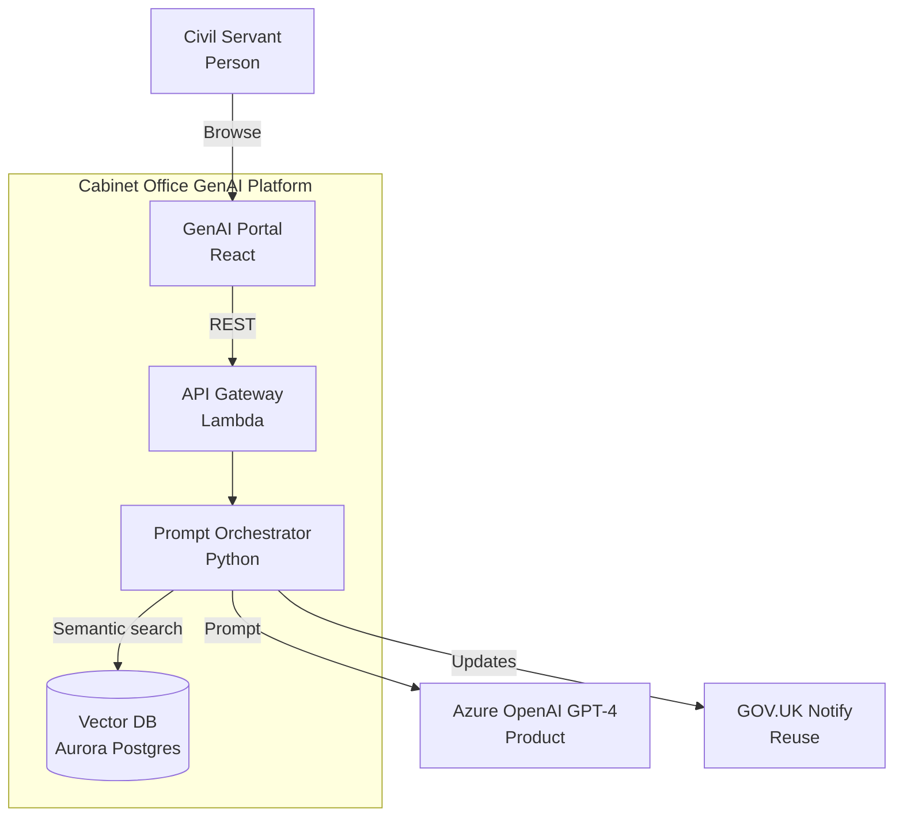

# C4 model architecture diagrams: context, container and component

> **Guide Origin**: Official | **ArcKit Version**: [VERSION]

The C4 model draws software architecture as a set of zoom levels: system context, containers, components and code. This guide explains each C4 diagram and the supporting deployment and dynamic diagrams, then shows how `/arckit:diagram` generates them in Mermaid or PlantUML.

---

## What the C4 model is

The [C4 model](https://c4model.com/) was created by Simon Brown. Its site calls it an "easy to learn, developer friendly approach to software architecture diagramming". It works like an online map: you zoom from the whole system down to its parts, and each level is its own diagram. It is notation independent and tooling independent, so you can draw it in any tool.

The model has four levels of diagram:

| Level | Diagram | Scope | Shows | Audience | Recommended? |
|-------|---------|-------|-------|----------|--------------|
| 1 | [System context](https://c4model.com/diagrams/system-context) | One software system | The system as a box in the centre, its users, and the other systems it depends on | Everybody, technical and non-technical | Yes, for all teams |
| 2 | [Container](https://c4model.com/diagrams/container) | One software system | The applications and data stores that make up the system | Technical people inside and outside the team | Yes, for all teams |
| 3 | [Component](https://c4model.com/diagrams/component) | One container | The components inside a container | Software architects and developers | Only if it adds value |
| 4 | [Code](https://c4model.com/diagrams/code) | One component | Classes, interfaces, functions or database tables | Software architects and developers | No: IDEs can generate it on demand |

The C4 site says [you don't need all four levels](https://c4model.com/diagrams): "the system context and container diagrams are sufficient for most software development teams."

Two terms cause most confusion:

- A **container** is not a Docker container. In C4 it is ["an application or a data store"](https://c4model.com/abstractions/container): a server-side web application, a JavaScript app in the browser, a database schema or a serverless function, for example.
- A **component** is ["a grouping of related functionality encapsulated behind a well-defined interface"](https://c4model.com/abstractions/component). Components are not separately deployable. The container is the unit you deploy.

---

## Supporting diagrams

C4 adds three supporting diagram types to the four levels:

- **[System landscape](https://c4model.com/diagrams/system-landscape)**: a map of the software systems and people across an organisation or department, not just one system.
- **[Dynamic](https://c4model.com/diagrams/dynamic)**: how elements collaborate at runtime "to implement a user story, use case, feature, etc." It is based on a UML communication diagram and is similar to a UML sequence diagram.
- **[Deployment](https://c4model.com/diagrams/deployment)**: how instances of software systems and containers are deployed onto infrastructure in one environment, such as production or staging.

---

## Which diagrams ArcKit draws

`/arckit:diagram` draws C4 levels 1 to 3, a deployment diagram, a sequence diagram (which does the job of a C4 dynamic diagram) and a data flow diagram. It does not draw code-level or system landscape diagrams. For a full Yourdon-DeMarco data flow diagram with levels and a data dictionary, use [`/arckit:dfd`](dfd.md).

---

## Using /arckit:diagram

`/arckit:diagram` converts architecture artefacts into Mermaid or PlantUML C4 diagrams for visual architecture documentation.

Output: `projects/<id>/diagrams/ARC-<id>-DIAG-<NNN>-v1.0.md` (each diagram is a separate numbered document)

## Supported Diagram Types

| Command | Diagram | Use When | Output Highlights |
|---------|---------|----------|-------------------|
| `/arckit:diagram context` | C4 Level 1 | Discovery / stakeholder briefings | Users, external systems, boundaries |
| `/arckit:diagram container` | C4 Level 2 | HLD reviews | Services, databases, queues, technology stack |
| `/arckit:diagram component` | C4 Level 3 | DLD & developer handover | Internal modules, data-access repositories, adapters |
| `/arckit:diagram deployment` | Infrastructure | Cloud First evidence, cost modelling | Regions, VPCs, subnets, HA/DR |
| `/arckit:diagram sequence` | Interaction | API design, integration workshops | Request/response steps, actors |
| `/arckit:diagram dataflow` | Data privacy | GDPR/DPIA, audit | PII flows, encryption, retention |

Run without a suffix to auto-detect (`/arckit:diagram Describe architecture...`).

---

## Output Format

For C4 diagram types (Context, Container, Component), you can choose between two output formats:

| | Mermaid (Default) | PlantUML C4 |
|---|---|---|
| **Best for** | Diagrams with 12 or fewer elements | Diagrams with more than 12 elements |
| **Layout control** | Declaration order only | Directional hints (`Rel_Right`, `Rel_Down`, `Lay_Right`) |
| **Renders in** | GitHub, VS Code, mermaid.live, ArcKit Pages | PlantUML Server, VS Code (extension), CLI, ArcKit Pages |
| **GitHub rendering** | Automatic | Not supported |

Specify the format in arguments: `/arckit:diagram context plantuml` or select when prompted.

Why the split: Mermaid's [C4 support](https://mermaid.js.org/syntax/c4.html) is labelled experimental, and its layout is not fully automatic. Shapes are placed by the order you write the statements in. [C4-PlantUML](https://github.com/plantuml-stdlib/C4-PlantUML) adds directional relationships (`Rel_Up`, `Rel_Down`, `Rel_Left`, `Rel_Right`) and layout helpers (`Lay_Right`, `Lay_Down`) that give finer control. GitHub [renders Mermaid](https://docs.github.com/en/get-started/writing-on-github/working-with-advanced-formatting/creating-diagrams) in Markdown files but does not list PlantUML among the syntaxes it renders.

Deployment and Data Flow diagrams use Mermaid only. Sequence diagrams support both Mermaid and PlantUML.

---

## Example Output (Excerpt)



Paste into [https://mermaid.live](https://mermaid.live) for PNG/SVG export.

### PlantUML C4 Example (Excerpt)

```plantuml
@startuml
!include https://raw.githubusercontent.com/plantuml-stdlib/C4-PlantUML/master/C4_Container.puml

title Container Diagram - Cabinet Office GenAI Platform

Person(civil_servant, "Civil Servant", "Uses GenAI tools")

System_Boundary(platform, "GenAI Platform") {
    Container(web, "GenAI Portal", "React", "User interface")
    Container(api, "API Gateway", "Lambda", "Request routing")
    Container(orch, "Prompt Orchestrator", "Python", "LLM integration")
    ContainerDb(vectordb, "Vector DB", "Aurora Postgres", "Embeddings")
}

System_Ext(gpt4, "Azure OpenAI GPT-4", "LLM provider")
System_Ext(notify, "GOV.UK Notify", "Notifications")

Rel_Down(civil_servant, web, "Browse", "HTTPS")
Rel_Right(web, api, "Calls", "REST")
Rel_Right(api, orch, "Routes")
Rel_Down(orch, vectordb, "Semantic search")
Rel_Right(orch, gpt4, "Prompt", "API")
Rel_Right(orch, notify, "Updates", "API")

Lay_Right(web, api)
Lay_Right(api, orch)

@enduml
```

Paste into [https://www.plantuml.com/plantuml/uml/](https://www.plantuml.com/plantuml/uml/) to render.

---

## Review Checklist

- Components and integrations reference requirement IDs where relevant.
- Compliance call-outs (GOV.UK Pay/Notify, Cloud First, GDPR) appear in annotations.
- Evolution tags from Wardley Maps show build/buy decisions when needed.
- Deployment diagrams include regions, availability zones, and failover notes.
- Dataflow diagrams highlight lawful basis, retention, and subject rights.

---

## Tips

- Re-run diagrams whenever the design review highlights changes to avoid drift.
- Embed diagrams in HLD/DLD outputs and service assessments for consistent visuals.
- Pair `/arckit:diagram` with `/arckit:servicenow` so operations inherit the same component hierarchy.
- Use PlantUML C4 for complex diagrams (more than 12 elements) where Mermaid's auto-layout produces too many edge crossings — directional hints give precise control over element placement.
