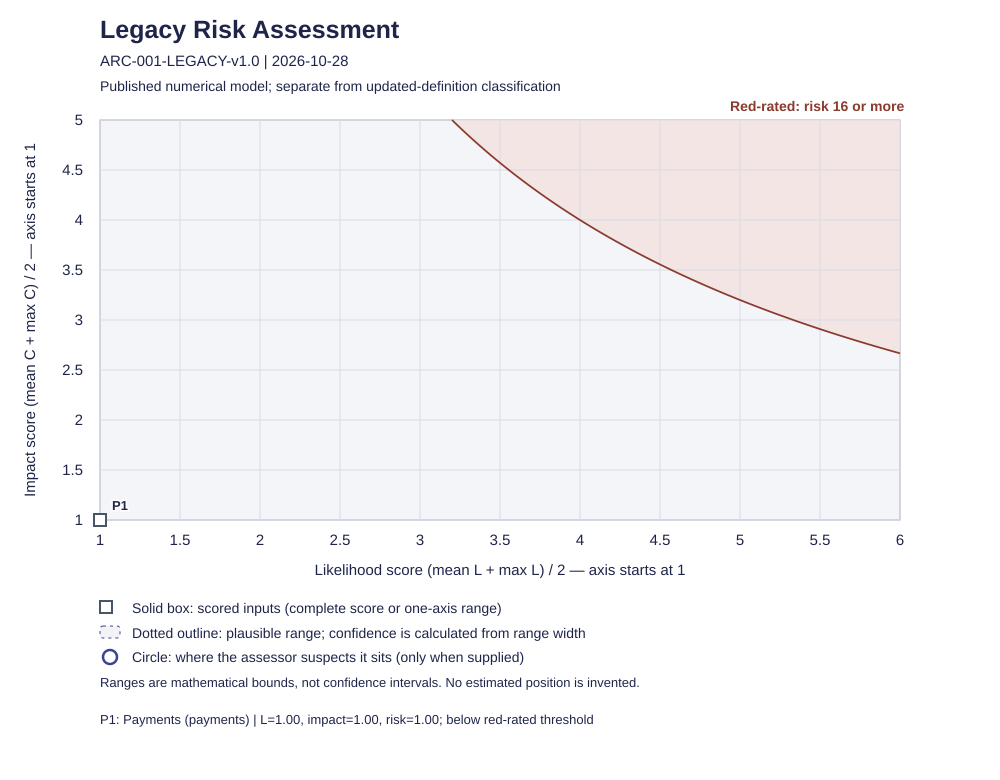
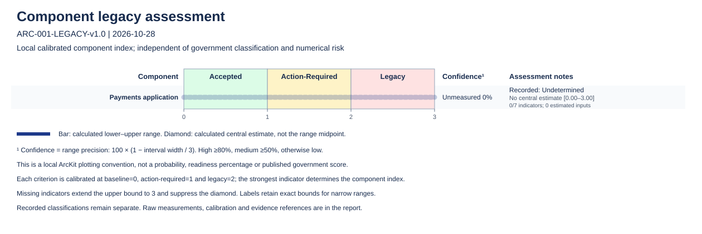

# Legacy IT Assessment

> **Template Origin**: Official | **ArcKit Version**: 6.18.3 | **Command**: `/arckit:uk-legacy-assessment`

## Document Control

| Field | Value |
|-------|-------|
| **Document ID** | ARC-001-LEGACY-v1.0 |
| **Document Type** | Legacy IT Assessment |
| **Project** | Payments (Project 001) |
| **Classification** | OFFICIAL |
| **Status** | DRAFT |
| **Version** | 1.0 |
| **Created Date** | 2026-10-28 |
| **Last Modified** | 2026-10-28 |
| **Review Cycle** | On-Demand |
| **Next Review Date** | 2027-10-28 (helper-proposed; recommendation, not a schedule) |
| **Owner** | Service owner (synthetic fixture) |
| **Reviewed By** | PENDING |
| **Approved By** | PENDING |
| **Distribution** | PENDING |

## Revision History

| Version | Date | Author | Changes | Approved By | Approval Date |
|---------|------|--------|---------|-------------|---------------|
| 1.0 | 2026-10-28 | ArcKit AI | First assessment of Payments as of 2026-10-28, published risk model | PENDING | PENDING |

## Executive Summary

*Narrative is assessor interpretation; helper verification does not verify its truth.*

Payments (application 8.2 and database; hosted platform responsibilities attested separately) is **Accepted** on all seven criteria D1–D7, with complete evidence and no provisional status. Every rule is an owner-approved policy (rule_D1–D7, effective 2026-10-01, content digests verified by the helper). The supplied L1–L7 and C1–C6 inputs are all 1, giving a published numerical risk of 1.00, not red-rated (threshold 16). No dependencies, actions or management gaps were recorded.

Caveat: the one inventoried component (`payments_app`) has no component-scoped findings or measurements, so the component view shows it as Undetermined/incomplete. System-wide findings are not silently assigned to components. This does not change the system outcome. Report approval is pending.

## Verified Factual Assessment

<!-- legacy-results:start -->
Calculation version: 1.2.0; input SHA-256: 0cb6cfc006c94dfa338732add36cca16609a6f0264c4606de97727ba06ea8d7f.

| System | Outcome | Strongest known | Provisional | Evidence completeness | Action plan | Proposed review |
|--------|---------|-----------------|-------------|-----------------------|-------------|-----------------|
| payments | Accepted | Accepted | false | complete | complete | 2027-10-28 |

Counts: Accepted=1; Action-Required=0; Legacy=0; Undetermined=0; complete=1; incomplete=0; provisional=0; actionPlanComplete=1; actionPlanIncomplete=0.
Evidence-use counts: qualifying=20; rejected=0. Counts describe uses, not independent sources.

| System | Criterion | Effective outcome | Local policy basis | Provisional | Evidence completeness | Source findings | Dependency witnesses |
|--------|-----------|-------------------|--------------------|-------------|--------------|-----------------|----------------------|
| payments | D1 | Accepted | approved-policy | false | complete | finding_D1 | None |
| payments | D2 | Accepted | approved-policy | false | complete | finding_D2 | None |
| payments | D3 | Accepted | approved-policy | false | complete | finding_D3 | None |
| payments | D4 | Accepted | approved-policy | false | complete | finding_D4 | None |
| payments | D5 | Accepted | approved-policy | false | complete | finding_D5 | None |
| payments | D6 | Accepted | approved-policy | false | complete | finding_D6 | None |
| payments | D7 | Accepted | approved-policy | false | complete | finding_D7 | None |

Published numerical prioritisation (separate from classification):

| System | Status | Likelihood | Impact | Risk | Red-rated | Exact fractions / missing inputs |
|--------|--------|------------|--------|------|-----------|-------------------------------------|
| payments | complete | 1 | 1 | 1.00 | false | L=14/14; C=12/12; risk=168/168 |

| System | Risk criterion | Supplied score | Evidence | Rationale |
|--------|----------------|----------------|----------|-----------|
| payments | L1 | 1 | operating_record | Synthetic independently supplied score against the original published table. |
| payments | L2 | 1 | operating_record | Synthetic independently supplied score against the original published table. |
| payments | L3 | 1 | operating_record | Synthetic independently supplied score against the original published table. |
| payments | L4 | 1 | operating_record | Synthetic independently supplied score against the original published table. |
| payments | L5 | 1 | operating_record | Synthetic independently supplied score against the original published table. |
| payments | L6 | 1 | operating_record | Synthetic independently supplied score against the original published table. |
| payments | L7 | 1 | operating_record | Synthetic independently supplied score against the original published table. |
| payments | C1 | 1 | operating_record | Synthetic independently supplied score against the original published table. |
| payments | C2 | 1 | operating_record | Synthetic independently supplied score against the original published table. |
| payments | C3 | 1 | operating_record | Synthetic independently supplied score against the original published table. |
| payments | C4 | 1 | operating_record | Synthetic independently supplied score against the original published table. |
| payments | C5 | 1 | operating_record | Synthetic independently supplied score against the original published table. |
| payments | C6 | 1 | operating_record | Synthetic independently supplied score against the original published table. |

Numerical ordering: payments.

### Component classification breakdown

Legend: Outcome is classification; Unknown is an undecided criterion; Undetermined is an undecided system. Provisional means material policy/attestation approval is pending. Evidence gaps, plan gaps and incomplete numerical scores are independent.

### Inventory

| System / component | Name / version | Boundary / services | Business owner | Delivery owner |
| --- | --- | --- | --- | --- |
| payments | Payments | Application and database; hosted platform responsibilities attested separately; services: Benefit disbursement | Service owner (synthetic fixture) | Operations lead (synthetic fixture) |
| payments_app | Payments application / 8.2 | Component of payments | Service owner (synthetic fixture) | Operations lead (synthetic fixture) |

### Threshold policy register

| Rule | Criterion | Source / owner / version | Applicability | Unacceptable / warning conditions | Approval references |
| --- | --- | --- | --- | --- | --- |
| rule_D1 | D1 | external/owner-policy.md / Business risk owner (synthetic) / 1.0 | Project scope | No current provider or community arrangement delivers required technical support and security fixes for the exact deployed version. / Evidenced unacceptable breach forecast within 12 calendar months. | policy_approval |
| rule_D2 | D2 | external/owner-policy.md / Business risk owner (synthetic) / 1.0 | Project scope | Required operating rights or support obligations have lapsed without suitable continuity arrangements. / Evidenced unacceptable breach forecast within 12 calendar months. | policy_approval |
| rule_D3 | D3 | external/owner-policy.md / Business risk owner (synthetic) / 1.0 | Project scope | Tested capability to operate, restore, patch or safely change the system is absent, including necessary cover for key people. / Evidenced unacceptable breach forecast within 12 calendar months. | policy_approval |
| rule_D4 | D4 | external/owner-policy.md / Business risk owner (synthetic) / 1.0 | Project scope | An agreed user, statutory, performance or business requirement is demonstrably unmet without an acceptable workaround. / Evidenced unacceptable breach forecast within 12 calendar months. | policy_approval |
| rule_D5 | D5 | external/owner-policy.md / Business risk owner (synthetic) / 1.0 | Project scope | Measured capacity, physical reliability, repairability or recovery fails the agreed operating requirement without verified mitigation. / Evidenced unacceptable breach forecast within 12 calendar months. | policy_approval |
| rule_D6 | D6 | external/owner-policy.md / Business risk owner (synthetic) / 1.0 | Project scope | Persistent exploitable weaknesses breach the applicable CAF profile or Secure by Design requirements without verified adequate controls. / Evidenced unacceptable breach forecast within 12 calendar months. | policy_approval |
| rule_D7 | D7 | external/owner-policy.md / Business risk owner (synthetic) / 1.0 | Project scope | Necessary operational reliance on an assessed Legacy service exceeds the owner tolerance documented for the consuming system. / Evidenced unacceptable breach forecast within 12 calendar months. | policy_approval |

### Dependency register

| Dependency | Consumer / dependency | Qualification / policy | Evidence / external assessment |
| --- | --- | --- | --- |

### Finding register

| Finding / system / component | Criterion / rule | Recorded outcome | Evidence | Rationale / forecast / conflicts |
| --- | --- | --- | --- | --- |
| finding_D1 / payments | D1 / rule_D1 | Accepted | operating_record | Dated operational evidence meets the supplied criterion rule. |
| finding_D2 / payments | D2 / rule_D2 | Accepted | operating_record | Dated operational evidence meets the supplied criterion rule. |
| finding_D3 / payments | D3 / rule_D3 | Accepted | operating_record | Dated operational evidence meets the supplied criterion rule. |
| finding_D4 / payments | D4 / rule_D4 | Accepted | operating_record | Dated operational evidence meets the supplied criterion rule. |
| finding_D5 / payments | D5 / rule_D5 | Accepted | operating_record | Dated operational evidence meets the supplied criterion rule. |
| finding_D6 / payments | D6 / rule_D6 | Accepted | operating_record | Dated operational evidence meets the supplied criterion rule. |
| finding_D7 / payments | D7 / rule_D7 | Accepted | operating_record | Dated operational evidence meets the supplied criterion rule. |

### Action register

| Action / targets | Accountable / delivery owners | Containment / remediation | Priority / funding / cost | Milestones / target / review | Closure evidence / trigger |
| --- | --- | --- | --- | --- | --- |

### Known findings and blockers

| System | Criterion | Strongest known | Blockers |
| --- | --- | --- | --- |
| payments | D1 | Accepted | None |
| payments | D2 | Accepted | None |
| payments | D3 | Accepted | None |
| payments | D4 | Accepted | None |
| payments | D5 | Accepted | None |
| payments | D6 | Accepted | None |
| payments | D7 | Accepted | None |

### Approval ledger

| Target | Status | Content digest |
| --- | --- | --- |
| policy:rule_D1 | verified | 3c9aaf8bbb158faa806833a17129f33491731a87dc7078fd4cd153b67f0bfbe1 |
| policy:rule_D2 | verified | ec5383c5d94d4e7d393d28cf554e960889a1a854d2b8adb7f161831342173037 |
| policy:rule_D3 | verified | a6b17f2d7c9a4ecbfac95ed2fcd980582452d4fca770d10382410bf4fe6d0beb |
| policy:rule_D4 | verified | d3a6f3f7f29700701ae3480e0dc4b569c653b80164feb77be8cfd1a6dc80ee7e |
| policy:rule_D5 | verified | 05182e9ffcb6a8bd643b62423bd6627b9e90f545fbbf3ec9676d061a3071a072 |
| policy:rule_D6 | verified | 9e63017392e624e772928f7c85523b1cc07e0d9abb92ae718508add95655967e |
| policy:rule_D7 | verified | 60e425ddd68f08065e2415df90d8592e09e0e29e9eba351acf256b88633395b5 |

### Numerical bounds — not completed scores

| System | Minimum / maximum | Threshold sensitivity | Single missing input |
| --- | --- | --- | --- |

### Chart notes — calculated precision and supplied position

| System | Range confidence | Suspected position (not scored) | Rationale |
| --- | --- | --- | --- |

### Component assessment

| System / component | Recorded outcome / evidence completeness | Calculated position [lower–upper] | Confidence (range precision) | Numerical coverage / estimates | Finding IDs |
| --- | --- | --- | --- | --- | --- |
| payments / payments_app | Undetermined / incomplete | Unavailable [0–3] | Unmeasured; 0.00% | 0/7; 0 estimated |  |

### Component numerical inputs

| Component / criterion | Raw lower / central / upper | Unit / calibration (baseline, action, legacy) | Basis / evidence | Rationale |
| --- | --- | --- | --- | --- |

### Dated events

| System | Date | Kind | Source | Review trigger |
| --- | --- | --- | --- | --- |
| payments | 2027-10-28 | review-horizon | payments | true |

Evidence register and per-use qualification (assessor assertions, not verified truth)

### Evidence register

| ID / subject | Source / locator | Date / provenance / expiry | Observation / limitations |
| --- | --- | --- | --- |
| policy_approval | external/owner-policy.md / Approval section | 2026-10-01 / document / Not recorded | Synthetic owner decision approves the seven rules before this assessment.; Synthetic test evidence only. |
| operating_record / payments | external/operations.md / Test results and attestations | 2026-10-27 / operation / Not recorded | Version-specific support, contract rights, recovery/skills, requirements, capacity, applicable CAF controls and dependency attestations verified.; Synthetic test evidence only. |

### Evidence uses

| Evidence | Use | Evaluation date | Rejected reasons |
| --- | --- | --- | --- |
| operating_record | Finding finding_D1 | 2026-10-28 | Qualifies for this use |
| operating_record | Finding finding_D2 | 2026-10-28 | Qualifies for this use |
| operating_record | Finding finding_D3 | 2026-10-28 | Qualifies for this use |
| operating_record | Finding finding_D4 | 2026-10-28 | Qualifies for this use |
| operating_record | Finding finding_D5 | 2026-10-28 | Qualifies for this use |
| operating_record | Finding finding_D6 | 2026-10-28 | Qualifies for this use |
| operating_record | Finding finding_D7 | 2026-10-28 | Qualifies for this use |
| operating_record | Risk payments/L1 | 2026-10-28 | Qualifies for this use |
| operating_record | Risk payments/L2 | 2026-10-28 | Qualifies for this use |
| operating_record | Risk payments/L3 | 2026-10-28 | Qualifies for this use |
| operating_record | Risk payments/L4 | 2026-10-28 | Qualifies for this use |
| operating_record | Risk payments/L5 | 2026-10-28 | Qualifies for this use |
| operating_record | Risk payments/L6 | 2026-10-28 | Qualifies for this use |
| operating_record | Risk payments/L7 | 2026-10-28 | Qualifies for this use |
| operating_record | Risk payments/C1 | 2026-10-28 | Qualifies for this use |
| operating_record | Risk payments/C2 | 2026-10-28 | Qualifies for this use |
| operating_record | Risk payments/C3 | 2026-10-28 | Qualifies for this use |
| operating_record | Risk payments/C4 | 2026-10-28 | Qualifies for this use |
| operating_record | Risk payments/C5 | 2026-10-28 | Qualifies for this use |
| operating_record | Risk payments/C6 | 2026-10-28 | Qualifies for this use |

System payments evidence gaps: None recorded.
System payments management gaps: None recorded.
<!-- legacy-results:end -->

## Scope, Source Versions and Limitations

- **Scope**: project 001 only; system `payments` with explicit boundary above. Historical age of the system is treated as immaterial.
- **Assessment date**: 2026-10-28 (as-of). Operational evidence dated 2026-10-27; owner policy approval dated 2026-10-01. The generated 2026-10-28 results were produced on 2026-11-02.
- **Models**: classification `uk-definition-2026-08-17`; risk model `published-2026-08-17`, using the bundled dated definition and full 72-anchor rubric. The numerical framework remains under review, and reporting arrangements require confirmation.
- **Catalogue research limitation**: no network was available, so no source refresh or online catalogue research was done. The bundled dated model was used. This is a freshness limitation only, not missing tables.
- **Assessor inputs**: the findings and risk scores are supplied assessor inputs for a synthetic fixture. The helper verified structure, policy digests and arithmetic. It does not verify the truth of the evidence. `external/operations.md` records a single aggregated attestation, so every criterion rests on one operational record (see the evidence-use counts, which count uses, not independent sources).
- **Unknowns**: evidence `validUntil` dates, finding forecast breach dates and the Distribution list are null or pending (not known).

## Assessor Analysis and Dependency Diagram

No dependencies are recorded. The empty register is an assessor-supplied position, and D7 is Accepted on supplied D7 evidence, whose only stated basis is the aggregated operating record's "dependency attestations verified". The register holds no individual reliance edge to inspect.

## Remediation and Prevention Recommendations

No actions are required or recorded, and the helper reports the action plan complete with no management gaps. Proportionate ongoing practice (proposals only): keep named ownership and funded maintenance; keep Payments registered as an asset; keep patching and tested recovery current; keep skills cover for key people; monitor support and contract events for version 8.2; and record dependency-owner attestations with `validUntil` dates. Reassess after incidents, supplier or dependency changes. Investment, roadmap and planning detail belong in `/arckit:sobc`, `/arckit:roadmap` and `/arckit:plan`. Nothing here is a completed remediation.

## Owner Review and References

Report approval is **PENDING**: no documentary approval of this exact version was supplied, and none is claimed. The helper-proposed review date is 2027-10-28 (12-month horizon); review sooner on incidents, supplier or dependency changes, or a support or contract event. No risk acceptance is recorded, and none is needed for classification. The owner should confirm the component-level gap and the Distribution list.

## External References

### Document Register

| Doc ID | Filename | Type | Source Location | Description |
|--------|----------|------|-----------------|-------------|
| EXT-001 | owner-policy.md | Owner policy | external/owner-policy.md | Approval of rules D1–D7 on 2026-10-01 (evidence `policy_approval`) |
| EXT-002 | operations.md | Operational evidence | external/operations.md | Operating record dated 2026-10-27 (evidence `operating_record`) |

### Citations

| Citation ID | Doc ID | Page/Section | Category | Quoted Passage |
|-------------|--------|--------------|----------|----------------|
| C-001 | EXT-001 | Approval section | Policy | "Synthetic business risk owner approved rules D1–D7 on 2026-10-01, effective that day." |
| C-002 | EXT-002 | Test results and attestations | Operational evidence | "Evidence dated 2026-10-27." |

### Unreferenced Documents

| Filename | Source Location | Reason |
|----------|-----------------|--------|
| README.md | projects/001-payments/ | Fixture summary; restates the brief and adds no independent evidence |

---

**Generated by**: ArcKit `/arckit:uk-legacy-assessment` command\
**Generated on**: 2026-11-02\
**ArcKit Version**: 6.18.3\
**Project**: 001 Payments\
**Model**: claude-sonnet-5-5
