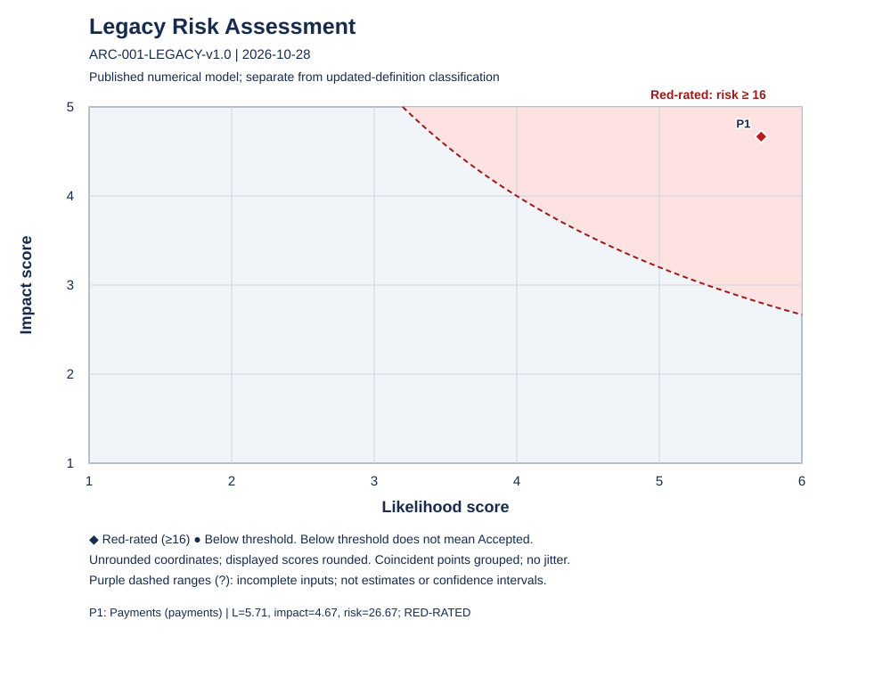

# Legacy IT Assessment — reproducible calculation fixture

This synthetic fixture demonstrates rendering calculated results. It is not evidence
about an actual service. Classification inputs and published numerical example inputs
are deliberately independent; policy and operating records are synthetic assertions
for testing, not real approvals or a substantive production assessment.

## Document Control

| Field | Value |
|-------|-------|
| **Document ID** | ARC-001-LEGACY-v1.0 |
| **Document Type** | Legacy IT Assessment |
| **Project** | Synthetic Payments (Project 001) |
| **Classification** | PUBLIC |
| **Status** | DRAFT |
| **Version** | 1.0 |
| **Created Date** | 2026-10-28 |
| **Last Modified** | 2026-10-28 |
| **Review Cycle** | Annual |
| **Next Review Date** | 2027-10-28 |
| **Owner** | Synthetic business risk owner |
| **Reviewed By** | PENDING |
| **Approved By** | PENDING |
| **Distribution** | Fixture reviewers |

## Revision History

| Version | Date | Author | Changes | Approved By | Approval Date |
|---------|------|--------|---------|-------------|---------------|
| 1.0 | 2026-10-28 | ArcKit fixture | Reproducible results rendering | PENDING | PENDING |

## Executive Summary

The following block is generated and verified by the calculator.

<!-- legacy-results:start -->
Calculation version: 1.2.0; input SHA-256: af2ae97a82a490b3000623dd20b2760e6ce9f6dac3669e8b1883a625980ea89d.

| System | Outcome | Strongest known | Provisional | Evidence completeness | Action plan | Proposed review |
|--------|---------|-----------------|-------------|-----------------------|-------------|-----------------|
| payments | Accepted | Accepted | false | complete | incomplete | 2026-10-28 |

Counts: Accepted=1; Action-Required=0; Legacy=0; Undetermined=0; complete=1; incomplete=0; provisional=0; actionPlanComplete=0; actionPlanIncomplete=1.
Evidence-use counts: qualifying=20; rejected=0. Counts describe uses, not independent sources.

| System | Criterion | Effective outcome | Local policy basis | Provisional | Evidence completeness | Source findings | Dependency witnesses |
|--------|-----------|-------------------|--------------------|-------------|--------------|-----------------|----------------------|
| payments | D1 | Accepted | approved-policy | false | complete | finding_D1 | None |
| payments | D2 | Accepted | approved-policy | false | complete | finding_D2 | None |
| payments | D3 | Accepted | approved-policy | false | complete | finding_D3 | None |
| payments | D4 | Accepted | approved-policy | false | complete | finding_D4 | None |
| payments | D5 | Accepted | approved-policy | false | complete | finding_D5 | None |
| payments | D6 | Accepted | approved-policy | false | complete | finding_D6 | None |
| payments | D7 | Accepted | approved-policy | false | complete | finding_D7 | None |

Published numerical prioritisation (separate from classification):

| System | Status | Likelihood | Impact | Risk | Red-rated | Exact fractions / missing inputs |
|--------|--------|------------|--------|------|-----------|-------------------------------------|
| payments | complete | 5.714285714285714 | 4.666666666666667 | 26.67 | true | L=80/14; C=56/12; risk=4480/168 |

| System | Risk criterion | Supplied score | Evidence | Rationale |
|--------|----------------|----------------|----------|-----------|
| payments | L1 | 5 | operating_record | Synthetic independently supplied score against the original published table. |
| payments | L2 | 5 | operating_record | Synthetic independently supplied score against the original published table. |
| payments | L3 | 5 | operating_record | Synthetic independently supplied score against the original published table. |
| payments | L4 | 5 | operating_record | Synthetic independently supplied score against the original published table. |
| payments | L5 | 6 | operating_record | Synthetic independently supplied score against the original published table. |
| payments | L6 | 6 | operating_record | Synthetic independently supplied score against the original published table. |
| payments | L7 | 6 | operating_record | Synthetic independently supplied score against the original published table. |
| payments | C1 | 5 | operating_record | Synthetic independently supplied score against the original published table. |
| payments | C2 | 5 | operating_record | Synthetic independently supplied score against the original published table. |
| payments | C3 | 2 | operating_record | Synthetic independently supplied score against the original published table. |
| payments | C4 | 5 | operating_record | Synthetic independently supplied score against the original published table. |
| payments | C5 | 5 | operating_record | Synthetic independently supplied score against the original published table. |
| payments | C6 | 4 | operating_record | Synthetic independently supplied score against the original published table. |

Numerical ordering: payments.

Legend: Outcome is classification; Unknown is an undecided criterion; Undetermined is an undecided system. Provisional means material policy/attestation approval is pending. Evidence gaps, plan gaps and incomplete numerical scores are independent.

### Inventory

| System / component | Name / version | Boundary / services | Business owner | Delivery owner |
| --- | --- | --- | --- | --- |
| payments | Payments | Application and database; hosted platform responsibilities attested separately; services: Benefit disbursement | Service owner (synthetic fixture) | Operations lead (synthetic fixture) |
| payments_app | Payments application / 8.2 | Component of payments | Service owner (synthetic fixture) | Operations lead (synthetic fixture) |

### Threshold policy register

| Rule | Criterion | Source / owner / version | Applicability | Unacceptable / warning conditions | Approval references |
| --- | --- | --- | --- | --- | --- |
| rule_D1 | D1 | external/owner-policy.md / Business risk owner (synthetic) / 1.0 | Project scope | No current provider or community arrangement delivers required technical support and security fixes for the exact deployed version. / Evidenced unacceptable breach forecast within 12 calendar months. | policy_approval |
| rule_D2 | D2 | external/owner-policy.md / Business risk owner (synthetic) / 1.0 | Project scope | Required operating rights or support obligations have lapsed without suitable continuity arrangements. / Evidenced unacceptable breach forecast within 12 calendar months. | policy_approval |
| rule_D3 | D3 | external/owner-policy.md / Business risk owner (synthetic) / 1.0 | Project scope | Tested capability to operate, restore, patch or safely change the system is absent, including necessary cover for key people. / Evidenced unacceptable breach forecast within 12 calendar months. | policy_approval |
| rule_D4 | D4 | external/owner-policy.md / Business risk owner (synthetic) / 1.0 | Project scope | An agreed user, statutory, performance or business requirement is demonstrably unmet without an acceptable workaround. / Evidenced unacceptable breach forecast within 12 calendar months. | policy_approval |
| rule_D5 | D5 | external/owner-policy.md / Business risk owner (synthetic) / 1.0 | Project scope | Measured capacity, physical reliability, repairability or recovery fails the agreed operating requirement without verified mitigation. / Evidenced unacceptable breach forecast within 12 calendar months. | policy_approval |
| rule_D6 | D6 | external/owner-policy.md / Business risk owner (synthetic) / 1.0 | Project scope | Persistent exploitable weaknesses breach the applicable CAF profile or Secure by Design requirements without verified adequate controls. / Evidenced unacceptable breach forecast within 12 calendar months. | policy_approval |
| rule_D7 | D7 | external/owner-policy.md / Business risk owner (synthetic) / 1.0 | Project scope | Necessary operational reliance on an assessed Legacy service exceeds the owner tolerance documented for the consuming system. / Evidenced unacceptable breach forecast within 12 calendar months. | policy_approval |

### Dependency register

| Dependency | Consumer / dependency | Qualification / policy | Evidence / external assessment |
| --- | --- | --- | --- |

### Finding register

| Finding / system / component | Criterion / rule | Recorded outcome | Evidence | Rationale / forecast / conflicts |
| --- | --- | --- | --- | --- |
| finding_D1 / payments | D1 / rule_D1 | Accepted | operating_record | Dated operational evidence meets the supplied criterion rule. |
| finding_D2 / payments | D2 / rule_D2 | Accepted | operating_record | Dated operational evidence meets the supplied criterion rule. |
| finding_D3 / payments | D3 / rule_D3 | Accepted | operating_record | Dated operational evidence meets the supplied criterion rule. |
| finding_D4 / payments | D4 / rule_D4 | Accepted | operating_record | Dated operational evidence meets the supplied criterion rule. |
| finding_D5 / payments | D5 / rule_D5 | Accepted | operating_record | Dated operational evidence meets the supplied criterion rule. |
| finding_D6 / payments | D6 / rule_D6 | Accepted | operating_record | Dated operational evidence meets the supplied criterion rule. |
| finding_D7 / payments | D7 / rule_D7 | Accepted | operating_record | Dated operational evidence meets the supplied criterion rule. |

### Action register

| Action / targets | Accountable / delivery owners | Containment / remediation | Priority / funding / cost | Milestones / target / review | Closure evidence / trigger |
| --- | --- | --- | --- | --- | --- |

### Known findings and blockers

| System | Criterion | Strongest known | Blockers |
| --- | --- | --- | --- |
| payments | D1 | Accepted | None |
| payments | D2 | Accepted | None |
| payments | D3 | Accepted | None |
| payments | D4 | Accepted | None |
| payments | D5 | Accepted | None |
| payments | D6 | Accepted | None |
| payments | D7 | Accepted | None |

### Approval ledger

| Target | Status | Content digest |
| --- | --- | --- |
| policy:rule_D1 | verified | 3c9aaf8bbb158faa806833a17129f33491731a87dc7078fd4cd153b67f0bfbe1 |
| policy:rule_D2 | verified | ec5383c5d94d4e7d393d28cf554e960889a1a854d2b8adb7f161831342173037 |
| policy:rule_D3 | verified | a6b17f2d7c9a4ecbfac95ed2fcd980582452d4fca770d10382410bf4fe6d0beb |
| policy:rule_D4 | verified | d3a6f3f7f29700701ae3480e0dc4b569c653b80164feb77be8cfd1a6dc80ee7e |
| policy:rule_D5 | verified | 05182e9ffcb6a8bd643b62423bd6627b9e90f545fbbf3ec9676d061a3071a072 |
| policy:rule_D6 | verified | 9e63017392e624e772928f7c85523b1cc07e0d9abb92ae718508add95655967e |
| policy:rule_D7 | verified | 60e425ddd68f08065e2415df90d8592e09e0e29e9eba351acf256b88633395b5 |

### Numerical bounds — not completed scores

| System | Minimum / maximum | Threshold sensitivity | Single missing input |
| --- | --- | --- | --- |

### Dated events

| System | Date | Kind | Source | Review trigger |
| --- | --- | --- | --- | --- |
| payments | 2026-10-28 | immediate-review | payments | true |
| payments | 2027-10-28 | review-horizon | payments | true |

Evidence register and per-use qualification (assessor assertions, not verified truth)

### Evidence register

| ID / subject | Source / locator | Date / provenance / expiry | Observation / limitations |
| --- | --- | --- | --- |
| policy_approval | external/owner-policy.md / Approval section | 2026-10-01 / document / Not recorded | Synthetic owner decision approves the seven rules before this assessment.; Synthetic test evidence only. |
| operating_record / payments | external/operations.md / Test results and attestations | 2026-10-27 / operation / Not recorded | Version-specific support, contract rights, recovery/skills, requirements, capacity, applicable CAF controls and dependency attestations verified.; Synthetic test evidence only. |

### Evidence uses

| Evidence | Use | Evaluation date | Rejected reasons |
| --- | --- | --- | --- |
| operating_record | Finding finding_D1 | 2026-10-28 | Qualifies for this use |
| operating_record | Finding finding_D2 | 2026-10-28 | Qualifies for this use |
| operating_record | Finding finding_D3 | 2026-10-28 | Qualifies for this use |
| operating_record | Finding finding_D4 | 2026-10-28 | Qualifies for this use |
| operating_record | Finding finding_D5 | 2026-10-28 | Qualifies for this use |
| operating_record | Finding finding_D6 | 2026-10-28 | Qualifies for this use |
| operating_record | Finding finding_D7 | 2026-10-28 | Qualifies for this use |
| operating_record | Risk payments/L1 | 2026-10-28 | Qualifies for this use |
| operating_record | Risk payments/L2 | 2026-10-28 | Qualifies for this use |
| operating_record | Risk payments/L3 | 2026-10-28 | Qualifies for this use |
| operating_record | Risk payments/L4 | 2026-10-28 | Qualifies for this use |
| operating_record | Risk payments/L5 | 2026-10-28 | Qualifies for this use |
| operating_record | Risk payments/L6 | 2026-10-28 | Qualifies for this use |
| operating_record | Risk payments/L7 | 2026-10-28 | Qualifies for this use |
| operating_record | Risk payments/C1 | 2026-10-28 | Qualifies for this use |
| operating_record | Risk payments/C2 | 2026-10-28 | Qualifies for this use |
| operating_record | Risk payments/C3 | 2026-10-28 | Qualifies for this use |
| operating_record | Risk payments/C4 | 2026-10-28 | Qualifies for this use |
| operating_record | Risk payments/C5 | 2026-10-28 | Qualifies for this use |
| operating_record | Risk payments/C6 | 2026-10-28 | Qualifies for this use |

System payments evidence gaps: None recorded.
System payments management gaps: Numerical red-rated risk has no recorded review action.
<!-- legacy-results:end -->

## Assessor narrative and limitations

Synthetic regression fixture only. Evidence and approvals are invented. Report approval PENDING.
No government submission or verification of evidence truth is claimed.
